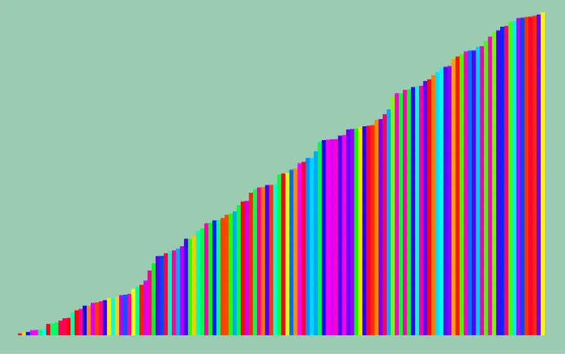

# 二分木ソート  
これはソートというのもあれな気もするけど、まあ一応ソート.  
二分探索木を構築することでソートを行うというものである[^1].  
まあ木構造を構築してしまえば、後はデータは揃ってるのでこれは言えてることではあるが...  
要は構築時間がそのままソート時間となるわけではある、簡単だね.  

コードは特に解説するほどではないけど、一応挿入を見ておこう.  
```c++
// 挿入をしていく
auto Insert = [&](auto Insert, std::shared_ptr<Node> pNode, double weight) -> std::shared_ptr<Node>
{
    // ノードがない場合は生成
    if (!pNode) { return MakeNewNode(weight); }

    if (weight < pNode->weight)
    {
        // 小さければ左に代入
        pNode->left = Insert(Insert, pNode->left, weight);
    }
    else
    {
        // 大きければ右へ代入
        pNode->right = Insert(Insert, pNode->right, weight);
    }

    return pNode;
};
```
ノードがまだあるなら大小を比較して、小なら左へ、大なら右へ行く.  
最後にノードがなくなったらそこにノードを作るだけである.  

探索は小さい方からなので、常に左に行くようにする.  
一番左まで来たら、それを記録して、次は右に...といった流れを再帰で書けばよい.  
```c++
// ソート順に取得していく
auto Sorted = [&](auto Sorted, std::shared_ptr<Node> pNode, Array<double>& vList) -> void
{
    if (pNode)
    {
        Sorted(Sorted, pNode->left, vList);
        vList.push_back(pNode->weight);
        Sorted(Sorted, pNode->right, vList);
    }
};
```

このソート順に取得した結果が以下.  



うん、結果だけなんだけどもソートされてるのは分かる.  

[^1]: [Tree Sort](https://w.wiki/WiYW)