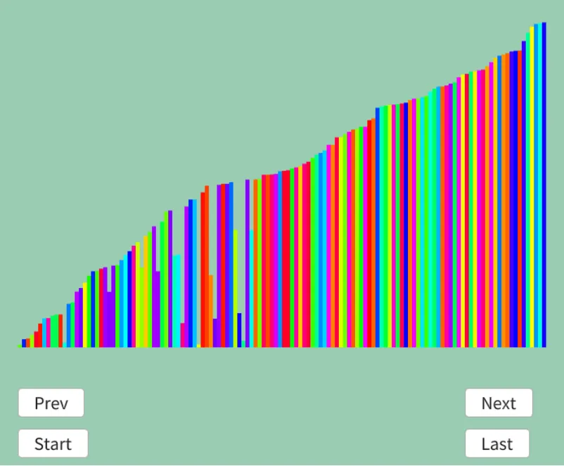

# バブルソート  
まずは有名なバブルソート[^1]から.  
一つずつ最大値を決定していくのがこの方法.  
図示するのが速い.  
```
ソート値|決定値
1回目
6 5 3 1 2 4 |
↑ ↑
5 6 3 1 2 4 |
  ↑ ↑
5 3 6 1 2 4 |
    ↑ ↑
5 3 1 6 2 4 |
      ↑ ↑
5 3 1 2 6 4 |
        ↑ ↑
5 3 1 2 4 | 6 確定！

2回目
5 3 1 2 4 | 6
↑ ↑
3 5 1 2 4 | 6
  ↑ ↑
3 1 5 2 4 | 6
    ↑ ↑
3 1 2 5 4 | 6
      ↑ ↑
3 1 2 4 | 5 6

3回目
3 1 2 4 | 5 6
↑ ↑
1 3 2 4 | 5 6
  ↑ ↑
1 2 3 4 | 5 6
    ↑ ↑
1 2 3 | 4 5 6

4回目
1 2 3 | 4 5 6
↑ ↑
1 2 3 | 4 5 6
  ↑ ↑
1 2 | 3 4 5 6

5回目
1 2 | 3 4 5 6
↑ ↑
1 | 2 3 4 5 6 完成！
```
要は右に値が大きいものを運んで確定を$`N-1`$回繰り返すだけである.  
大きいものは確定させた後は移動させるだけ.
これをコードにすると以下のようになる、シンプル～.  
```c++
for (int i = 0; i < dataList.size(); i++)
{
    for (int j = 1; j < dataList.size() - i; j++)
    {
        if (dataList[j].weight < dataList[j - 1].weight)
        {
            std::swap(dataList[j].weight, dataList[j - 1].weight);
        }
    }

    result.push_back(dataList);
}
```

今回はバーをソートするようなものを作ってみた.  
今後のソートはこれで行っていくことにする.  
分かりやすいソート中の中間地点の結果を見てみよう.  

  

ちゃんと右に長いものが固まっているのが分かる.  
こうやってちょっとず～つ確定させていくのがバブルソートでした.終わり.  

[^1]: [バブルソート](https://w.wiki/3Sng)  