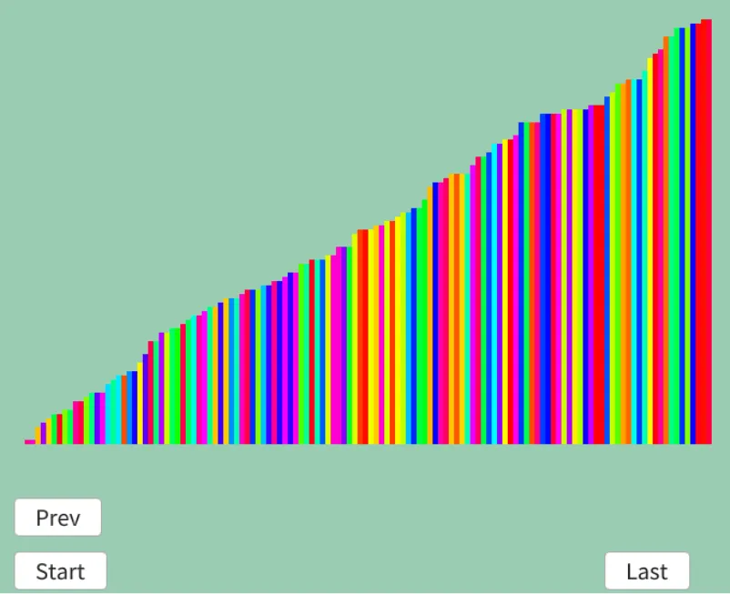

# バケットソート  
バケットソート[^1]は必要な数分の配列を用意して、そこで同じ数が何回出たかをカウントする.  
バケツソートとかとも言ったりするらしい.  

バケットソートって内容だけで見ると簡単なんだけど、実際に実装する際、ソートの区別がイマイチわからない...  
例えば出現数をカウントするものは分布数え上げソートになるし、全範囲を用意して突っ込むだと鳩の巣ソートになる...  
内容としてはバケットソートなんだけど、純粋なバケットソートとは...となるため、どれを実装しようか悩む.  
が、これに関しては英語のBucket sort[^2]の説明が一番それっぽかったので、これを実装してみることにした.  

この方法はバケツの数は自分で指定可能.  
そして、各バケツが一定区間内の値を保持することになる.  
バケツに全部の値を入れた後、各バケツをソートして取り出せば完成.  
手順を見ていこう.  

```
初期値: 29 25 3 49 9 37 21 43
バケツ:
0~9:{} 10~19:{} 20~29:{} 30~39:{} 40~49:{}

Phase.1 片っ端から値をバケツに入れる

25 3 49 9 37 21 43
バケツ:
0~9:{} 10~19:{} 20~29:{29} 30~39:{} 40~49:{}

3 49 9 37 21 43
バケツ:
0~9:{} 10~19:{} 20~29:{29,25} 30~39:{} 40~49:{}

49 9 37 21 43
バケツ:
0~9:{3} 10~19:{} 20~29:{29,25} 30~39:{} 40~49:{}

9 37 21 43
バケツ:
0~9:{3} 10~19:{} 20~29:{29,25} 30~39:{} 40~49:{49}

37 21 43
バケツ:
0~9:{3,9} 10~19:{} 20~29:{29,25} 30~39:{} 40~49:{49}

21 43
バケツ:
0~9:{3,9} 10~19:{} 20~29:{29,25} 30~39:{37} 40~49:{49}

43
バケツ:
0~9:{3,9} 10~19:{} 20~29:{29,25,21} 30~39:{37} 40~49:{49}

バケツ:
0~9:{3,9} 10~19:{} 20~29:{29,25,21} 30~39:{37} 40~49:{49,43}

Phase.2 各バケツ内をソート
0~9:{3,9} 10~19:{} 20~29:{21,25,29} 30~39:{37} 40~49:{43,49}

Phase.3 先頭のバケツから順に取り出す
0~9:{} 10~19:{} 20~29:{21,25,29} 30~39:{37} 40~49:{43,49}
3 9

0~9:{} 10~19:{} 20~29:{} 30~39:{37} 40~49:{43,49}
3 9 21 25 29

0~9:{} 10~19:{} 20~29:{} 30~39:{} 40~49:{43,49}
3 9 21 25 29 37

0~9:{} 10~19:{} 20~29:{} 30~39:{} 40~49:{}
3 9 21 25 29 37 43 49 完了！
```
流れとしては非常にシンプルだ.  
バケツに突っ込むことで大小を大まかに確定させていくという感じだね.  

それではコードを見ていこう.  
まず指定した数だけバケツを用意する.  
```c++
auto Sort = [&]()
{
    // 最大値分の配列を生成
    Array<Array<int>> buckets; buckets.resize(bucketSize);
```

そして、範囲を絞り込んだ後にバケツに値を突っ込む.  
バケツ数を$`b`$,データ数を$`n`$,現状の数値を$`t`$,インデックスを$`i`$とする.  
この際$`\frac{t}{n}`$が重みとなる、最大値なら1で最小値は0.    
そして、これに$`b`$を掛けてやればその位置のindexを示すことになるので、

```math
i = \frac{bt}{n}
```
となる.  
これを利用してIndexを特定し、そこに値を突っ込めばOK.  
```c++
    for (const auto& value : dataList)
    {
        // 足しておく
        int index = bucketSize * value.weight / static_cast<int>(dataList.size());
        buckets[index].push_back(value.weight);
    }
```

次に各バケツをソートする．  
何を使ってもいいと思うが、面倒なのでSiv3Dに既にあるソート機能を利用.  

```C++
    for (auto& bucket : buckets)
    {
        bucket.sort();
    }
```

最後に先頭から値を取ってくれば終わり.  

```c++
    int index = 0;
    for (const auto& bucket : buckets)
    {
        int n = bucket.size();
        for (int v = 0; v < n; v++)
        {
            dataList[index++].weight = bucket[v];
        }
        result.push_back(dataList);
    }
};
```

あとは結果を見てみよう.  



うん、ちゃんとソートされている.  
これでバケットソートの基礎はできた！    

[^1]: [バケットソート](https://w.wiki/3H7F)  
[^2]: [Bucket sort](https://w.wiki/ezcH)