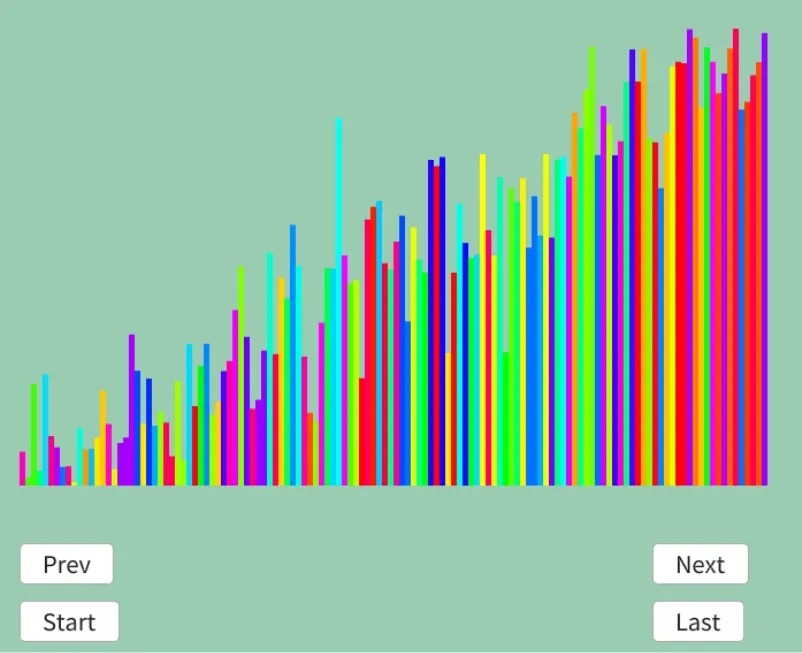

# コムソート  
バブルソートをちょっと改良したものがコムソート[^1].  
コムというのは英語で「Comb」で櫛の意味.  

やることは簡単で$`n`$個がある場合、これを$`h`$とする.  
$`h`$を$`1.3`$で割り、この間隔でバブルソートと同じ比較を行うだけ.  
$`1.3`$に関してはこれが一番性能がいいというだけの理由らしい、いやちゃんとした理由あるのかもだけど.  
これを調べてる記事[^2]もあって、ちゃんと1.3が良い精度にはなるっぽい.へぇ～.  

まあ細かいことは抜きにして、実際の動きを見た方がソートに関しては分かりやすい.  
```
h=8
8 4 3 7 6 5 2 1

1回目 h/1.3=8/1.3=6.15...~6
8 4 3 7 6 5 2 1     8と2を比較、8の方が大きいので入れ替える
↑ 1 2 3 4 5 ↑

2 4 3 7 6 5 8 1     4と1を比較、4の方が大きいので入れ替える
  ↑ 1 2 3 4 5 ↑

2 1 3 7 6 5 8 4     1週目終了

2回目 h/1.3=6/1.3=4.61...~4
2 1 3 7 6 5 8 4     2と6を比較、6の方が大きいので入れ替えx
↑ 1 2 3 ↑

2 1 3 7 6 5 8 4     1と5を比較、5の方が大きいので入れ替えx
  ↑ 1 2 3 ↑

2 1 3 7 6 5 8 4     3と8を比較、8の方が大きいので入れ替えx
    ↑ 1 2 3 ↑

2 1 3 7 6 5 8 4     7と4を比較、7の方が大きいので入れ替える
      ↑ 1 2 3 ↑

2 1 3 4 6 5 8 7     2週目終了

3回目 h/1.3=5/1.3=3.07...~3
2 1 3 4 6 5 8 7     2と4を比較、4の方が大きいので入れ替えx
↑ 1 2 ↑

2 1 3 4 6 5 8 7     1と6を比較、6の方が大きいので入れ替えx
  ↑ 1 2 ↑

2 1 3 4 6 5 8 7     3と5を比較、5の方が大きいので入れ替えx
    ↑ 1 2 ↑

2 1 3 4 6 5 8 7     4と8を比較、8の方が大きいので入れ替えx
      ↑ 1 2 ↑

2 1 3 4 6 5 8 7     6と7を比較、7の方が大きいので入れ替える
        ↑ 1 2 ↑

2 1 3 4 6 5 8 7     3週目終了

4回目 h/1.3=3/1.3=2.30...~2
2 1 3 4 6 5 8 7     2と3を比較、3の方が大きいので入れ替えx
↑ 1 ↑

2 1 3 4 6 5 8 7     1と4を比較、4の方が大きいので入れ替えx
  ↑ 1 ↑

2 1 3 4 6 5 8 7     3と6を比較、6の方が大きいので入れ替えx
    ↑ 1 ↑

2 1 3 4 6 5 8 7     4と5を比較、5の方が大きいので入れ替えx
      ↑ 1 ↑

2 1 3 4 6 5 8 7     6と8を比較、8の方が大きいので入れ替えx
        ↑ 1 ↑

2 1 3 4 6 5 8 7     5と7を比較、7の方が大きいので入れ替えx
          ↑ 1 ↑

2 1 3 4 6 5 8 7     4週目終了

5回目 h/1.3=2/1.3=1.53...~1
2 1 3 4 6 5 8 7     2と1を比較、2の方が大きいので入れ替える
↑ ↑

1 2 3 4 6 5 8 7     2と3を比較、3の方が大きいので入れ替えx
  ↑ ↑

1 2 3 4 6 5 8 7     3と4を比較、4の方が大きいので入れ替えx
    ↑ ↑

1 2 3 4 6 5 8 7     4と6を比較、6の方が大きいので入れ替えx
      ↑ ↑

1 2 3 4 6 5 8 7     6と5を比較、6の方が大きいので入れ替える
        ↑ ↑

1 2 3 4 5 6 8 7     6と8を比較、8の方が大きいので入れ替えx
          ↑ ↑

1 2 3 4 5 6 8 7     8と7を比較、8の方が大きいので入れ替える
            ↑ ↑

1 2 3 4 5 6 7 8

6回目 h=1なので、1のままで継続
すでにソート済みなので、swapなし
→swapなしなので終了
```
こんな風に最初は大き目な値でswapをしていき、後になるほど細かくswapをするのがコムソート.  
実装は簡単.  

まず`h`とスワップしたかどうかのフラグを用意.  
```c++
	auto Sort = [&]()
	{
		int h = dataList.size();
		bool isSwapped = false;
```
h=1かスワップしてるかで繰り返すかを判定.  
$`h=1`$の比較をしないと、間を空けつつの探索になるため終了判定にならない.  
そのため$`h=1`$まではたとえswapがなくても繰り返す.  
```C++
		while (h > 1 || isSwapped)
		{
```
まだ$`h=1`$になってない場合は$`1.3`$で割る.  
```C++
			// 探索する幅を確定する
			if (h > 1)
			{
				h = (h * 10) / 13;
			}
```
後はフラグを戻して、現在の位置$`i`$と$`i+h`$でバブルソートと同じswapをするだけ.  
ただし、境界条件的に繰り返す回数は$`n-h`$回.  
```C++
			isSwapped = false;
			for (int i = 0; i < dataList.size() - h; i++)
			{
				if (dataList[i + h].weight < dataList[i].weight)
				{
					std::swap(dataList[i].weight, dataList[i + h].weight);
					isSwapped = true;
				}
			}

			result.push_back(dataList);
		}
	};
```

これでコムソートも完成！結果を見てみよう.  

今回も中間あたりをスクショ.  

  

全体的に区間毎にソートされていってる感じだね.  

[^1]: [コムソート](https://w.wiki/Viek)  
[^2]: [コムソート（Comb Sort）で出てくる"1.3"について実験](https://qiita.com/MKX/items/510a82b2f4cb2290be30)  