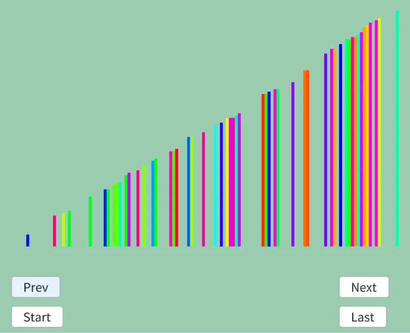

# 分布数え上げソート  
分布数え上げソートは出現回数側を記録するバケットソート、計数ソートともいう.  
日本語のWikiではバケットソート[^1]に説明があるが、EnのWikiは独自の記事があるっぽい[^2].  

さて、これも流れを見るのが速い.  
鳩の巣ソート[^3]の際と同じ例で見てみる.  
```
初期値: 1 4 2 2 6 2 6 4 6 4 5 6 6

最小値:1 最大値:6なので、1から6の箱を用意
1: 0 2: 0 3: 0 4: 0 5: 0 6: 0

Phase.1 頭からデータを数えていく.
4 2 2 6 2 6 4 6 4 5 6 6
1: 0+1 2: 0 3: 0 4: 0 5: 0 6: 0

2 2 6 2 6 4 6 4 5 6 6
1: 1 2: 0 3: 0 4: 0+1 5: 0 6: 0

2 6 2 6 4 6 4 5 6 6
1: 1 2: 0+1 3: 0 4: 1 5: 0 6: 0

6 2 6 4 6 4 5 6 6
1: 1 2: 1+1 3: 0 4: 1 5: 0 6: 0

2 6 4 6 4 5 6 6
1: 1 2: 2 3: 0 4: 1 5: 0 6: 0+1

6 4 6 4 5 6 6
1: 1 2: 2+1 3: 0 4: 1 5: 0 6: 1

4 6 4 5 6 6
1: 1 2: 3 3: 0 4: 1 5: 0 6: 1+1

6 4 5 6 6
1: 1 2: 3 3: 0 4: 1+1 5: 0 6: 2

4 5 6 6
1: 1 2: 3 3: 0 4: 2 5: 0 6: 2+1

5 6 6
1: 1 2: 3 3: 0 4: 2+1 5: 0 6: 3

6 6
1: 1 2: 3 3: 0 4: 3 5: 0+1 6: 3

6
1: 1 2: 3 3: 0 4: 3 5: 1 6: 3+1

1: 1 2: 3 3: 0 4: 3 5: 1 6: 4+1

1: 1 2: 3 3: 0 4: 3 5: 1 6: 5 完了！

Phase.2 累積式に変換
1: 1 2: 3 3: 0 4: 3 5: 1 6: 5
->
1: 1 2: 1+3 3: 1+3+0 4: 1+3+0+3 5: 1+3+0+3+1 6: 1+3+0+3+1+5
->
1: 1 2: 4 3: 4 4: 7 5: 8 6: 13

Phase3. 累積分布の値を減らしながら追加をしていく
初期値:1 4 2 2 6 2 6 4 6 4 5 6 6
sorted:{0 0 0 0 0 0 0 0 0 0 0 0 0}

1週目
1 4 2 2 6 2 6 4 6 4 5 6 6
↑

1より、index:1を1下げて参照
1: 1-1=0 2: 4 3: 4 4: 7 5: 8 6: 13

つまりソートに突っ込む位置は 0
sorted:{1 0 0 0 0 0 0 0 0 0 0 0 0}

2週目
1 4 2 2 6 2 6 4 6 4 5 6 6
  ↑

4より、index:4を1下げて参照
1: 0 2: 4 3: 4 4: 7-1=6 5: 8 6: 13

つまりソートに突っ込む位置は 6
sorted:{1 0 0 0 0 0 4 0 0 0 0 0 0}

3週目
1 4 2 2 6 2 6 4 6 4 5 6 6
    ↑

2より、index:2を1下げて参照
1: 0 2: 4-1=3 3: 4 4: 6 5: 8 6: 13

つまりソートに突っ込む位置は 3
sorted:{1 0 0 2 0 0 4 0 0 0 0 0 0}

4週目
1 4 2 2 6 2 6 4 6 4 5 6 6
      ↑

2より、index:2を1下げて参照
1: 0 2: 3-1=2 3: 4 4: 6 5: 8 6: 13

つまりソートに突っ込む位置は 2
sorted:{1 0 2 2 0 0 4 0 0 0 0 0 0}

5週目
1 4 2 2 6 2 6 4 6 4 5 6 6
        ↑

6より、index:6を1下げて参照
1: 0 2: 2 3: 4 4: 6 5: 8 6: 13-1=12

つまりソートに突っ込む位置は 12
sorted:{1 0 2 2 0 0 4 0 0 0 0 0 6}

6週目
1 4 2 2 6 2 6 4 6 4 5 6 6
          ↑

2より、index:2を1下げて参照
1: 0 2: 2-1=1 3: 4 4: 6 5: 8 6: 12

つまりソートに突っ込む位置は 1
sorted:{1 2 2 2 0 0 4 0 0 0 0 0 6}

7週目
1 4 2 2 6 2 6 4 6 4 5 6 6
            ↑

6より、index:6を1下げて参照
1: 0 2: 1 3: 4 4: 6 5: 8 6: 12-1=11

つまりソートに突っ込む位置は 11
sorted:{1 2 2 2 0 0 4 0 0 0 0 6 6}

8週目
1 4 2 2 6 2 6 4 6 4 5 6 6
              ↑

4より、index:4を1下げて参照
1: 0 2: 1 3: 4 4: 6-1=5 5: 8 6: 11

つまりソートに突っ込む位置は 5
sorted:{1 2 2 2 0 4 4 0 0 0 0 6 6}

9週目
1 4 2 2 6 2 6 4 6 4 5 6 6
                ↑

6より、index:6を1下げて参照
1: 0 2: 1 3: 4 4: 5 5: 8 6: 11-1=10

つまりソートに突っ込む位置は 10
sorted:{1 2 2 2 0 4 4 0 0 0 6 6 6}

10週目
1 4 2 2 6 2 6 4 6 4 5 6 6
                  ↑

4より、index:4を1下げて参照
1: 0 2: 1 3: 4 4: 5-1=4 5: 8 6: 10

つまりソートに突っ込む位置は 4
sorted:{1 2 2 2 4 4 4 0 0 0 6 6 6}

11週目
1 4 2 2 6 2 6 4 6 4 5 6 6
                    ↑

5より、index:5を1下げて参照
1: 0 2: 1 3: 4 4: 4 5: 8-1=7 6: 10

つまりソートに突っ込む位置は 7
sorted:{1 2 2 2 4 4 4 5 0 0 6 6 6}

12週目
1 4 2 2 6 2 6 4 6 4 5 6 6
                      ↑

6より、index:6を1下げて参照
1: 0 2: 1 3: 4 4: 4 5: 7 6: 10-1=9

つまりソートに突っ込む位置は 9
sorted:{1 2 2 2 4 4 4 5 0 6 6 6 6}

13週目
1 4 2 2 6 2 6 4 6 4 5 6 6
                        ↑

6より、index:6を1下げて参照
1: 0 2: 1 3: 4 4: 4 5: 7 6: 9-1=8

つまりソートに突っ込む位置は 8
sorted:{1 2 2 2 4 4 4 5 6 6 6 6 6}

完了！
```
やってることは簡単だ.  
数を数えて累積分布を作る.  
あとはそれをindexとして参照する、これだけ.  

そしたら実装に移ろう、まずは入れる箱を作り、そこに値を数えていく.  
```c++
// 今回は[0,99]を仮定
const int range = 100;

// 分布を作る
Array<int> distribution; distribution.resize(range);

for (const auto& value : dataList)
{
    // まずは度数分布
    distribution[value.weight]++;
}
```
数え終わったら、これを累積分布に変換.  
```c++
for (int i = 1; i < distribution.size(); i++)
{
    // 累積分布に変換
    distribution[i] += distribution[i - 1];
}
```
最後に累積分布を下げつつ`sorted`に突っ込んでいけばよいだけ.  
```c++
Array<Data> sorted(dataList.size());

int index = 0;
for (const auto& value : dataList)
{
    int index = value.weight;
    distribution[index]--;
    sorted[distribution[index]].weight = index;
    result.push_back(sorted);
}
```

結果を見てみよう.  

  

中間あたりで撮ってみたけど、段々と並んで行ってるのが分かるね.  
既にソート自体は完了していて、後は並べるだけといった感じ.  
さて、今回はここまで.  

[^1]: [バケットソート](https://w.wiki/3H7F)  
[^2]: [Counting Sort](https://w.wiki/f7fJ)  
[^3]: [鳩の巣ソート](./PigeonholeSort.md)  