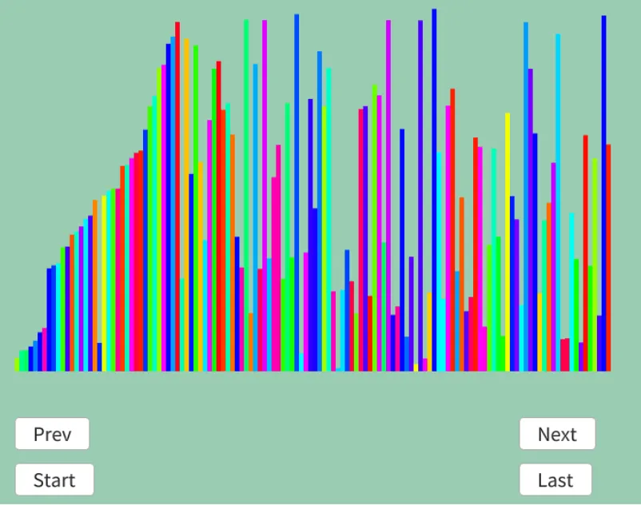

# ノームソート  
ノームソート[^1]は挿入ソートに似てるが、移動はバブルソートみたいなアルゴリズム.  
ガーデン・ノーム[^2],つまり庭の小人が植木鉢を入れ替える様に着想を得たらしい.  

やることは簡単だ.  
一番端から開始して、 
 
* 整列してるかを確認,整列してるなら次へ
* 整列されてないデータが出てきたら、正しい位置になるまで交換して戻る  

これを繰り返すだけである.  
実際に例で見てみよう.  

```
4 2 7 3

4 2 7 3 並びがおかしいので交換して戻る
↑ ↑

2 4 7 3 端の場合は次へ
↑

2 4 7 3 大丈夫そうなので次へ 
↑ ↑

2 4 7 3 大丈夫そうなので次へ 
  ↑ ↑

2 4 7 3 並びがおかしいので交換して戻る
    ↑ ↑

2 4 3 7 並びがおかしいので交換して戻る
  ↑ ↑

2 3 4 7 大丈夫そうなので次へ
↑ ↑

2 3 4 7 大丈夫そうなので次へ
  ↑ ↑

2 3 4 7 最後まで大丈夫なので終わり
    ↑ ↑
```
さて、実装は非常にシンプル.  
indexを1にして開始、端にたどり着くまでループする.  
```c++
	auto Sort = [&]()
	{
		int i = 1;

		while (i < dataList.size())
		{
```
正しい順なら$`+1`$,間違ってるなら$`-1`$で戻り続ける.(端のみ$`+1`$)  
これだけだ.  
```c++
			if (dataList[i - 1].weight < dataList[i].weight)
			{
				i++;
			}
			else
			{
				std::swap(dataList[i - 1].weight, dataList[i].weight);
				i = (i - 1 == 0) ? i : i - 1;

				result.push_back(dataList);
			}
        }
    };
```
結果を見てみよう、今回も中間あたり.  



ソートしている中にポツンとソートされてないものがあるね.  
これが今移動させている途中のデータというわけだ.  
非常にシンプルでしたね、ノームソート.  

[^1]: [ノームソート](https://w.wiki/VtoU)  
[^2]: [ガーデン・ノーム](https://w.wiki/484z)  