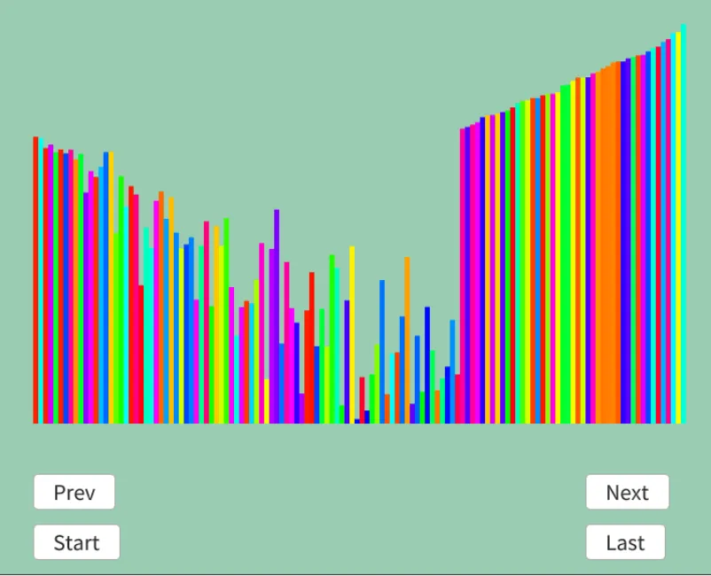

# ヒープソート  
ヒープソート[^1]はヒープを満たす2分木を構築.  
最大値を取り出して、またヒープを満たす2分木にする...という処理を繰り返すソート.  
ヒープは大雑把に言うと親が子よりも大きい(or小さい)を全部のノードで満たすもの.  
今回は全部の親が大きくなる方向で組んでみよう.  

いつも通り流れをペタリ、初期状態はこちら[^2]から拝借しました.  
```
初期状態:0 1 7 3 5 9 2
Result: x x x x x x x

ヒープを作成: 
i=n/2-1=2の位置から開始
i = 2
0 | 1 7 | 3 5 9 2 左の子9は大きいので、こことswap 
    　↑       ↑ ↑
0 | 1 9 | 3 5 7 2 swapした場合は子で同じ処理、問題なし
    　        ↑

i = 1
0 | 1 9 | 3 5 7 2 子の内大きい方の5とswap
    ↑     ↑ ↑ 
0 | 5 9 | 3 1 7 2 swapした場合は子で同じ処理、問題なし
            ↑ 

i = 0
0 | 5 9 | 3 1 7 2 子の内大きい方の9とswap
↑　 ↑ ↑
9 | 5 0 | 3 1 7 2 swapした場合は子で同じ処理,大きい方の7とswap
      ↑　     ↑ ↑
9 | 5 7 | 3 1 0 2 swapした場合は子で同じ処理、問題なし
      　      ↑
ヒープ完成！

1回目
データの端と初期位置をswap
2 | 5 7 | 3 1 0 9

最大値を書き出し
2 | 5 7 | 3 1 0 x
Result: x x x x x x 9

ヒープを再作成 (i=0から)
2 | 5 7 | 3 1 0 x 子のうち大きい7とswap
↑   ↑ ↑
7 | 5 2 | 3 1 0 x swapした場合は子で同じ処理、問題なし
      ↑       ↑

1週目終わり

2回目
データの端と初期位置をswap
0 | 5 2 | 3 1 7 x

最大値を書き出し
0 | 5 2 | 3 1 x x
Result: x x x x x 7 9

ヒープを再作成 (i=0から)
0 | 5 2 | 3 1 x x 子のうち大きい5とswap
↑   ↑ ↑
5 | 0 2 | 3 1 x x swapした場合は子で同じ処理、大きい3とswap
    ↑     ↑ ↑
5 | 3 2 | 0 1 x x swapした場合は子で同じ処理、問題なし
          ↑
2週目終わり

3回目
データの端と初期位置をswap
1 | 3 2 | 0 5 x x

最大値を書き出し
1 | 3 2 | 0 x x x
Result: x x x x 5 7 9

ヒープを再作成 (i=0から)
1 | 3 2 | 0 x x x 子のうち大きい3とswap
↑   ↑ ↑
3 | 1 2 | 0 x x x swapした場合は子で同じ処理、問題なし
    ↑     ↑
3週目終わり

4回目
データの端と初期位置をswap
0 | 1 2 | 3 x x x

最大値を書き出し
0 | 1 2 | x x x x
Result: x x x 3 5 7 9

ヒープを再作成 (i=0から)
0 | 1 2 | x x x x このうち大きい2とswap
↑   ↑ ↑
2 | 1 0 | x x x x swapした場合は子で同じ処理、問題なし
      ↑
4週目終わり

5回目
データの端と初期位置をswap
0 | 1 2 | x x x x

最大値を書き出し
0 | 1 x | x x x x
Result: x x 2 3 5 7 9

ヒープを再作成 (i=0から)
0 | 1 x | x x x x このうち大きい1とswap
↑   ↑
1 | 0 x | x x x x swapした場合は子で同じ処理、問題なし
    ↑
5週目終わり

6回目
データの端と初期位置をswap
0 | 1 x | x x x x

最大値を書き出し
0 | x x | x x x x
Result: x 1 2 3 5 7 9

ヒープを再作成 (i=0から)
0 | x x | x x x x 子がないのでskip
↑
6週目終わり

7回目
データが1つなので、swapなし

最大値を書き出し
x | x x | x x x x
Result: 0 1 2 3 5 7 9

ヒープを再作成,がデータないのでskip

終了
```

長かった...  
が、流れを見ると本当に単純.  
ヒープ作って、木の端と入れ変えたら木から取り除いて,またヒープにして...を繰り返すだけだ.  

後はコードにしてみよう.  
まず最初に木の調整.  
基本的にやることは左右の子を見て最大値を取り出す.  
```c++
auto adjustHeap = [&](auto adjustHeap, int i) -> void
{
    int maxIndex = i;

    // 左のサブツリーが存在 + 左側のサブツリーの方が大きい -> 交換
    if (i * 2 < n && dataList[maxIndex].weight < dataList[i * 2].weight)
    {
        maxIndex = i * 2;
    }

    // 右のサブツリーが存在 + 右側のサブツリーの方が大きい -> 交換
    if (i * 2 + 1 < n && dataList[maxIndex].weight < dataList[i * 2 + 1].weight)
    {
        maxIndex = i * 2 + 1;
    }
```
入れ替えた場合のみ、子の位置でヒープ性を保つために再帰させればよい.  
```c++
    if (maxIndex != i)
    {
        // サブツリーが変更された場合は、それより下のノードも
        // 正しく最大値になってるかを並び変えてあげる
        std::swap(dataList[maxIndex], dataList[i]);
        adjustHeap(adjustHeap, maxIndex);
    }
};
```
次に実際の処理.  
一番最初にヒープを作成する.  
下から順にくみ上げればよい.  
```C++
		// 最大ヒープの形成(この時index:0は最大値)
		for (int i = n / 2 - 1; i >= 0; i--)
		{
			adjustHeap(adjustHeap, i);
		}

        result.push_back(dataList);
```
毎回のループでやることはまず位置の交換.  
その後確定させる.  
手作業の場合はResult煮詰めるような感じだったけど、今回はnのサイズを縮めることで同じ動きをしている.  
最後にヒープの調整をすれば終わり.  
```c++
		// ヒープの位置を交換していく
		while (0 < n)
		{
			// 最大の位置と交換する(前回の処理で0の位置が最大の値のはず)
			std::swap(dataList[0], dataList[n - 1]);
			result.push_back(dataList);

			// nの位置はもう弄らないものとする
			n--;

			// 最大のヒープになるように調整
			adjustHeap(adjustHeap, 0);
			result.push_back(dataList);
		}
```

実行した結果は以下のような感じ.  

  

最大値の方から決まりつつ、確かにヒープ性を満たしてそうな並びをしている.  
まあ多分合ってるでしょう！  

[^1]: [ヒープソート](https://w.wiki/X3qK)  
[^2]: [ヒープソート Heap Sort【可視化GIFでソートアルゴリズムを解説 その７】](https://qiita.com/yp2211/items/47a5f1a2e9fdee966529)    