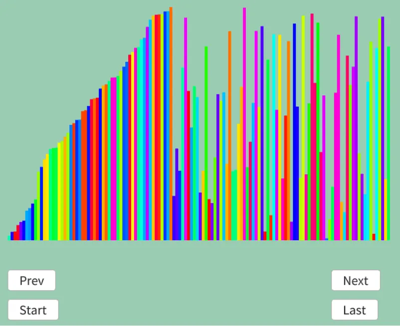

# 挿入ソート  
挿入ソート[^1]はイメージとしてはノームソートに近い動きかな？  

まず最初に大小関係を見て、正しければ$`+1`$を行う.  
その後、大小関係が崩れていた場合は、今のIndexから手前のIndexで小さいのを見つけて挿入する.  
挿入後は直ぐに戻ってくるだけ.  

ノームソートでは挿入した後も$`+1`$ずつ戻っていったが、そこが違う点かな.  
さて、そしたら実際に今回も例を見てみよう.  
```
確定|探索側
5 | 4 3 7 6 8 2 1

1回目
5 | 4 3 7 6 8 2 1   5の方が小さいため、正しい位置に挿入する
    ↑
4 5 | 3 7 6 8 2 1

2回目
4 5 | 3 7 6 8 2 1   3の方が小さいため、正しい位置に挿入する
      ↑

3 4 5 | 7 6 8 2 1

3回目
3 4 5 | 7 6 8 2 1   5の方が小さいため、そのまま
        ↑

3 4 5 7 | 6 8 2 1

4回目
3 4 5 7 | 6 8 2 1   6の方が小さいため、正しい位置に挿入する
          ↑

3 4 5 6 7 | 8 2 1

5回目
3 4 5 6 7 | 8 2 1   7の方が小さいため、そのまま
            ↑

3 4 5 6 7 8 | 2 1

6回目
3 4 5 6 7 8 | 2 1   2の方が小さいため、正しい位置に挿入する
              ↑
2 3 4 5 6 7 8 | 1

7回目
2 3 4 5 6 7 8 | 1   1の方が小さいため、正しい位置に挿入する
                ↑
1 2 3 4 5 6 7 8     終了！s
```

単純に小さければ左に作ったソートされてる範囲内の正しい位置に挿入する、ただそれだけだ.  

実装は簡単だ.  
先頭から大小関係を判定.  
前のものより大きい場合、そのままの位置でOKなので、そのまま次のループへ.  
前のものより小さい場合,正しい位置が見つかるまで戻る.  
見つかったらswapして次のループへ.  
```c++
auto Sort = [&]()
{
    for (int i = 1; i < dataList.size(); i++)
    {
        if (dataList[i].weight < dataList[i - 1].weight)
        {
            int j = i;
            auto tmp = dataList[i].weight;

            do
            {
                dataList[j].weight = dataList[j - 1].weight;
                j--;
            } while (j > 0 && dataList[j - 1].weight > tmp);
            dataList[j].weight = tmp;
        }

        result.push_back(dataList);
    }
};
```

これで実装できた、実際に結果を見てみよう.今回も中間位置あたりだ.  

  

うん、いい感じ！  
選択ソート辺りと同じような動きですね.  
前から埋めていってるのでそりゃそう.  

[^1]: [挿入ソート](https://w.wiki/3NPj)  