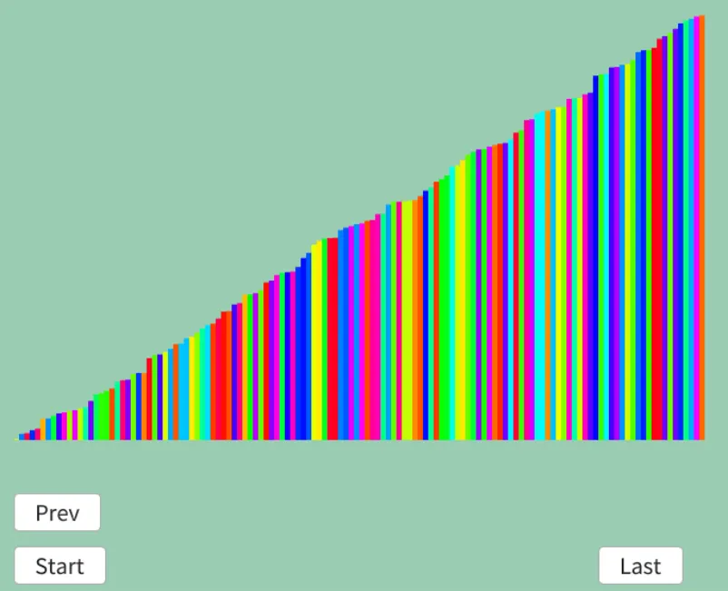

# イントロソート  
イントロソート[^1]はヒープソートとクイックソートを組み合わせたハイブリットソート.  

このソートがなぜ必要かというと、クイックソートの弱点にある.  
クイックソートはピボットの選び方によって性能が決まる.  
が、どう頑張って選んだとしても最悪の場合はどうしても$`\mathcal{O}(n^{2})`$になってしまう.  

ならそもそもある程度計算した上でダメそうなら最悪計算量が$`\mathcal{O}(n\log(n))`$のヒープソートに切り替えるのである.  

クイックソートはキャッシュヒット率もいいし、構築時間とかもないので基本的にはこれを使うのが嬉しい.  
なので、これを生かしつつも最悪の場合は切り替えるってわけだね.  

さて、実装は簡単で、再帰中にdepthが0を切ったらheapsortを使用.  
heapsortを使ったらそれ以上処理はしなくてOK.  
それ以外はquicksortに$`depth--`$しながら行っていくという感じだ.  
```c++
bool isSorted = false;
auto introSort = [&](auto introSort, int first, int last, int depth) -> void
{
    if (last <= first || isSorted) { return; }

    if (depth <= 0)
    {
        // depthが指定回数行われていたらHeapSort
        HeapSort(first, n);
        isSorted = true;
    }
    else
    {
        int l = first, r = last;

        // まだdepthに余裕があるならQuickSort
        int p = quick(l, r);

        // 再帰
        if (l < p) { introSort(introSort, l, p - 1, depth - 1); }
        if (p < r) { introSort(introSort, p + 1, r, depth - 1); }
    }
};

introSort(introSort, 0, n - 1, maxDepth);
```

深度は任意の値で良いらしい.  
まあWikiでも使ってる「ある長さ$`N`$に対して$`2 \times \log_{2}N`$」とかがいいんかな？  
確かに長さによって変わる方がよさそうだしね.  
結果は以下.  

  

うん、ソート自体はいけてるっぽい.  

[^1]: [イントロソート](https://w.wiki/XRei)  