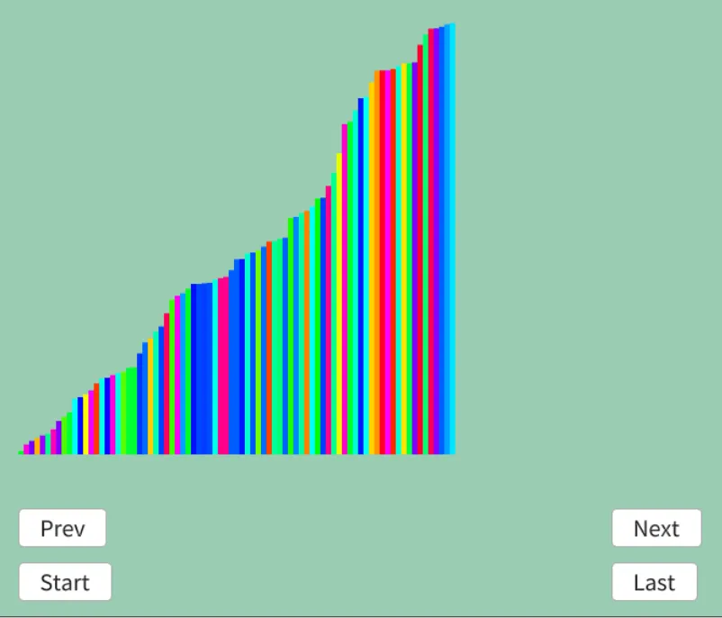

# 図書館ソート
ちょっと変わったソートに図書館ソート[^1]というものがある.  
本棚が複数ある状態で、その本をA\~Zの順で並べるとする.  
この時普通に考えたら挿入ソートみたいにするだけ.  
が、その本の手前であると判定できれば、簡単に挟むことが可能.  

とはいえ説明だけだと難しいので、実際の手順を見ていこう.  
結構複雑ではあるけど、まあちゃんと辿れば分かるかとは思う.  
```
初期状態: 5 3 7 6 8 4 n=6

最初の条件
7冊入る本棚を3つ用意,1つ目に初期状態を詰めておく
Library1: 5 x x x x x x
Library2: x x x x x x x
Library3: x x x x x x x

3 7 6 8 4

1回目
3に対して処理
Library1の本より大きい値のindexを取ってくる(二分探索)
今回は5が大きいのでindex:0が手に入る

これをLibrary3のindex位置に詰めておく
Library3: 3 x x x x x x

現在の本: 7 6 8 4

2回目
7に対して処理
Library1の本より大きい値のindexを取ってくる(二分探索)
が、ない...この場合は一番最後尾のindexを取る.  

これをLibrary3のindex位置に詰めておく
Library3: 3 x x x x x 7

現在の本: 6 8 4

3回目
6に対して処理
Library1の本より大きい値のindexを取ってくる(二分探索)
が、ない...この場合は一番最後尾のindexを取る.  

この6のindexの位置は既に7がいるため、埋められない...
Library3: 3 x x x x x 7
　　　　　　　　　　　　↑

この時は整理を開始！
各Indexの位置に対して、値がある場合Library3->Library1の順に参照してLibrary2に詰めていく
(二分探索の時点でindex位置の大小関係はLibrary3 < Library1になっているため)

i = 0を詰めたとき
Library2: 3 5 x x x x x

i = 6を詰めたとき
Library2: 3 5 7 x x x x

一旦整理完了！
Library1: x x x x x x x
Library2: 3 5 7 x x x x
Library3: x x x x x x x

次はLibrary2とLibrary3で比較を行う

現在の本: 6 8 4

4回目
6に対して処理
Library2の本より大きい値のindexを取ってくる(二分探索)
今回は7が大きいので、index:2が手に入る

これをLibrary3のindex位置に詰めておく
Library3: x x 6 x x x x

現在の本: 8 4

5回目
8に対して処理
Library2の本より大きい値のindexを取ってくる(二分探索)
が、ない...この場合は一番最後尾のindexを取る.  

これをLibrary3のindex位置に詰めておく
Library3: x x 6 x x x 8

現在の本: 4

6回目
4に対して処理
Library2の本より大きい値のindexを取ってくる(二分探索)
今回は5が大きいので、index:1が手に入る

これをLibrary3のindex位置に詰めておく
Library3: x 4 6 x x x 8

終了

現在の本棚:
Library1: x x x x x x x
Library2: 3 5 7 x x x x
Library3: x 4 6 x x x 8

最後に整理
各Indexの位置に対して、値がある場合Library3->Library2の順に参照してSortedに詰めていく
(二分探索の時点でindex位置の大小関係はLibrary3 < Library2になっているため)

i = 0を詰めたとき
Sorted: 3 x x x x x

i = 1を詰めたとき
Sorted: 3 4 5 x x x

i = 2を詰めたとき
Sorted: 3 4 5 6 7 x

i = 6を詰めたとき
Sorted: 3 4 5 6 7 8
```
間を使って上手くやってるわけだ.  
さて、そしたら実際に実装を行うわけだが、今回はWikiの疑似コードだけだとなんとも...な感じ.  
他に分かりやすいのを調べていたら、ここ[^2]が一番わかりやすかったので、こちらを読み解きつつやっていこうかと思う.  

まず最初は初期化で必要なサイズとindex,そして現状処理してるLibraryを用意する.  
libraryは先程の`library1, library2`に相当しており、gapsは先程の`library3`に相当.  
そして、既に本が収まってるかどうかの判定用に`numbered`を用意.  
```c++
		int n = dataList.size();

		// 必要なデータを初期化
		int librarySize = 1, indexPos = 1, targetLibrary = 0;
		Array<double> gaps; gaps.resize(n + 1);
		Array<bool> numbered; numbered.resize(n + 1, false);
		auto sortedData = dataList;

		Array<Array<double>> library; library.resize(2); // 本の配列は2にしておく
		for (auto i : step(2)) { library[i].resize(n); }
```

library1にはデータを収めておく.  
```c++
		// Libraryの初期状態を形成
		library[targetLibrary][0] = dataList[0].weight;
```

さて、まず最初に二分探索を行い、現状の値より大きいものを見つける.  
見つからない場合は最後尾だ.  
こうしてindexが手に入る.  
```C++
    while (indexPos < n)
    {
        int insert = std::distance
        (
            library[targetLibrary].begin(),
            std::lower_bound(library[targetLibrary].begin(), library[targetLibrary].begin() + librarySize, dataList[indexPos].weight)
        );
```
まずは`numbered[index]=false`,つまりまだ埋まってない場合は`library3`に本を詰めておく.  
詰めた後はチェックをして、次へ行く.  
```c++
			else
			{
				numbered[insert] = true;
				gaps[insert] = dataList[indexPos].weight;
				indexPos++;
            }
```
もしも既にある場合は整頓の処理となる.  
まず整頓した後は`library2`を中心にデータの比較を行うため、indexのswapが必要.  
そのため、`nextTargetLib`として保持しておく.  
また、`probSize`で整頓した位置を保持できるようにする.  
```c++
			if (numbered[insert])
			{
				int provSize = 0, nextTargetLib = targetLibrary == 1 ? 0 : 1; // 操作するLibを切り替える
```
そしたら実際の本の整理.  
`numbered[i]=true`の場合,これは`Library3`にデータがあるため、先にデータをnextのLibraryに詰める.  
そうすると`Library3`は空と見なしていいので、`numbered[i]=false`にしておく.  
```c++
				for (int i = 0; i <= n; i++)
				{
					if (numbered[i])
					{
						// gapsに記録されているものを入れる
						library[nextTargetLib][provSize] = gaps[i];
						provSize++;
						numbered[i] = false; // numberedをfalseにして、gapにまた入れられるようにする
					}
```
そして、現在のLibraryもデータがある場合は移す必要がある.  
データは絶対に前から埋まるので、そのまま対応すればよい.  
```c++
					if (i < librarySize)
					{
						// もう一つのライブラリには既にソート済みのものがあるので、
						// それは必要分だけ移す
						library[nextTargetLib][provSize] = library[targetLibrary][i];
						provSize++; // 移したところにはデータは来てほしくないので、ずらす
					}
				}
```
あとLibraryを入れ替えて、サイズも更新しておけば終わり.  
可視化のためソートに代入してるが、まあこれは実際の処理には関係ないことです.  
```c++
				targetLibrary = nextTargetLib; // 整理した方のlibraryで処理する
				librarySize = provSize; // provサイズは整理した本の数にする

				for (auto i : step(n))
				{
					sortedData[i].weight = library[targetLibrary][i];
				}
				result.push_back(sortedData);
			}
```

さて、そうしてこの処理を繰り返した最後はデータが完全に整理されている状態となる.  
そのため、最後に本をまとめてあげればよい.  
先程詰めてたのとほぼ同じことをやればよい.  
```c++
    int indexPositionOutput = 0;
    for (int i = 0; indexPositionOutput < n; i++)
    {
        // 整理の部分を最後にやってるだけ,while抜け段階では
        // 最後の整理だけ行われていないのでここで行う
        if (numbered[i] == true)
        {
            sortedData[indexPositionOutput].weight = gaps[i];
            indexPositionOutput++;
        }

        if (i < librarySize)
        {
            sortedData[indexPositionOutput].weight = library[targetLibrary][i];
            indexPositionOutput++;
        }
    }
```

今回はソート途中までを可視化してみた.  

  

うん、いい感じにソートされていってるね.  
途中までで確定させてるので見た目が中途半端だけど、まあそれは許してほしい.  

[^1]: [図書館ソート](https://w.wiki/Ww9a)  
[^2]: [library sort Algorithm](https://cplusplus.algorithmexamples.com/web/sorting/library_sort.html)