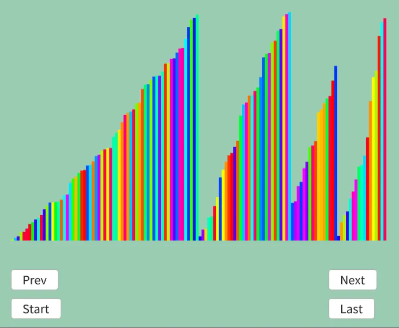

# マージソート
ソートといえばこれ！ってくらい有名なマージソート[^1].  
どんどん分割して、分割したものをマージしていくだけ.  
シンプルではあるんだけど、再帰で書けてスマートに行けるのがいいよね.  

因みにこのアルゴリズム、フォン・ノイマンが発明したらしい.知らなんだ.  
詳しく知りたい人はここ[^2]を見るといいと思う,どういう経緯で見つかったのかが詳しく書いてあって面白い.  

ということで実際に流れを見ていこう！  
```
初期状態: 8 4 3 7 6 5 2 1

~分割~
8 4 3 7 | 6 5 2 1 半分の区間に分割 (|はmidとなる)

8 4 | 3 7 | 6 5 | 2 1 半分の区間に分割

8 | 4 | 3 | 7 | 6 | 5 | 2 | 1 半分の区間に分割,これ以上無理なので終わり

~統治~
4 8 | 3 7 | 5 6 | 1 2 ソートしつつマージ
3 4 7 8 | 1 2 5 6 ソートしつつマージ
1 2 3 4 5 6 7 8 ソートしつつマージ

完了！
```
こんな感じで最小単位に分けた後に、各部分をソートしつつくっつけるだけである.  
そしたら実装をしてみよう.  

まず最初に分割を行う処理は`mergeSort`という関数でやる.  
これは単純に先程の`|`に相当する`mid`を計算して、左右に分割するだけ.  
分割時は`mergeSort`を呼び出しているので、再帰的に行われるわけである.  
```c++
auto mergeSort = [&](auto mergeSort, int left, int right) -> void
{
    if (left == right || left == right - 1) { return; } // これ以上分割できない
    int mid = (left + right) / 2;
    mergeSort(mergeSort, left, mid); // 左に分割
    mergeSort(mergeSort, mid, right); // 右に分割
    merge(left, mid, right); // マージ
};
```
`merge`を呼び出すことで最小単位まで分かれたデータを次々にマージしていく.  
再帰を行っているということは最小単位側からマージは行われることになる.  
再帰の性質を上手く利用してるね,最小側からソートしてるおかげでそれ以降では問題なくなるわけだ.  

マージの処理もシンプルだ.  
まずaとbという箱を用意して、bにソートしたものを突っ込んでいく.  
```c++
Array<Data> a = dataList, b = dataList;
auto merge = [&](int left, int mid, int right)
{
```
各indexを取って先頭から最小のものを取り出す.  
左右のどちらかが入れ終わればここは終了.  
```c++
    int i = left, j = mid, k = 0;

    while (i < mid && j < right)
    {
        // 先頭から小さい順にbに放り込む
        if (a[i].weight <= a[j].weight)
        {
            b[k++].weight = a[i++].weight;
        }
        else
        {
            b[k++].weight = a[j++].weight;
        }
    }
```
処理をちょっと可視化してみよう.  

```
1回目
a: 3 4 7 8 | 1 2 5 6 
   ↑         ↑
   i         j
1の方が小さいので,
b: 1 x x x x x x x

2回目
a: 3 4 7 8 | 1 2 5 6 
   ↑           ↑
   i           j
2の方が小さいので,
b: 1 2 x x x x x x

3回目
a: 3 4 7 8 | 1 2 5 6 
   ↑             ↑
   i             j
3の方が小さいので,
b: 1 2 3 x x x x x

4回目
a: 3 4 7 8 | 1 2 5 6 
     ↑           ↑
     i           j
4の方が小さいので,
b: 1 2 3 4 x x x x

5回目
a: 3 4 7 8 | 1 2 5 6 
       ↑         ↑
       i         j
5の方が小さいので,
b: 1 2 3 4 5 x x x

6回目
a: 3 4 7 8 | 1 2 5 6 
       ↑           ↑
       i           j
6の方が小さいので,
b: 1 2 3 4 5 6 x x

右側を入れ終えたので終了！
```

ここまでの処理でまだ左側が入ってない...  
が、左のみに限れば既にソートされているため,そのままデータを突っ込んであげればよい.    
```c++
    // 片方が出尽くしたら、もう片方は片っ端から入れるようにする
    if (i == mid)
    {
        while (j < right)
        {
            b[k++].weight = a[j++].weight;
        }
    }
    else
    {
        while (i < mid)
        {
            b[k++].weight = a[i++].weight;
        }
    }
```
つまりこうだ.  
```
1回目
a: 3 4 7 8 | 1 2 5 6 
       ↑           ↑
       i           j
そのまま7を入れる
b: 1 2 3 4 5 6 7 x

2回目
a: 3 4 7 8 | 1 2 5 6 
         ↑         ↑
         i         j
そのまま8を入れる
b: 1 2 3 4 5 6 7 8
```
最後にBのデータをAに移しておく.  
こうすることで、次に使う時もAのデータはソートされていることが保証されるのである！  
```c++
    // kはマージするサイズになってるはず
    for (int l = 0; l < k; l++)
    {
        a[left + l].weight = b[l].weight;
    }

    result.push_back(a);
};
```
結果を見ると以下のような感じになる.  

  

階段状にソートされているのが分かる、こいつが再帰で段々詰みあがっているわけだ.  
まあ今回位だとまだいいけど、あまりに大きいとスタックを食いつぶすことになる.  
なので、再帰なしで書く方がいいんだろうな、うん.まあ今回はこれでいいでしょう.  

[^1]: [マージソート](https://w.wiki/X27k)  
[^2]: [Merge Sort And It's Early History](https://compileralchemy.substack.com/p/merge-sort-and-its-early-history)  