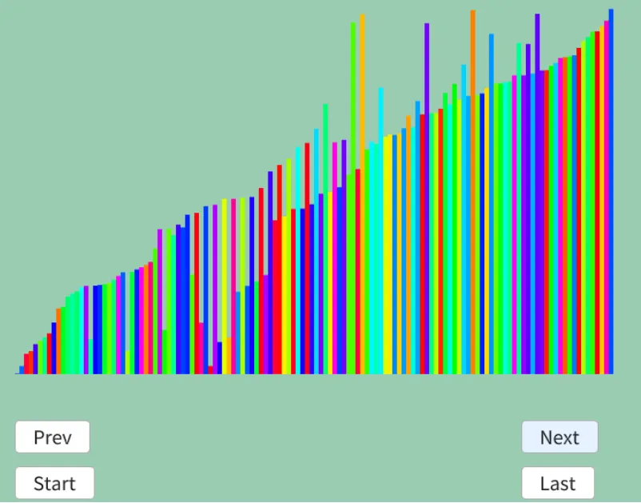

# 奇偶転置ソート
奇偶転置ソートはバブルソートを奇数偶数の組にして行うもの.  
やることは

* Group1: 偶数番目,奇数番目の順で比較
* Group2: 奇数番目,偶数番目の順で比較

というのを変更がなくなるまで繰り返すだけ.  
実際に見てみよう.  

```
初期状態: 8 4 3 7 6 5 2 1

Group1
8 4 -> swap 
3 7 -> そのまま 
6 5 -> swap 
2 1 -> swap
よって, 4 8 3 7 5 6 1 2

Group2
8 3 -> swap
7 5 -> swap
6 1 -> swap
よって、 4 3 8 5 7 1 6 2

Group1
4 3 -> swap
8 5 -> swap
7 1 -> swap
6 2 -> swap
よって、 3 4 5 8 1 7 2 6

Group2
4 5 -> そのまま
8 1 -> swap
7 2 -> swap
よって、 3 4 5 1 8 2 7 6

Group 1
3 4 -> そのまま
5 1 -> swap
8 2 -> swap
7 6 -> swap
よって、 3 4 1 5 2 8 6 7

Group2
4 1 -> swap
5 2 -> swap
8 6 -> swap
よって、 3 1 4 2 5 6 8 7

Group1
3 1 -> swap
4 2 -> swap
5 6 -> そのまま
8 7 -> swap
よって、 1 3 2 4 5 6 7 8

Group2
3 2 -> swap
4 5 -> そのまま
6 7 -> そのまま
よって、 1 2 3 4 5 6 7 8

Group1
1 2 -> そのまま
3 4 -> そのまま
5 6 -> そのまま
7 8 -> そのまま

Group2
2 3 -> そのまま
4 5 -> そのまま
6 7 -> そのまま

Group1とGroup2を通して変化が起きないので終わり！
```
こんな感じでバブルソートを偶数奇数の位置でのswapのみに分解している.  
実際にやってること自体はバブルソートと全く同じ.  
何だけど、利点として並列化しやすいというのがある.  
例えば以下のようにあるときのGroup1を抜き出してみる.  
```
3 1 -> swap
4 2 -> swap
5 6 -> そのまま
8 7 -> swap
よって、 1 3 2 4 5 6 7 8
```
`(3,1),(4,2),(5,6),(8,7)`という4つの操作はすべて独立している.  
そのため、この4つは並列に処理をしても問題ないというわけだ.  
バブルソートだと`(3,1)`の比較の結果を参照して`(3,4)`の比較に移る.  
このため並列化が出来ないんだけど、そこの欠点を補っているということだね.  

さて、そしたら後は実装.  
まずは`i=0`の地点から比較を行う.  
```c++
bool changed = false;

do
{
    changed = false;
    // (奇数,偶数) Pair
    for (int i = 0; i < dataList.size() - 1; i += 2)
    {
        if (dataList[i].weight > dataList[i + 1].weight)
        {
            std::swap(dataList[i], dataList[i + 1]);
            changed = true;
        }
    }
    result.push_back(dataList);
```
次は`i=1`の地点から比較を行う.  
これを変化が起こらなくなるまでやるだけ！  
```c++
    // (偶数,奇数) Pair
    for (int i = 1; i < dataList.size() - 1; i += 2) /* 組2 */
    {
        if (dataList[i].weight > dataList[i + 1].weight)
        {
            std::swap(dataList[i], dataList[i + 1]);
            changed = true;
        }

    }
    result.push_back(dataList);
} while (changed);
```

さて、結果を見てみよう.  

  

うん、小さい値が左によりつつ、大きい値は右に寄っている状態が観察できる.  
ちゃんと機能していそうだ.  

[^1]: [奇偶転置ソート](https://w.wiki/dism)  