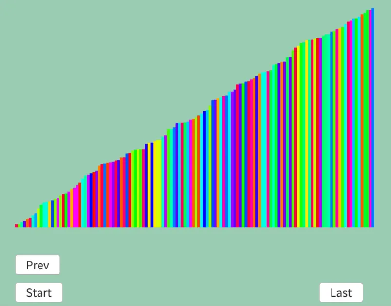

# パティエンスソート  
パティエンスソート[^1]はソリティアのようにソートを行うアルゴリズム.  
ならソリティアソートでいいじゃない、と思うかもしれないが実はここに勘違いがある.  
あのよく知ってるソリティアというのは正式名称じゃなく、実際はクロンダイク[^2]というらしい.  
でもWindowsで搭載されたときに「ソリティア」の名前だったため、そういう勘違いが生まれたと.知らんかった...  
因みに「ソリティア」はフランス語で「孤独」の意、一人遊びのボードゲーム全般を指すらしい.  
似たようなものに「パティエンス」がありこれは「忍耐」の意、一人遊びのトランプゲームを差す.  
つまり今回のソートはこのパティエンスから来てるわけである.  

では実際にソートの流れを見てみよう.  
ソリティア改めクロンダイクのことを考えながら見るとそれほど難しくない.  
```
初期状態: 6 12 2 8 3 7

1回目: 12 2 8 3 7  {6} まずは6を置く

2回目: 2 8 3 7 {6} {12} 6の上に12は置けないので、横に12は置いておく

3回目: 8 3 7 {6 2} {12} 6の上に2は置けるので配置

4回目: 3 7 {6 2} {12 8} 8は2の上には置けないが、12の上には置けるので配置

5回目: 7 {6 2} {12 8 3} 3は2の上には置けないが、8の上には置けるので配置

6回目: {6 2} {12 8 3} {7} 7は2の上に置けず、3の上に持置けないため横に置く

整理完了！

上から順に小さいものを取っていく.  
1回目: {6 2}->2 {12 8 3}->3 {7}->7 一番小さいのは2なので、　{2}

2回目: {6}->6 {12 8 3}->3 {7}->7 一番小さいのは3なので、　{2,3}

3回目: {6}->6 {12 8}->8 {7}->7 一番小さいのは6なので、　{2,3,6}

4回目: {12 8}->8 {7}->7 一番小さいのは7なので、　{2,3,6,7}

4回目: {12 8}->8 一番小さいのは8なので、　{2,3,6,7,8}

5回目: {12}->12 一番小さいのは12なので、　{2,3,6,7,8,12}

よって、{2,3,6,7,8,12}でソート完了！
```
あとはこれを愚直にコードに落とし込むだけ！  

まず最初に積み上げる用のデータを用意.  
```c++
// 積み重ね保存用
Array<Array<double>> piles;
```

そしたら積み込んでいく、初回に関してはまだ配列が作られていないため配列を作ってデータを入れて終了.  
```c++
// まずは積み込み
for (auto& data : dataList)
{
    // まずないなら詰め込み
    if (piles.size() == 0)
    {
        piles.push_back({ data.weight });
        continue;
    }
```
そしたらデータの一番後ろと比較して、そのデータより小さい場合は詰め込む.  
この条件に引っ掛からなかった場合、詰める場所がないので新しく配列を作ってそこに入れる.  
```c++
    // すでにある場合
    bool isStack = false;
    auto pileValue = data.weight;
    for (auto& pile : piles)
    {
        // 小さいなら詰め込み
        if (pileValue <= pile.back())
        {
            isStack = true;
            pile.push_back(pileValue);
            break;
        }
    }

    // 詰め込みをしてないなら全ての一番上よりでかいので、横流し
    if (!isStack)
    {
        piles.push_back({ pileValue });
    }
}
```
ここまでで用意はできたので、次は最小値を探すターン.  
各Pileの最大値を読み取り、最小だった配列を`index`で保持しておく.  
```c++
// 積み込みデータを利用してソートしていく
Array<Data> sortedList;
while (true)
{
    bool isSorted = true;
    double pileValue = std::numeric_limits<double>::infinity();
    int index = 0, count = 0;
    for (auto& pile : piles)
    {
        count++;
        if (pile.size() == 0) { continue; }
        isSorted = false;

        // 最後を比較していく
        double next = pile.back();
        bool checkPile = next < pileValue;
        if (checkPile)
        {
            // 条件を満たすならindex位置とその値を保持
            pileValue = next;
            index = count - 1;
        }
    }
```
もしそもそもindexの保持の処理に入らない場合,つまりすべての配列が空の場合はソートを終える.  
そうでなければ配列の最後を取得して記録後、配列の最後から消しておけばOK.  
```c++
    if (isSorted)
    {
        break; // ソートが終わってるなら終了
    }
    else
    {
        // 最小値を入れて、pileからは消す
        sortedList.push_back({pileValue, RandomColorF()});
        piles[index].pop_back();
        result.push_back(sortedList); // 記録
    }
}
```
これで出来ました、結果を見てみよう.  

  

うん、途中までだけどそれっぽくなってる.  
多分合ってるでしょう.  

[^1]: [Patience sorting](https://w.wiki/a4xx)  
[^2]: [世界の誰もが勘違い？超有名『ソリティア』に対する壮大な誤解](https://s-port.shinwart.com/tech-column/app08/)  
