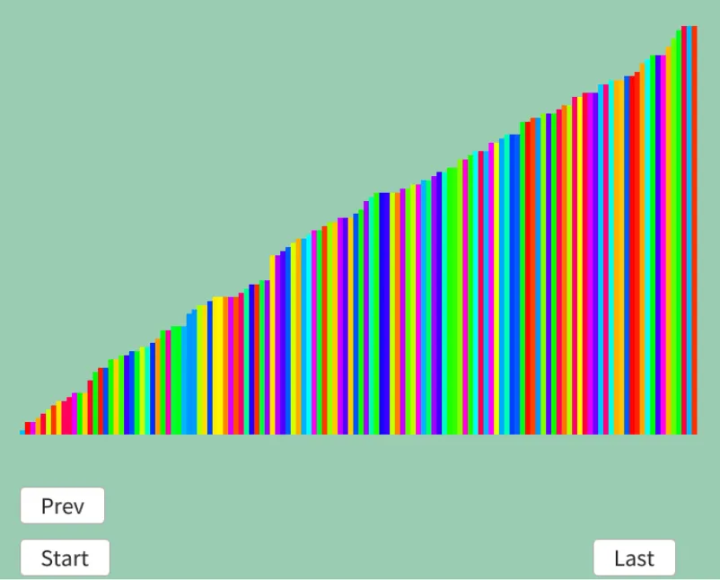

# 鳩の巣ソート  
鳩の巣ソート[^1]はデータの幅だけ箱を用意して、そこにデータを入れることでソートするアルゴリズム.  
鳩の巣原理[^2]みたいに全部を収められるだけのデータを用意して、そこに突っ込んでから小さい方から取り出せばいいよね.ってやつ.  
メモリには優しくない.  

今回も流れを見て理解しよう.  
```
初期値: 1 4 2 2 6 2 6 4 6 4 5 6 6

最小値:1 最大値:6なので、1から6の箱を用意
{1:} {2:} {3:} {4:} {5:} {6:}

データの挿入を行う
1 4 2 2 6 2 6 4 6 4 5 6 6
↑
{1:} {2:} {3:} {4:} {5:} {6:}

4 2 2 6 2 6 4 6 4 5 6 6
↑
{1:1} {2:} {3:} {4:} {5:} {6:}

2 2 6 2 6 4 6 4 5 6 6
↑
{1:1} {2:} {3:} {4:4} {5:} {6:}

2 6 2 6 4 6 4 5 6 6
↑
{1:1} {2:2} {3:} {4:4} {5:} {6:}

6 2 6 4 6 4 5 6 6
↑
{1:1} {2:2 2} {3:} {4:4} {5:} {6:}

2 6 4 6 4 5 6 6
↑
{1:1} {2:2 2} {3:} {4:4} {5:} {6:6}

6 4 6 4 5 6 6
↑
{1:1} {2:2 2 2} {3:} {4:4} {5:} {6:6}

4 6 4 5 6 6
↑
{1:1} {2:2 2 2} {3:} {4:4} {5:} {6:6 6}

6 4 5 6 6
↑
{1:1} {2:2 2 2} {3:} {4:4 4} {5:} {6:6 6}

4 5 6 6
↑
{1:1} {2:2 2 2} {3:} {4:4 4} {5:} {6:6 6 6}

5 6 6
↑
{1:1} {2:2 2 2} {3:} {4:4 4 4} {5:} {6:6 6 6}

6 6
↑
{1:1} {2:2 2 2} {3:} {4:4 4 4} {5:5} {6:6 6 6}

6
↑
{1:1} {2:2 2 2} {3:} {4:4 4 4} {5:5} {6:6 6 6 6}

終了
{1:1} {2:2 2 2} {3:} {4:4 4 4} {5:5} {6:6 6 6 6 6}

小さい方から取り出す
{1:} {2:2 2 2} {3:} {4:4 4 4} {5:5} {6:6 6 6 6 6}
1

{1:} {2:} {3:} {4:4 4 4} {5:5} {6:6 6 6 6 6}
1 2 2 2

{1:} {2:} {3:} {4:} {5:5} {6:6 6 6 6 6}
1 2 2 2 4 4 4

{1:} {2:} {3:} {4:} {5:} {6:6 6 6 6 6}
1 2 2 2 4 4 4 5

{1:} {2:} {3:} {4:} {5:} {6:}
1 2 2 2 4 4 4 5 6 6 6 6 6
ソート完了！
```

うん、まず最初に箱に詰める.  
あとは小さい方から取り出す.非常に単純明快だ！  

さて、実装に移ろう.  
最初は単純に最大・最小値を取ってくる.  
```c++
int minValue =
    (
        *std::min_element(dataList.begin(), dataList.end(),
            [](const Data& lhs, const Data& rhs) {return lhs.weight < rhs.weight; })
    ).weight;
int maxValue =
    (
        *std::max_element(dataList.begin(), dataList.end(),
            [](const Data& lhs, const Data& rhs) {return lhs.weight < rhs.weight; })
    ).weight;
```
その後、範囲分の箱を作成.  
```c++
int range = maxValue - minValue + 1;

// 巣を作る
Array<Array<int>> holes; holes.resize(range);
```
あとは同じ値のものにデータを突っ込む.  
```c++
for (const auto& value : dataList)
{
    // 最低値を0番目として巣に値を放り込む
    holes[value.weight - minValue].push_back(value.weight);
}
```
最後にデータを取り出せば完了!!  
```c++
int index = 0;
for (const auto& hole : holes)
{
    for (const auto& value : hole)
    {
        // 入ってる要素を順に取り出すだけ
        dataList[index++].weight = value;
        result.push_back(dataList);
    }
}
```

結果を見てみよう.  



うん、ちゃんとソートができていそうなのでヨシ！  

[^1]: [鳩の巣ソート](https://w.wiki/eH9G)  
[^2]: [鳩の巣原理](https://w.wiki/7sxd)