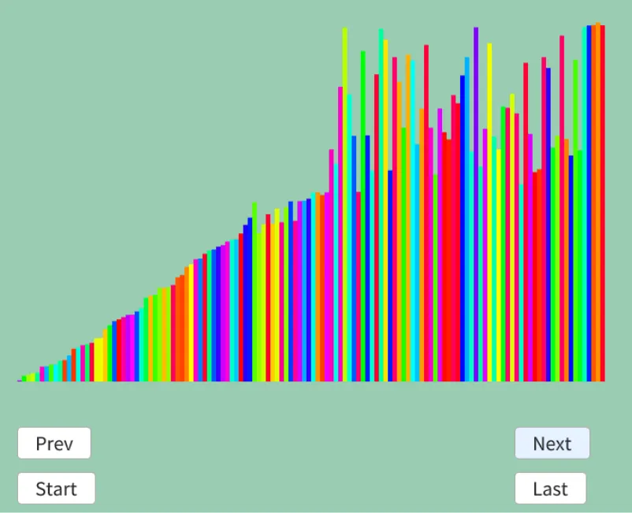

# クイックソート
クイックソート[^1]もマージソートみたいに分割をしていって統合するソート.  
基準となる数値をピボットとして選出し、それを基準に左右を入れ替える.  
というのを上から順に再帰することで上手く実行を行う寸法.  

実際の流れを見ていこう.  
```
初期状態: 
8 4 3 7 6 5 2 1
↑             ↑
l             r

1: 
pivot: (l+r)/2=(0+7)/2=3 ->arr[3]=7

8 4 3 7 6 5 2 1     pivot以上のlと以下のrを見つける
↑             ↑
l             r

1 4 3 7 6 5 2 8     swap
↑             ↑
l             r

1 4 3 7 6 5 2 8     pivot以上のlと以下のrを見つける
      ↑     ↑
      l     r

1 4 3 2 6 5 7 8     swap
      ↑     ↑
      l     r

1 4 3 2 6 5 7 8     pivot以上のlと以下のrを見つける
          ↑ ↑
          r l

lとrの大小が逆転してるので終わり

1-left:
l_start=0, l_end=6で、l_start < l_endが成り立つので,
l=l_start=0, r=l_end-1=5で開始

pivot: (l+r)/2=(0+5)/2=2 -> arr[2]=3

1 4 3 2 6 5 | 7 8     pivot以上のlと以下のrを見つける
  ↑   ↑
  l   r

1 2 3 4 6 5 | 7 8     swap
  ↑   ↑
  l   r

1 2 3 4 6 5 | 7 8     pivot以上のlと以下のrを見つける
    ↑
    lr

lとrが同じ位置を差してるので終わり
1 2 | 3 | 4 6 5 | 7 8 

1-left-left:
l_start=0, l_end=2で、l_start < l_endが成り立つので,
l=l_start=0, r=l_end-1=1で開始

pivot: (l+r)/2=(0+1)/2=0 -> arr[0]=1

1 2 | 3 | 4 6 5 | 7 8     pivot以上のlと以下のrを見つける
↑
lr

lとrが同じ位置を差してるので終わり
同じ位置なら確定  
1 | 2 | 3 | 4 6 5 | 7 8    1が確定！

1-left-left-left:
l_start=0, l_end=0で、l_start < l_endが成り立たないので終わり

1-left-left-right:
r_start=1, r_end=0で、r_end < r_startが成り立つので、
l=r_end+1=1, r=r_start=1で開始
(特に変更ないので略) 

1 | 2 | 3 | 4 6 5 | 7 8    2もarr[1]=2で同じ位置なので、ここで確定

1-left-right:
r-start=5, r_end=2で、r_end < r_startが成り立つので、
l=r_end+1=3. r=r_start=5で開始

pivot: (l+r)/2=(3+5)/2=4 -> arr[4]=6

1 | 2 | 3 | 4 6 5 | 7 8     pivot以上のlと以下のrを見つける
              ↑ ↑
              l r

1 | 2 | 3 | 4 5 6 | 7 8     swap
              ↑ ↑
              l r

1 | 2 | 3 | 4 5 6 | 7 8     pivot以上のlと以下のrを見つける
                ↑
                lr

lとrが同じ位置を差してるので終わり
同じ位置なら確定  
1 | 2 | 3 | 4 5 | 6 | 7 8 ここで6は確定

1-left-right-left:
l_start=3, l_end=5で、l_start < l_endが成り立たつので、
l=l_start=3, r=l_end-1=4で開始

pivot: (l+r)/2=(3+4)/2=3 -> arr[3]=4
1 | 2 | 3 | 4 5 | 6 | 7 8     pivot以上のlと以下のrを見つける
            ↑
            lr

lとrが同じ位置を差してるので終わり
同じ位置なら確定  
1 | 2 | 3 | 4 | 5 | 6 | 7 8 ここで4は確定

1-left-right-left-left:
l_start=3, l_end=3で、l_start < l_endが成り立たたないので再帰しない

1-left-right-left-right:
r_start=4, r_end=3で、r_end < r_startが成り立つので、
l=r_end+1=4, r=r_start=4で開始
(特に変更ないので略) 

1 | 2 | 3 | 4 | 5 | 6 | 7 8    5もarr[4]=5で同じ位置なので、ここで5も確定

1-left-right-right:
r_start=5,r_end=5で、r_end < r_startが成り立たたないので終わり

1-right:
r_start=7,r_end=5で、r_end < r_startが成り立たつので、
l=r_end+1=6, r=r_start=7で開始

pivot: (l+r)/2=(6+7)/2=6 -> arr[6]=7
1 | 2 | 3 | 4 | 5 | 6 | 7 8     pivot以上のlと以下のrを見つける
                        ↑
                        lr

lとrが同じ位置を差してるので終わり
同じ位置なら確定  
1 | 2 | 3 | 4 | 5 | 6 | 7 | 8 ここで7は確定(8はまだ)

1-right-left:
l_start=6, l_end=6で、l_start < l_endが成り立たたないので再帰しない

1-right-right:
r_start=7,r_end=6で、r_end < r_startが成り立たつので、
l=r_end+1=7, r=r_start=7で開始
(特に変更ないので略) 

1 | 2 | 3 | 4 | 5 | 6 | 7 | 8  8もarr[7]=8で同じ位置なので、ここで8も確定

完了！
```

長々と書いたけど、基本的にはswapさせていき、もし左右で同じindexを示した場合は
```
小さい | lrが示した位置 | 大きい
```
が満たされてるので、位置としては確定できる！  
というのを繰り返して分割しているだけである.  
ここの肝が一番大事かもしれない.  

さて、クイックソートを実際に組んでいこう.  
まずピボット位置を決めて、左右を初期位置にする.  
```c++
  auto quick = [&](auto quick, int left, int right) -> void
  {
    double pivot = dataList[(left+right)/2].weight;
    int l = left, r = right;
```
左右で左からなら大きい値を、右からなら小さい値を見つける.  
見つかったら整列させるが、配列位置が逆転してる場合は終了してしまう.  
```c++
    // pivotの左に小さい値、右に大きい値となるように整列
    while (true)
    {
      // pivotより小さければ右にずらしていく
      while (dataList[left].weight < pivot)
      {
        left++;
      }

      // pivotより大きければ左にずらしていく
      while (pivot < dataList[right].weight)
      {
        right--;
      }

      if (right <= left) { break; }

      std::swap(dataList[right], dataList[left]);
      result.push_back(dataList);
    }
```

最後に決まった左の位置を基準に更に再帰.  
これで完了！  
```c++
    // 元の位置に
    int p = left;
    left = l; right = r;

    if (left < p) { quick(quick, left, p - 1); }
    if (p < right) { quick(quick, p + 1, right); }
  };
```

結果を見てみよう.  

  

うん、左側に再帰の山が出来ている.  
再帰が左優先で潜っていくので、まあこうなるのは正しい動作ですね.  

[^1]: [クイックソート](https://w.wiki/3MeT)