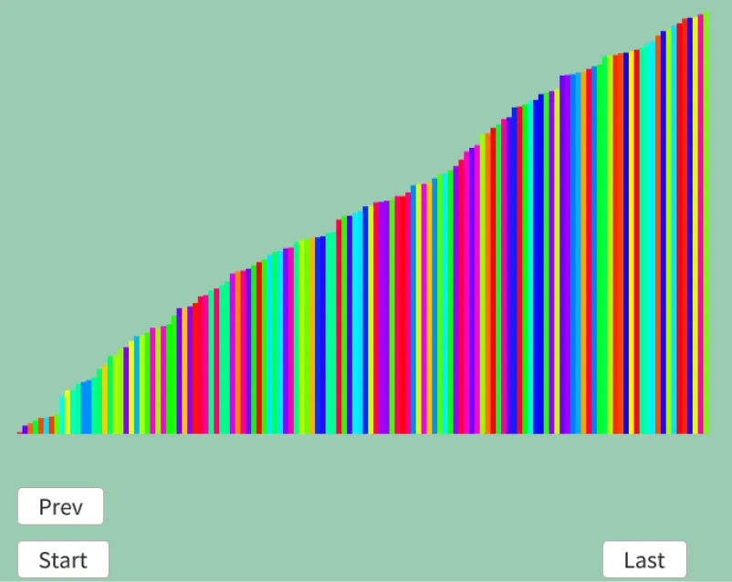

# 基数ソート
基数ソート[^1]は各桁の数字をソートをすることで、順にソートしていく.  
いつも通り流れを見ていこう.  

流れは単純で桁の数字に対して分布数え上げソートを行い、逆順に取り出すだけ.  
逆順に取り出すことでちゃんと整列された形になる.  
2桁目だけど数字は「3」といったように1桁のような場合、足りない部分は0で埋めてしまう.  
こうすることで絶対に先頭に行くことになるのが保証される.  
```
初期状態: 170 45 75 90 2 24 802 66

ソート自体は分布数え上げソートで行う
1桁目のソート:
まず入れる箱を作る
{0:} {1:} {2:} {3:} {4:} {5:} {6:} {7:} {8:} {9:}

170 045 075 090 002 024 802 066
  ↑
{0:1} {1:} {2:} {3:} {4:} {5:} {6:} {7:} {8:} {9:}
170 045 075 090 002 024 802 066
      ↑
{0:1} {1:} {2:} {3:} {4:} {5:1} {6:} {7:} {8:} {9:}
170 045 075 090 002 024 802 066
          ↑
{0:1} {1:} {2:} {3:} {4:} {5:2} {6:} {7:} {8:} {9:}
170 045 075 090 002 024 802 066
              ↑
{0:2} {1:} {2:} {3:} {4:} {5:2} {6:} {7:} {8:} {9:}
170 045 075 090 002 024 802 066
                  ↑
{0:2} {1:} {2:1} {3:} {4:} {5:2} {6:} {7:} {8:} {9:}
170 045 075 090 002 024 802 066
                      ↑
{0:2} {1:} {2:1} {3:} {4:1} {5:2} {6:} {7:} {8:} {9:}
170 045 075 090 002 024 802 066
                          ↑
{0:2} {1:} {2:2} {3:} {4:1} {5:2} {6:} {7:} {8:} {9:}
170 045 075 090 002 024 802 066
                              ↑
{0:2} {1:} {2:2} {3:} {4:1} {5:2} {6:1} {7:} {8:} {9:}

累積分布に変換
{0:2} {1:2} {2:4} {3:4} {4:5} {5:7} {6:8} {7:8} {8:8} {9:8}

逆順に並べていく(分布数え上げソートとは逆)
170 045 075 090 002 024 802 066
                              ↑
6なので、1下げた値を取得 : index=7
{0:2} {1:2} {2:4} {3:4} {4:5} {5:7} {6:7} {7:8} {8:8} {9:8}
sorted:{0,0,0,0,0,0,0,66}

170 045 075 090 002 024 802 066
                          ↑
2なので、1下げた値を取得 : index=3
{0:2} {1:2} {2:3} {3:4} {4:5} {5:7} {6:7} {7:8} {8:8} {9:8}
sorted:{0,0,0,802,0,0,0,66}

170 045 075 090 002 024 802 066
                      ↑
4なので、1下げた値を取得 : index=4
{0:2} {1:2} {2:3} {3:4} {4:4} {5:7} {6:7} {7:8} {8:8} {9:8}
sorted:{0,0,0,802,24,0,0,66}

170 045 075 090 002 024 802 066
                  ↑
2なので、1下げた値を取得 : index=2
{0:2} {1:2} {2:2} {3:4} {4:4} {5:7} {6:7} {7:8} {8:8} {9:8}
sorted:{0,0,2,802,24,0,0,66}

170 045 075 090 002 024 802 066
              ↑
0なので、1下げた値を取得 : index=1
{0:1} {1:2} {2:2} {3:4} {4:4} {5:7} {6:7} {7:8} {8:8} {9:8}
sorted:{0,90,2,802,24,0,0,66}

170 045 075 090 002 024 802 066
          ↑
5なので、1下げた値を取得 : index=6
{0:1} {1:2} {2:2} {3:4} {4:4} {5:6} {6:7} {7:8} {8:8} {9:8}
sorted:{0,90,2,802,24,0,75,66}

170 045 075 090 002 024 802 066
      ↑
5なので、1下げた値を取得 : index=5
{0:1} {1:2} {2:2} {3:4} {4:4} {5:5} {6:7} {7:8} {8:8} {9:8}
sorted:{0,90,2,802,24,45,75,66}

170 045 075 090 002 024 802 066
  ↑
0なので、1下げた値を取得 : index=0
{0:0} {1:2} {2:2} {3:4} {4:4} {5:5} {6:7} {7:8} {8:8} {9:8}
sorted:{170,90,2,802,24,45,75,66}

1桁目終了！

2桁目のソート:
まず入れる箱を作る
{0:} {1:} {2:} {3:} {4:} {5:} {6:} {7:} {8:} {9:}

170 090 002 802 024 045 075 066
 ↑
{0:} {1:} {2:} {3:} {4:} {5:} {6:} {7:1} {8:} {9:}
170 090 002 802 024 045 075 066
     ↑
{0:} {1:} {2:} {3:} {4:} {5:} {6:} {7:1} {8:} {9:1}
170 090 002 802 024 045 075 066
         ↑
{0:1} {1:} {2:} {3:} {4:} {5:} {6:} {7:1} {8:} {9:1}
170 090 002 802 024 045 075 066
             ↑
{0:2} {1:} {2:} {3:} {4:} {5:} {6:} {7:1} {8:} {9:1}
170 090 002 802 024 045 075 066
                 ↑
{0:2} {1:} {2:1} {3:} {4:} {5:} {6:} {7:1} {8:} {9:1}
170 090 002 802 024 045 075 066
                     ↑
{0:2} {1:} {2:1} {3:} {4:1} {5:} {6:} {7:1} {8:} {9:1}
170 090 002 802 024 045 075 066
                         ↑
{0:2} {1:} {2:1} {3:} {4:1} {5:} {6:} {7:2} {8:} {9:1}
170 090 002 802 024 045 075 066
                             ↑
{0:2} {1:} {2:1} {3:} {4:1} {5:} {6:1} {7:2} {8:} {9:1}

累積分布に変換
{0:2} {1:2} {2:3} {3:3} {4:4} {5:4} {6:5} {7:7} {8:7} {9:8}

逆順に並べていく(分布数え上げソートとは逆)
170 090 002 802 024 045 075 066
                             ↑
6なので、1下げた値を取得 : index=4
{0:2} {1:2} {2:3} {3:3} {4:4} {5:4} {6:4} {7:7} {8:7} {9:8}
sorted:{0,0,0,0,66,0,0,0}

170 090 002 802 024 045 075 066
                         ↑
7なので、1下げた値を取得 : index=6
{0:2} {1:2} {2:3} {3:3} {4:4} {5:4} {6:4} {7:6} {8:7} {9:8}
sorted:{0,0,0,0,66,0,75,0}

170 090 002 802 024 045 075 066
                     ↑
4なので、1下げた値を取得 : index=3
{0:2} {1:2} {2:3} {3:3} {4:3} {5:4} {6:4} {7:6} {8:7} {9:8}
sorted:{0,0,0,45,66,0,75,0}

170 090 002 802 024 045 075 066
                 ↑
2なので、1下げた値を取得 : index=2
{0:2} {1:2} {2:2} {3:3} {4:3} {5:4} {6:4} {7:6} {8:7} {9:8}
sorted:{0,0,24,45,66,0,75,0}

170 090 002 802 024 045 075 066
             ↑
0なので、1下げた値を取得 : index=1
{0:1} {1:2} {2:2} {3:3} {4:3} {5:4} {6:4} {7:6} {8:7} {9:8}
sorted:{0,802,24,45,66,0,75,0}

170 090 002 802 024 045 075 066
         ↑
0なので、1下げた値を取得 : index=0
{0:0} {1:2} {2:2} {3:3} {4:3} {5:4} {6:4} {7:6} {8:7} {9:8}
sorted:{2,802,24,45,66,0,75,0}

170 090 002 802 024 045 075 066
     ↑
9なので、1下げた値を取得 : index=7
{0:0} {1:2} {2:2} {3:3} {4:3} {5:4} {6:4} {7:6} {8:7} {9:7}
sorted:{2,802,24,45,66,0,75,90}

170 090 002 802 024 045 075 066
 ↑
7なので、1下げた値を取得 : index=5
{0:0} {1:2} {2:2} {3:3} {4:3} {5:4} {6:4} {7:5} {8:7} {9:7}
sorted:{2,802,24,45,66,170,75,90}

2桁目終了！

3桁目のソート:
まず入れる箱を作る
{0:} {1:} {2:} {3:} {4:} {5:} {6:} {7:} {8:} {9:}

002 802 024 045 066 170 075 090
↑
{0:1} {1:} {2:} {3:} {4:} {5:} {6:} {7:} {8:} {9:}
002 802 024 045 066 170 075 090
    ↑
{0:1} {1:} {2:} {3:} {4:} {5:} {6:} {7:} {8:1} {9:}
002 802 024 045 066 170 075 090
        ↑
{0:2} {1:} {2:} {3:} {4:} {5:} {6:} {7:} {8:1} {9:}
002 802 024 045 066 170 075 090
            ↑
{0:3} {1:} {2:} {3:} {4:} {5:} {6:} {7:} {8:1} {9:}
002 802 024 045 066 170 075 090
                ↑
{0:4} {1:} {2:} {3:} {4:} {5:} {6:} {7:} {8:1} {9:}
002 802 024 045 066 170 075 090
                    ↑
{0:4} {1:1} {2:} {3:} {4:} {5:} {6:} {7:} {8:1} {9:}
002 802 024 045 066 170 075 090
                        ↑
{0:5} {1:1} {2:} {3:} {4:} {5:} {6:} {7:} {8:1} {9:}
002 802 024 045 066 170 075 090
                            ↑
{0:6} {1:1} {2:} {3:} {4:} {5:} {6:} {7:} {8:1} {9:}

累積分布に変換
{0:6} {1:7} {2:7} {3:7} {4:7} {5:7} {6:7} {7:7} {8:8} {9:8}

逆順に並べていく(分布数え上げソートとは逆)
002 802 024 045 066 170 075 090
                            ↑
0なので、1下げた値を取得 : index=5
{0:5} {1:7} {2:7} {3:7} {4:7} {5:7} {6:7} {7:7} {8:8} {9:8}
sorted:{0,0,0,0,0,90,0,0}

002 802 024 045 066 170 075 090
                        ↑
0なので、1下げた値を取得 : index=4
{0:4} {1:7} {2:7} {3:7} {4:7} {5:7} {6:7} {7:7} {8:8} {9:8}
sorted:{0,0,0,0,75,90,0,0}

002 802 024 045 066 170 075 090
                    ↑
1なので、1下げた値を取得 : index=6
{0:4} {1:6} {2:7} {3:7} {4:7} {5:7} {6:7} {7:7} {8:8} {9:8}
sorted:{0,0,0,0,75,90,170,0}

002 802 024 045 066 170 075 090
                ↑
0なので、1下げた値を取得 : index=3
{0:3} {1:6} {2:7} {3:7} {4:7} {5:7} {6:7} {7:7} {8:8} {9:8}
sorted:{0,0,0,66,75,90,170,0}

002 802 024 045 066 170 075 090
            ↑
0なので、1下げた値を取得 : index=2
{0:2} {1:6} {2:7} {3:7} {4:7} {5:7} {6:7} {7:7} {8:8} {9:8}
sorted:{0,0,45,66,75,90,170,0}

002 802 024 045 066 170 075 090
        ↑
0なので、1下げた値を取得 : index=1
{0:1} {1:6} {2:7} {3:7} {4:7} {5:7} {6:7} {7:7} {8:8} {9:8}
sorted:{0,24,45,66,75,90,170,0}

002 802 024 045 066 170 075 090
    ↑
8なので、1下げた値を取得 : index=7
{0:1} {1:6} {2:7} {3:7} {4:7} {5:7} {6:7} {7:7} {8:7} {9:8}
sorted:{0,24,45,66,75,90,170,802}

002 802 024 045 066 170 075 090
↑
0なので、1下げた値を取得 : index=0
{0:0} {1:6} {2:7} {3:7} {4:7} {5:7} {6:7} {7:7} {8:7} {9:8}
sorted:{2,24,45,66,75,90,170,802}

3桁目終了！

ソート完了！
{2,24,45,66,75,90,170,802}
```
うん、長いけどやってるのは各桁でのソート.  
既に小さい値はソートされてるので、大きい値の時に左に寄せられていく.  
最後の3桁目の処理なんかは顕著で、既にソートされてる`24,45,66,75,90`がいい感じに左に寄せられている.  
そして、該当桁の`170,802`は2桁目までは`70, 02`で逆順になっているが、3桁目で大小がちゃんと決まるようになってる.  
うまく桁の性質をとらえたソートだね.  

それでは実装に移ってみよう.  
まず最大値を取っておく、これで最大の桁数を求めるのに使える.  
```c++
auto Sort = [&]()
{
    int maxValue =
        (
            *std::max_element(dataList.begin(), dataList.end(),
                [](const Data& lhs, const Data& rhs) {return lhs.weight < rhs.weight; })
        ).weight;
```
実際にソートは以下のように$`10^{exp}`$のように割って必要数分回す.  
```c++
    // 各桁に対してソートを実行
    for (int exp = 1; maxValue / exp > 0; exp *= 10)
    {
        countSort(exp);
    }
```
各桁のソートは簡単、10で割った値を$`[0,10]`$のバケツの中に突っ込む.  
$`exp`$で補正をしてるので、確実に桁は同じものとなり、桁として存在しない場合は0となる.  
```c++
    auto countSort = [&](int exp)
    {
        Array<int> count{}; count.resize(10, 0);
        Array<Data> sorted{dataList.size()};

        // ある桁の数字を数える
        for (const auto& data : dataList)
        {
            count[(data.weight / exp) % 10]++;
        }
```
ここまでできれば後は分布数え上げソートと同じ要領で処理を行えばOK.  
```c++
        // 桁の数からindex位置へ変換
        for (int i = 1; i < count.size(); i++)
        {
            count[i] += count[i-1];
        }

        // index位置に値を入れていく
        for (const auto& data : dataList.reverse())
        {
            auto digit = (data.weight / exp) % 10;
            sorted[count[digit] - 1] = data;
            count[digit]--; // indexをずらしておく
        }

        std::swap(sorted, dataList);
        result.push_back(dataList);
    };
```

さて、結果を見てみよう.  



結構簡単に実装できるRadix Sort君.  
これはGPUとかでもよく使うソート手法なので、今度機会があればGPUでの実装を試したいところ.  

[^1]: [基数ソート](https://w.wiki/fNmX)  