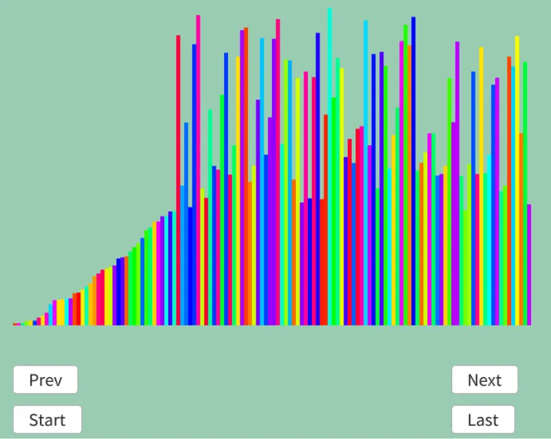

# 選択ソート  
選択ソート[^1]は単純に全配列を確認して、一番小さいものを見つける.  
それを先頭から並べるだけ.  
今回も動きを見るのが速い.  
```
決定|探索中
| 8 4 3 7 6 5 2 1 初期

1回目
| 8 4 3 7 6 5 2 1 最小を確定
               ↑
1 | 4 3 7 6 5 2 8 探索側の先頭とswap

2回目
1 | 4 3 7 6 5 2 8 最小を確定
              ↑
1 2 | 3 7 6 5 4 8 探索側の先頭とswap

3回目
1 2 | 3 7 6 5 4 8 最小を確定
      ↑
1 2 3 | 7 6 5 4 8 探索側の先頭とswap(つまり自分自身を入れ替えただけ)

4回目
1 2 3 | 7 6 5 4 8 最小を確定
              ↑
1 2 3 4 | 6 5 7 8 探索側の先頭とswap

5回目
1 2 3 4 | 6 5 7 8 最小を確定
            ↑
1 2 3 4 5 | 6 7 8 探索側の先頭とswap

6回目
1 2 3 4 5 | 6 7 8 最小を確定
            ↑
1 2 3 4 5 6 | 7 8 探索側の先頭とswap

7回目
1 2 3 4 5 6 | 7 8 最小を確定
              ↑
1 2 3 4 5 6 7 | 8 探索側の先頭とswap

探索側は1つになるときは確定してるのが分かるのでこれで終わり.  
1 2 3 4 5 6 7 8
```
後はこれをコードに落とし込むだけ.  
最小のIndexを設定して、最小を探す.  
最後にswapして終了.  
```c++
	auto Sort = [&]()
	{
		for (int i = 0; i < dataList.size(); i++)
		{
			int minIndex = i;

			for (int j = i + 1; j < dataList.size(); j++)
			{
				if (dataList[j].weight < dataList[minIndex].weight)
				{
					minIndex = j;
				}
			}

			std::swap(dataList[i].weight, dataList[minIndex].weight);
			result.push_back(dataList);
		}
	};
```

今回も実行したものの中間あたりを見てみよう.  



うん、前から順に決定しているのが分かる！  

[^1]: [選択ソート](https://w.wiki/4oJK)  