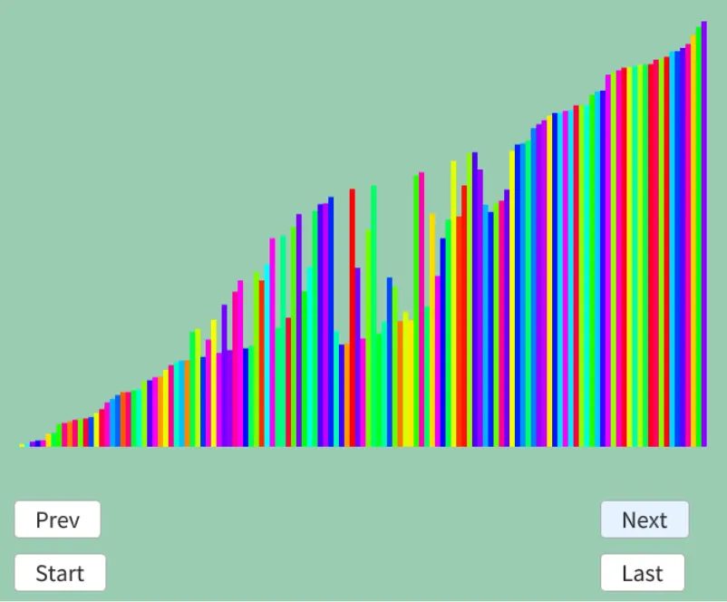

# シェーカーソート  
バブルソートをちょっと変えたのがシェーカーソート[^1].  
バブルソートでは固定位置が最大のものだった.  
これをシェーカーソートでは大→小→大→小...といった感じで狭めていく.  
つまり、次のような感じだ.  

```
固定位置|ソート対象|固定位置
| 8 4 3 7 6 5 2 1 |
↓
| 4 3 7 6 5 2 1 | 8 大方向にソート
↓
1 | 4 3 7 6 5 2 | 8 小方向にソート
↓
1 | 3 4 6 5 2 | 7 8 大方向にソート
↓
1 2 | 3 4 6 5 | 7 8 小方向にソート
↓
1 2 | 3 4 5 | 6 7 8 大方向にソート,がSwapは起きない...
↓
1 2 3 4 5 6 7 8 完了！
```
こんな風に大を決めた後に小を決める.  
小を決めた後に大を決めるという処理をおこなうだけ.  

実装は簡単で、まず右端と左端のIndexを持っておく.  
```c++
	auto Sort = [&]()
	{
		int top = 0, bottom = dataList.size() - 1;
```
その後、大の方向にソートをする.  
これはバブルソートと同じだ.  
このとき、Swapが起きた最後のIndexを保持しておく.  
```c++
		while (true)
		{
			int last = -1;

			// 順方向
			last = top;

			for (int i = top; i < bottom; i++)
			{
				if (dataList[i+1].weight < dataList[i].weight)
				{
					std::swap(dataList[i].weight, dataList[i+1].weight);
					last = i;
				}
			}
```

そして、次のループ時のために右端の`bottom`を縮めておく.
縮める際はSwapが起きてない位置に対して行う.  
Swapが起きない=既にソートされているなのでスキップしても問題ない.  
最後に右端と左端が同じなら、ソート完了なので終わり.  
```C++
			// 後方スキャンを狭める
			bottom = last;
			result.push_back(dataList);

			if (top == bottom) { break; }
```

小さい方向へのソートもやることとしては同じ.  
```c++
			// 逆方向
			last = bottom;
			for (int i = bottom; top < i; i--)
			{
				if (dataList[i].weight < dataList[i - 1].weight)
				{
					std::swap(dataList[i].weight, dataList[i-1].weight);
					last = i;
				}
			}

			// 前方スキャンを狭める
			top = last;
			result.push_back(dataList);

			if (top == bottom) { break; }
		}
```
これで実装は完了.バブルソートと同じで中間の結果を見てみよう.  



バブルソートと違って前方後方にソートされた形跡が残っている！  
これがシェーカーソートというわけだね.  

[^1]: [シェーカーソート](https://w.wiki/8EKs)  