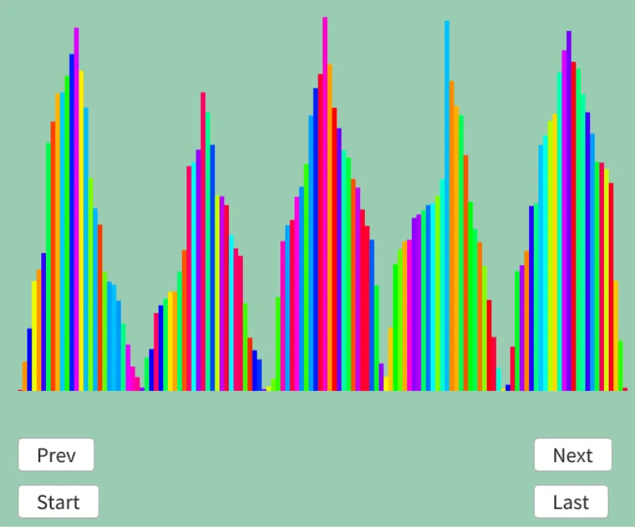

# シェアソート  
シェアソート[^1]はデータを四角形に並べて、各行ソートと上下ソートを駆使して並べていくソート.  
共有の「Share」ではなく、せん断の「Shear」であるところは間違えないように.  
自分も最初はShareかと思ってました(1敗).  
各行・列毎に処理を分割できるため、並列処理に向いてるソートともいえる.  
数の暴力で解決が可能なわけだ.  

手順としてはこうだ.  

1. 奇数行目は小さい順、偶数行目は大きい順に並べる.  
2. その後、全列で上は小さいもの下は大きいものとなるように並べる.  

最初の1で凸凹にすることで2の処理ででかい数字は下に、小さい数字は上に行くようになるという寸法.  
これを繰り返してある程度データが上下に揃ったら、後はソートして小さい順に並べれば終わり.  
一見変な処理に見えるけど、ブロックに分けたことで並列に処理できるのがやっぱり大きい気がする.  

さて、では繰り返し回数はどれくらい必要か？となるわけだけど、この回数は$`\lceil \log_{2} \sqrt{X} \rceil`$回らしい.  
では実際にやってみよう.  
```
初期データ
25	9	5	19	20	6	29
8	24	32	14	34	10	28
26	3	18	2	22	21	11
17	27	15	23	13	35	30
16	33	4	31	7	1	12

n = 35 つまり Sqrt(n) = 5.916

ceil(log2(5.916)) = ceil(2.57) = 3
なので、3週すればよい！

1週目
奇数行目は小さい順、偶数行目は大きい順で並べる
5	6	9	19	20	25	29 ←小さい順
34	32	28	24	14	10	 8 ←大きい順
2	3	11	18	21	22	26 ←小さい順
35	30	27	23	17	15	13 ←大きい順
1	4	7	12	16	31	33 ←小さい順

縦方向に上が小さくなるようにソート！
1	3	7	12	14	10	 8 小
2	4	9	18	16	15	13 ↑
5	6	11	19	17	22	26
34	30	27	23	20	25	29 ⇃
35	32	28	24	21	31	33 大

1週目終了!

2週目
奇数行目は小さい順、偶数行目は大きい順で並べる
1	3	7	8	10	12	14 ←小さい順
18	16	15	13	9	4	2  ←大きい順
5	6	11	17	19	22	26 ←小さい順
34	30	29	27	25	23	20 ←大きい順
21	24	28	31	32	33	35 ←小さい順

縦方向に上が小さくなるようにソート！
1	3	7	8	9	4	2  小
5	6	11	13	10	12	14 ↑
18	16	15	17	19	22	20 
21	24	28	27	25	23	26 ↓
34	30	29	31	32	33	35 大

2週目終了!

3週目
奇数行目は小さい順、偶数行目は大きい順で並べる
1	2	3	4	7	8	9  ←小さい順
14	13	12	11	10	6	5  ←大きい順
15	16	17	18	19	20	22 ←小さい順
28	27	26	25	24	23	21 ←大きい順
29	30	31	32	33	34	35 ←小さい順

縦方向に上が小さくなるようにソート！
1	2	3	4	7	6	5  小
14	13	12	11	10	8	9  ↑
15	16	17	18	19	20	21 
28	27	26	25	24	23	22 ↓
29	30	31	32	33	34	35 大

3週目終了!これで周回は終わり！

最後に全行で左が小さくなるようにソート！
1	2	3	4	5	6	7 
8	9	10	11	12	13	14 
15	16	17	18	19	20	21 
22	23	24	25	26	27	28
29	30	31	32	33	34	35
小←                  　 →大

完成！
```
実際に処理を見ると分かりやすいね.  

さて、そしたら実際にコードを組んでみよう.  
まずはそれっぽい四角形順になるように調整を行う.  
四角形を作ってると思えばよい.  

```c++
// 配列の長さ
const int length = dataList.size();

int row = Sqrt(length);
int col = length / row;

// 行数*列数で並べた時に余る個数
int remainder = length - row * col;
if (remainder != 0) {
    // 余りがあり行数が3以上の奇数の場合、余りが偶数行目に並ぶので
    // 一行減らして余りが奇数行目に並ぶように行数/列数を変更する
    if (IsOdd(row) && row >= 3) {
        row--;
        col = length / row;
        remainder = length - row * col;
    }
}
```
そしたら繰り返し回数を計算.  
```c++
int iteration = Ceil(Log2(Sqrt(col * row)) + 1);
```

今回の各行と各列のソートは以下のように用意した.  
今回の本質ではないので中身は省略するが、奇遇転置ソートを適用範囲に対して行ってるだけである.  

```c++
// 各部分でのソート
auto oeTranSort = [&](int start, int end, int step, bool isInc) {
    // odd-evenソートで対応
    bool changed;
    do {
        changed = false;
        for (int i = start; i + step <= end; i += step * 2)
        {
            // 降順昇順を考慮しつつswap
            if ((isInc && (dataList[i].weight > dataList[i + step].weight))
                || (!isInc && (dataList[i].weight < dataList[i + step].weight)))
            {
                std::swap(dataList[i], dataList[i + step]);
                changed = true;
            }
        }

        for (int i = start + step; i + step <= end; i += step * 2)
        {
            // 降順昇順を考慮しつつswap
            if ((isInc && (dataList[i].weight > dataList[i + step].weight))
                || (!isInc && (dataList[i].weight < dataList[i + step].weight)))
            {
                std::swap(dataList[i], dataList[i + step]);
                changed = true;
            }
        }
    } while (changed);

    result.push_back(dataList);
};
```

さて、ここからが本番の部分.  
各行をまずソートする.  
この際、奇数偶数をみてソートの昇順降順を変える.  
また、ブロック状にしてはいるが、どうしても余りが存在する場合があるため、そこは調整する.  
```c++
// ソートする範囲の上限
int max;
for (int i = 0; i < iteration; i++) {
    // 行ごとに、奇数行目は左側が小さく、
    // 偶数行目は右側が小さくなるようにソートする
    for (int j = 0; j < row + (remainder > 0 ? 1 : 0); j++)
    {
        max = (j + 1) * col - 1; // 末尾

        if (max >= length)
        {
            // あまりの行は最終位置
            max = length - 1;
        }

        // 奇数偶数で昇順降順変えつつソート
        oeTranSort(j * col, max, 1, IsEven(j));
    }
```
そして、次に列毎にソートをすればOK.  
```c++
    // 列ごとに、上が小さくなるようにソートする
    for (int k = 0; k < col; k++)
    {
        // 余りのある列は、最初に求めた行数よりもデータが一つ多い
        oeTranSort(k, (row - (k < remainder ? 0 : 1)) * col + k,
                col, true);
    }
}
```
これを指定iteration分繰り返せばOK!!  
後は最後にデータを整列させるのを忘れずに.  
```c++
for (int j = 0; j < row + (remainder > 0 ? 1 : 0); j++) {
    max = (j + 1) * col - 1;
    if (max >= length) {
        max = length - 1;
    }

    // ここからは普通に行だけなので、単純にソートするだけ
    oeTranSort(j * col, max, 1, true);
}
```

これで出来たので結果を見てみよう.  

  

今回は形的に分かりやすい行のソートが終わったところを抽出してみた.  
山と谷が出来ているので、逆転したソートになってるのが分かって面白いね.  

[^1]: [シェアソート](https://w.wiki/5CPx)  