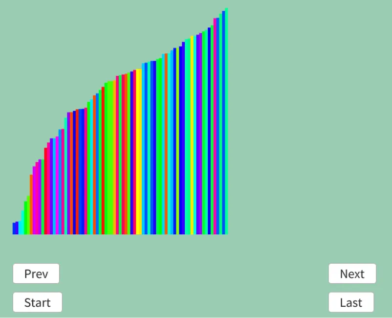

# ストランドソート  
ストランドソート[^1]はソートした配列を作って少しずつマージしていくようなソート.  
流れとしては非常に簡単なので見ていこう.  

```
初期状態: 10 5 30 40 30 2 4 9
sorted: {} temp: {}

1回目: 
5 30 40 30 2 4 9 temp: {10} 初期位置をそのままうつす

5 30 40 30 2 4 9 temp: {10} 5は10より小さいので何もしないで次へ
↑

5 30 40 30 2 4 9 temp: {10} 30は10より大きいので取り出し
  ↑

5 40 30 2 4 9 temp: {10 30} 40は30より大きいので取り出し
  ↑

5 30 2 4 9 temp: {10 30 40} 30は40より小さいので何もしないで次へ
  ↑  

5 30 2 4 9 temp: {10 30 40} 2は40より小さいので何もしないで次へ
     ↑

5 30 2 4 9 temp: {10 30 40} 4は40より小さいので何もしないで次へ
       ↑

5 30 2 4 9 temp: {10 30 40} 9は40より小さいので何もしないで次へ
         ↑

最後尾まで来たので終了

sorted: {} temp: {10 30 40}
-> sorted{10 30 40} temp{}  小さい順に取り出して移す

2回目:
30 2 4 9 temp: {5} 初期位置をそのままうつす

30 2 4 9 temp: {5} 30は5より大きいので取り出し
↑

2 4 9 temp: {5 30} 2は30より小さいので何もしないで次へ
↑

2 4 9 temp: {5 30} 4は30より小さいので何もしないで次へ
  ↑

2 4 9 temp: {5 30} 9は30より小さいので何もしないで次へ
    ↑

最後尾まで来たので終了

sorted: {10 30 40} temp: {5 30}
-> sorted{5 10 30 30 40} temp{}  小さい順に取り出して移す

3回目:
4 9 temp: {2} 初期位置をそのままうつす

4 9 temp: {2} 4は2より大きいので取り出し
↑

9 temp: {2 4} 9は4より大きいので取り出し
↑

temp:{2 4 9} 
何もなくなったので終了

sorted: {5 10 30 30 40} temp: {2 4 9}
-> sorted{2 4 5 9 10 30 30 40} temp{}  小さい順に取り出して移す

完了！
```
あとはこの流れをコードに移すだけだ.  
まずは終了条件.  
空になってる場合のみが終わりの合図.  
```c++
Array<Data> sorted;
while (true)
{
    if (dataList.size() == 0) { break; }
```
そしたら次にデータを移す.  
先頭から順に見て、基準より大きい場合はデータを移動.  
基準より小さい場合は次へすすむというのを最後尾に行くまでやる.  
```c++
    // まずサブツリーに分けていく
    Array<Data> subTree; subTree.push_back(dataList[0]);
    dataList = dataList.removed_at(0);

    int index = 0;
    while (true)
    {
        if (index == dataList.size()) { break; }

        if (subTree.back().weight <= dataList[index].weight)
        {
            // 基準より大きいなら追加
            subTree.push_back(dataList[index]);
            dataList = dataList.removed_at(index);
        }
        else
        {
            index++;
        }
    }
```
あとは二つの配列を先頭から走査して、小さい順に取り出して並べるだけ.  
```c++
    // 最小のものを選択していくだけ
    Array<Data> temp;
    auto treeIterator = subTree.begin();
    auto targetIterator = sorted.begin();
    while (true)
    {
        bool isTreeFinished = treeIterator == subTree.end();
        bool isTargetFinished = targetIterator == sorted.end();

        if (isTreeFinished && isTargetFinished) { break; }

        if (!isTreeFinished && isTargetFinished)
        {
            temp.push_back(*treeIterator); treeIterator++; continue;

        }
        if (isTreeFinished && !isTargetFinished)
        {
            temp.push_back(*targetIterator); targetIterator++; continue;
        }

        auto& iter = (*treeIterator).weight < (*targetIterator).weight ?
            treeIterator : targetIterator;
        temp.push_back(*iter); iter++;
    }
    sorted = temp;

    // 結果を積み込んでおく
    result.push_back(sorted);
}
```

結果は以下のようになる.  

 

うん、ちゃんとソートできていそう！  
どうしても大きいものが出てきた場合はそっち優先になるので、小さい方は中盤の数字は途中段階だと少なめ.  
まあこれは仕方ないところがあるね.  

[^1]: [Strand sort](https://w.wiki/b3qB)