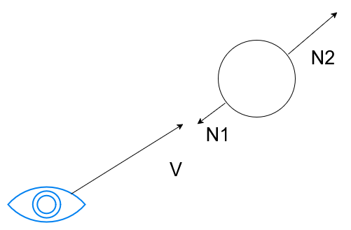
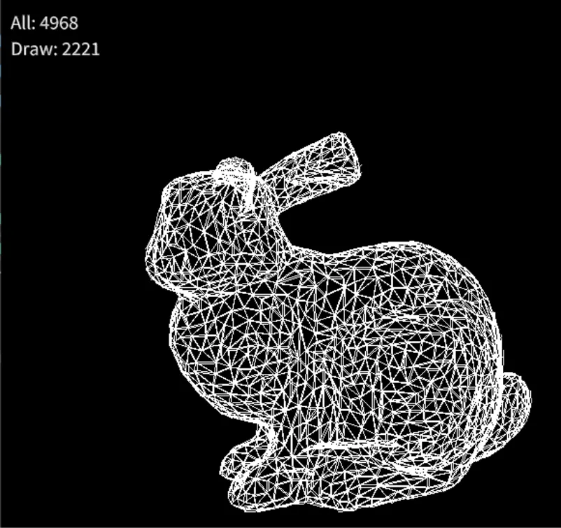

# 法線ベクトルによるBack Face Culling  

三角形を描画する際、見えていない部分に関しては処理を行わないようにしたい.  
裏面っていうのは見えないので、そのまま処理をしてしまうと無駄な負荷につながるからだね.  
これは法線と視線方向を考えると非常に簡単に求まる.  

  

こんな感じで法線を考えてみると、$`V`$から見えるのは$`N_{1}`$で、逆に見えないのは$`N_{2}`$となる.  
これを考えるとシンプルに内積を使って、法線と視線ベクトルがどれくらい同じ方向を向いてるかを見ればよい.  
今回で言えば$`N_{2}`$と$`V`$はほぼ同じ方向なんだけど、これが不可視となる訳である.  
逆に$`N_{1}`$と$`V`$は逆方向で可視.  
同じ方向っていうのは内積で言うとプラス、よってプラス方向の時のみCullingするように判定すればよい.  

```math
\begin{equation}
    \begin{split}
    V \dot N > 0 \quad (invisible)
    \end{split}
\end{equation}
```
これを計算すればいいわけだ.  

コードで見てみよう.  
今回のコードは座標変換の記事[^1]を基にしてるので、こちらを見ておくと良いかもしれない.  
まず頂点としてはワールド座標を用意.  
```c++
	for (auto& v : vertices)
	{
		auto tempV = DirectX::XMVector4Transform(DirectX::XMVectorSet(v.x, v.y, v.z, v.w), worldMatrix);
		worldPositions.push_back(Vec4{ tempV.m128_f32[0], tempV.m128_f32[1],tempV.m128_f32[2],tempV.m128_f32[3] });

        // ...
    }
```

ワールド位置から三点を取って、法線を用意.  
ポリゴンの場合は外積を取れば法線が作れる.  
```c++
		const Vec4& p1 = worldPositions[polygon.elem(0)];
		const Vec4& p2 = worldPositions[polygon.elem(1)];
		const Vec4& p3 = worldPositions[polygon.elem(2)];

		Vec3 meshNormal =
			Cross((p2 - p1).normalize().xyz(), (p3 - p1).normalize().xyz());
```

視線方向はカメラの原点とポリゴンの平均位置を使って形成.  
ここ以前に作った動画ではカメラのtargetを使ってましたが、あれ違いますね...  
間違ってたことをここでお詫びしておきます.  
```C++
		Vec4 point = (p1 + p2 + p3) / 3.0;
		Vec3 cameraRay = (point.xyz() - origin).normalize();
```

あとは内積を取って、正なら不可視なので処理を行わないで次のループへ.  
つまりカリングするってことになる.  
```c++
		if (Dot(meshNormal, cameraRay) > 0.0)
		{
			continue;
		}
```

結果を見てみよう.  
  

うん、いい感じだにバックフェースカリングができてる.  
全部のポリゴン数が4968だけど、描画したのは2221.  
つまり半分以上は消えてることになる.  
こう見ると結構馬鹿にならないね、ということで今回はここまで.  

[^1]: [3D座標変換](Trans.md)  