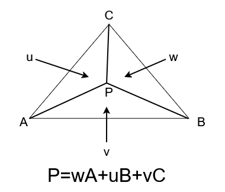
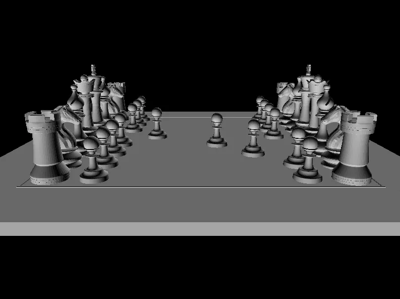

# デプスバッファ法  
前回のZ-Sort法[^1]ではポリゴン毎の深度だったから,どうしても重なりで解決できない部分があった.  
次に検討するのはデプスバッファ法.  
これは非常に簡単で描画毎にピクセル単位で深度を比較しつつ記録しようよ～というだけである.  

実装を見た方が実装を見ていこう.  
デプスバッファは単純だ.  
widthとheight分のデータを用意してあげて、最小値で初期化してあげればよい.  
Z軸はカメラ視点から見たら小さいほど遠いので、初期値は無限大に遠い場所にあるイメージである.  
保存するのはdepthなので`double`だけでOK.軽くしたければ`float`でもよいね.  
```c++
	class DepthBuffer
	{
	public:
		DepthBuffer(int width, int height)
		{
			m_data.resize(height);
			for (auto& data : m_data) { data.resize(width, std::numeric_limits<double>::lowest()); }
		}

	public:
		Array<Array<double>> m_data;
	};
```

さて、ここまで来たらちょっと面倒なのが次.  
前回のZ-Sort法はあくまで基準となるポリゴンの1点が分かればよかった.  
今回はピクセル単位に比較をする必要があるため、これでは問題がある...  
そのため三角形内を上手く補間する必要がある.  

ここで重心座標を考える.  
次のように頂点$`A,B,C`$を考えて、面積$`u,v,w`$を考える.  

  

全体の面積は外積自体が平行四辺形を表すという性質を使うと、この三角形は平行四辺形の半分である.  
そのため、全体の面積は以下のようになる.  

```math
\triangle ABC = \frac{\| AB \times AC\|}{2}
```

この全体の面積比と比べて比重を考えていく.  
まず最初に$`w`$から考えよう.  
このwの面積は先ほどと同じ外積を使って,  

```math
\triangle BCP = \frac{\|BC \times PB \|}{2}
```

これを使って比を考えると,  

```math
w = \frac{\triangle BCP}{\triangle ABC}=\frac{\|BC \times PB \|}{\| AB \times AC\|}
```

と計算可能.  
これを$`u,v,w`$で行えばよい！  

ではなぜこれでOKなのかというと、

```math
\begin{split}
& u = \frac{\triangle ACP}{\triangle ABC} \\
& v = \frac{\triangle ABP}{\triangle ABC}
\end{split}
```
となる.  
ここで面積を考えると,  

```math
\triangle ABC = \triangle BCP + \triangle ACP + \triangle ABP
```
なので、これを使うと,  

```math
u + v + w = \frac{\triangle BCP + \triangle ACP + \triangle ABP}{\triangle ABC}=1
```

という風に上手く1になるように正規化されるようになっているため、3点の比で$`P`$を求めることができるという訳だ.  

ここまで分かれば後は計算式通りにやれば終わり.  
```c++
// 重心の計算
const double polyArea = Cross(v2.xy() - v1.xy(), v3.xy() - v1.xy());
if (polyArea == 0.0) { continue; } // ゼロ除算対策
const double u = Abs(Cross(v2.xy() - v1.xy(), p - v1.xy()) / polyArea); // v3用
const double v = Abs(Cross(v3.xy() - v1.xy(), p - v1.xy()) / polyArea); // v2用
const double w = Abs(Cross(v3.xy() - v2.xy(), p - v2.xy()) / polyArea); // v1用

// 重心による補間
const double depth = w * vert1->viewPos.z + v * vert2->viewPos.z + u * vert3->viewPos.z;
```

これで$`P`$に対する深度が求まったので、深度値を比較して正しいかを確認する.  
depthが小さい場合は遠方なのでスキップ,0より大きい場合はカメラより内側になっちゃうので、これもスキップ.  
スキップされない場合は手前のポリゴンといえるので、描画に移ってもよい.  
```c++
// 深度バッファの適用
if (depth < m_depthBuffer->m_data[y][x] || depth >= 0.0)
{
    continue;
}
```
ただし、深度自体は今回のように更新を忘れずに.  
既に描かれてるものよりも奥だったら、次は省けるようになるので.  
```++
m_depthBuffer->m_data[y][x] = depth;
```

これで描画した状態が以下.  

  

前回と違い完全にちゃんと描画されている！  
ピクセル毎に比較をするようになったことで、綺麗に描画されるようになりました！  
他にも同じように解消する方法にスキャンライン法もあるので、今度やってみようかな～と思ったり.  

[^1]: [Z-Sort法](./ZSort.md)