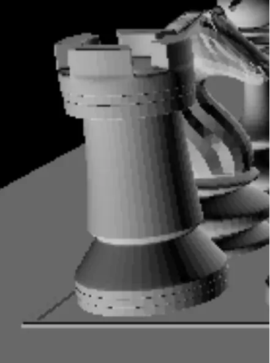
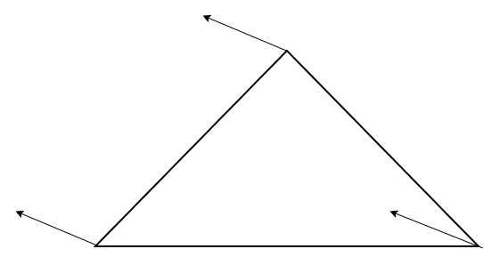
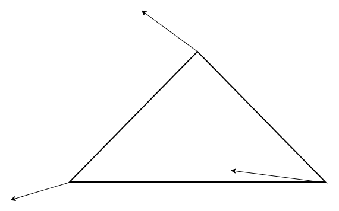
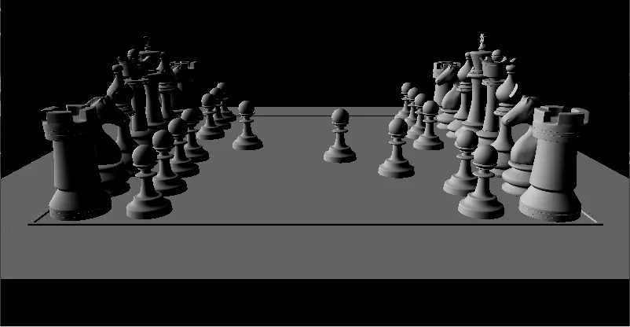

# グローシェーディング  
前回にDepthBufferの実装[^1]をやった.  
これで綺麗に出るようになったが、まだ問題点がある.  
画像をちょっと拡大してみよう.  

  

なんか線みたいなのが見えている.  
これは法線が全ての頂点において均一なのが問題で発生しているものである.  
実際に図で言うと以下のような感じである.  

  

こんな感じで法線が頂点においてすべて同じ方向である.  
こうなると、三角形内ではすべて同じ法線で計算が行われるため、どうしても滑らかにはならない.  
ではどうするか？上手く法線を補間してあげればよい.  

補間の方法はメジャーなものが2つあるが、今回はグローシェーディングというものをやっていく.  
グローシェーディングでは頂点法線を使用する.  
基本的に今までは以下のような感じで法線を計算していた.  

```c++
Vec3 normal = Cross((vert2->worldPos - vert1->worldPos).xyz(), (vert3->worldPos - vert1->worldPos).xyz()).normalized();
shaderInput->normal = normal;
```

あくまでポリゴンに含まれている3頂点から自分で法線を作成する方式.  
$`edge_{1}=normalize(v_{2}, v_{1}), edge_{2}=normalize(v_{3}, v_{1})`$で辺を計算.  
これに対して外積を取ると法線$`n=cross(edge_{1}, edge_{2})`$で生成できるという訳だ.  

これだと頂点毎の法線が分からないため、頂点法線が欲しい.  
頂点法線は実際のところ、基本的にモデル側で既に用意されていて読み込みができる場合が多い.  
自分はtinygltfを使ってるので、それを例にすると、以下のような感じでまず法線のバッファを取得できる.  

```c++
auto& normalAccessor = model.accessors[normalIndex];
auto& normalBufferView = model.bufferViews[normalAccessor.bufferView];
auto& normalBuffer = model.buffers[normalBufferView.buffer];
const float* normals = reinterpret_cast<const float*>(&normalBuffer.data[normalBufferView.byteOffset + normalAccessor.byteOffset]);
```

あとはバッファ内からデータを取るだけ.  
```c++
vertex->m_normal = normalAccessor.normalized ?
    Vec3{ normals[index], normals[index + 1], normals[index + 2] } :
    Vec3{ normals[index], normals[index + 1], normals[index + 2] }.normalized();
```
こんな感じで頂点毎にデータが取れれば、あとはこれを利用するだけである.  
今回はtinygltfだったが、他のものだったとしても同じことは絶対にできるはず.  
ここまでで以下のような感じで、頂点毎に違う法線が手に入った！  



勿論頂点法線ではなく、その頂点が持つ三角形の法線を平均して求めるとかいう方法でも問題ない.  
が、これは結構面倒なので、実際にやる分には頂点法線を引っ張ってくるのが速いと思う.  

さて、こうして頂点毎の法線が取れれば、まずは頂点シェーダーでの処理.  
頂点毎の処理では法線をワールド座標に持って行く.  
法線はそのままワールド行列が適用できないのは周知の事実.  
これをするためには細かいことは省くが、$`N_{world}= (M_{world}^{-1})^{T}N_{local}`$という面倒な処理が必要.  
なのでこれを計算して適用する.  
```c++
		// ライトの計算をWorld空間でしておく
		Vec4 normal{ input->normal, 1.0f };

		// 移動方向を消してWorld行列の逆行列を計算
		auto mat = input->worldMatrix;
		mat.value.r[3] = DirectX::XMVectorSet(0.0f, 0.0f, 0.0f, 1.0f);
		DirectX::XMVECTOR determinant;
		mat.value = DirectX::XMMatrixInverse(&determinant, mat.value);
		mat.value = DirectX::XMMatrixTranspose(mat.value);
		
        auto tempN = DirectX::XMVector4Transform(DirectX::XMVectorSet(normal.x, normal.y, normal.z, normal.w), mat);
```

最後にグローシェーディングでは頂点毎にライトの計算をした結果を納めておく.  

```c++
		double NoL = Math::Saturate(Dot(-input->directionalLight, Vec3{ tempN.m128_f32[0], tempN.m128_f32[1], tempN.m128_f32[2] }.normalized()));
		output->light = NoL * input->lightColor;
```

この辺の変換とライトの計算、ちょっと以前の動画だと雑すぎて間違ってますね.  
ここで謝っときます.  

さて、こうして得られたライトの結果は実際に重心座標で補間を行う.  

```c++
const Vec3 light = w * vert1->light + v * vert2->light + u * vert3->light;
shaderInput->light = light;
```

この補間したライトの値を使って、ピクセルシェーダーで結果を出せば終わり.  

```c++
(*m_image)[input->screenPos.y][input->screenPos.x] = ColorF({ input->light,1.0 });
```

要は頂点毎に別の法線が手に入ったので、それを頂点毎ライティング結果を求めて補間すればいいんじゃない～？というのがグローシェーディング.  
さて、結果を見てみよう.  



うん、いい感じではないでしょうか.  
前みたいなぱきっとした感じはなくなった.  

とはいえこれには問題がある.  
特にハイライトの描画を行うときで、ハイライトの位置がポリゴンの内側だと、頂点でしかライティングが計算されていない.  
ということは回転させたときに  

* 1s:頂点でハイライトが計算されている
* 1.1s: 頂点でハイライトが計算されていない
* 1.2s: 頂点がハイライトで計算されている
* ...

といったようにハイライトが付いたり消えたりという不規則な動きになっていることになる.  
これに似た不規則な動きが絶対にグローシェーディングでは起きてしまう.  

そういえば前回ZSortでの計算はポリゴン単位なので、ピクセル単位ではダメ.  
そのため、Depth Bufferでピクセル単位の処理で回避をしていた.  

これと同じで、ライティングも頂点のみじゃなくてピクセル単位でやれば問題ないのでは...？？？？と思うだろう.  
これが次回やるフォンシェーディングである.  

[^1]: [デプスバッファ法](./DepthBuffer.md)  
[^2]: [tinygltf v3 — C glTF 2.0 loader/saver](https://github.com/syoyo/tinygltf)  
