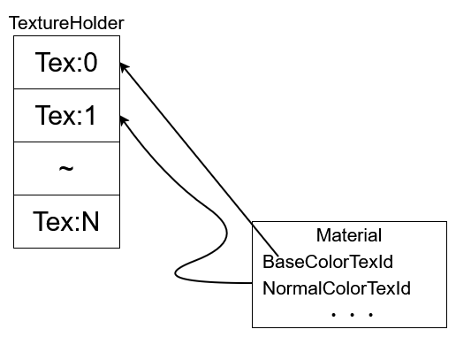

# パースペクティブコレクト  
今回はUVを張ることを考える.  
まずはデータがないと始まらないので、データの準備から.  

まずはGLTFにおいて、TexCoord,つまりuv値を取れるようにする.  
これがないと始まらない.  
前回のグローシェーディング[^1]の時は法線を取ってたが、それと同じような形式でデータにアクセス可能.  
```c++
auto& tecCoord0Accessor = model.accessors[texCoord0Index];
auto& texCoord0BufferView = model.bufferViews[tecCoord0Accessor.bufferView];
auto& tecCoordBuffer = model.buffers[texCoord0BufferView.buffer];
const float* texCoord0s = reinterpret_cast<const float*>(&tecCoordBuffer.data[texCoord0BufferView.byteOffset + tecCoord0Accessor.byteOffset]);
```
あとはこのデータからUVを取り出して、`m_uv0`に結び付ければOK.  
```c++
for (int i = 0; i < positionAccessor.count; ++i)
{
    int index = i * 3 + 0;
    auto vertex = std::make_shared<Vertex>();
    // ...
    vertex->m_uv0 = Vec2{ texCoord0s[i * 2], texCoord0s[i * 2 + 1] }; // 追加
    renderPrimitive->AddVertex(vertex);
}
```

これでUVはOK.  

ここから作るのは次のような構造.  

  

MaterialがIdを持っており、これを使えばテクスチャの元データにアクセスできる.  
テクスチャはHolderが管理をして、適宜確保解放を行い、あくまでIDでの取得のみを行う.  

ということでまずテクスチャ.  
テクスチャのデータはSiv3D側で簡単に扱えるので、これをフル活用する.  
Textureに関してはファイル名はtinygltf側から取得可能.  
そのため、これをModelが持つimageHolderという管理クラス側に`SetImage`経由で渡して登録する.  
```c++
void GLTFLoader::FetchImages(tinygltf::Model& model)
{
    auto renderModel = m_model.lock();
    auto imageHolder = renderModel->CreateImageHolder().lock();
    imageHolder->ResizeHolder(model.images.size());

    for (int index = 0; auto& image : model.images)
    {
        imageHolder->SetImage(m_path + Unicode::FromUTF8(image.uri), index);
        index++;
    }
}
```
ImageHolderのSetImageの関数は次のような感じ.  
Siv3dのImageクラスをパスから生成.  
こうすると勝手にTextureデータを読み込んでくれるので、余計なことは考えなくてよい.  
あとはImageクラスの機能であれこれできるので楽なもんよね.  
```c++
void ImageHolder::SetImage(const String path, const size_t index)
{
    assert(0 <= index);
    auto image = std::make_shared<Image>(path);
    this->m_images[index] = image;
}
```
これでImageは大体終わり.  

ここまで出来たら実際にModel側でマテリアルを用意する.  
まずマテリアルに関しては非常に単純なBaseColorのみを持つものとしてしまう.  

```c++
class DefaultMaterial
{
public:
    std::weak_ptr<Image> GetBaseColorTexture() const { return m_baseColorTexture; }

protected:
    void SetBaseColorTexture(std::weak_ptr<Image> texture) { m_baseColorTexture = texture; }

protected:
    std::weak_ptr<Image> m_baseColorTexture;

private:
    friend class GLTFLoader;
};
```
登録をするため,`GLTFLoader`はfriendにしてみた.  

そしたら、実際にModelからデータを取り出す作業.  
`tinygltf::Model`がマテリアルを持っているので、これからTextureを取り出して、Material側に登録すればよい.  
```c++
void GLTFLoader::FetchMaterials(tinygltf::Model& model)
{
    auto renderModel = m_model.lock();

    for (auto& material : model.materials)
    {
        auto renderMaterial = renderModel->CreateMaterial().lock();

        // 存在しない場合は飛ばし
        const int baseColorTextureIndex = material.pbrMetallicRoughness.baseColorTexture.index;
        if (baseColorTextureIndex == -1) { continue; }

        tinygltf::Texture baseColorTexture = model.textures[baseColorTextureIndex];
        renderMaterial->SetBaseColorTexture(renderModel->GetImage(baseColorTexture.source));
    }
}
```

さて、ここからは実際にUVを描画していくターン.  
まずはシェーダー側から用意をしてみよう.  

頂点シェーダーの受け渡しは簡単.  
そのまま渡すだけ.  
```c++
// 結果を格納
output->screenPos = Vec4{ tempV.m128_f32[0], tempV.m128_f32[1],tempV.m128_f32[2],tempV.m128_f32[3] };
output->uv = input->uv;
```

そして、ピクセルシェーダーでは画像とUVが入力として手に入るので、これを使ってアクセスするだけ.  
画像の縦と横はわかるので、後はこれを使ってUVで位置を計算.  
今回はそれっぽく近似した位置にしてるが、ここのサンプルの仕方は他にもある...  
が今回はシンプルにいこう.シンプルイズベスト.  
最後に色として反映させればOK.  
```c++
auto baseColorTexture = input->baseColorTexture.lock();

Vec3 baseColor = Vec3::One();
if (baseColorTexture)
{
    auto h = baseColorTexture->height() - 1;
    auto w = baseColorTexture->width() - 1;
    Color baseColorData = (*baseColorTexture)
        [static_cast<int>(h * input->uv.y)][static_cast<int>(w * input->uv.x)];
    baseColor = Vec3{ baseColorData.r, baseColorData.g, baseColorData.b } / 255.0f;
}
(*m_image)[input->screenPos.y][input->screenPos.x] = ColorF({ baseColor ,1.0 });
```
これでShaderは終了！  

次にプログラム側.  
ここではUVを重心座標で補間し、それをInputに渡している.  
Textureはポインタをそのまま渡してる.  
あとはShader側で生のテクスチャを良しなにしてねというやつだ.  
```c++
// UVを補間
const Vec2 uv = w * vert1->uv + v * vert2->uv + u * vert3->uv;
shaderInput->uv = uv;

// パラメータを用意
shaderInput->directionalLight = m_lightDir;
shaderInput->lightColor = m_lightColor;
shaderInput->screenPos = { x,y };
shaderInput->baseColorTexture = pMat->GetBaseColorTexture();
m_pixelShader->Calculate();
```

さて、今回はちょっとシンプルな画像として以下[^2]からシンプルなテクスチャを拝借した.  
このテクスチャ、テストには便利なんだけど、ちょっと中身のStrideが面倒...  
今回は特殊パターンとして、以下のように読み込み時をテスト時のみ書き換えた.  
```c++
vertex->m_uv0 = Vec2{ texCoord0s[i * 2 + i], texCoord0s[i * 2 + 1 + i] };
```
あまりにも変な読み込み方をしてて詰まったので、一応メモしておく.  

さて、こうして描画された結果は以下である.  


[^1]: [グローシェーディング](./GourandShading.md)  
[^2]: [glTF-Sample-Assets: Simple Texture]
(https://github.com/KhronosGroup/glTF-Sample-Assets/tree/main/Models/SimpleTexture)