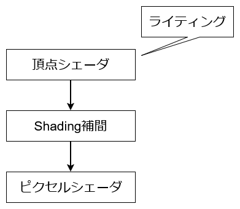
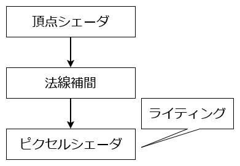
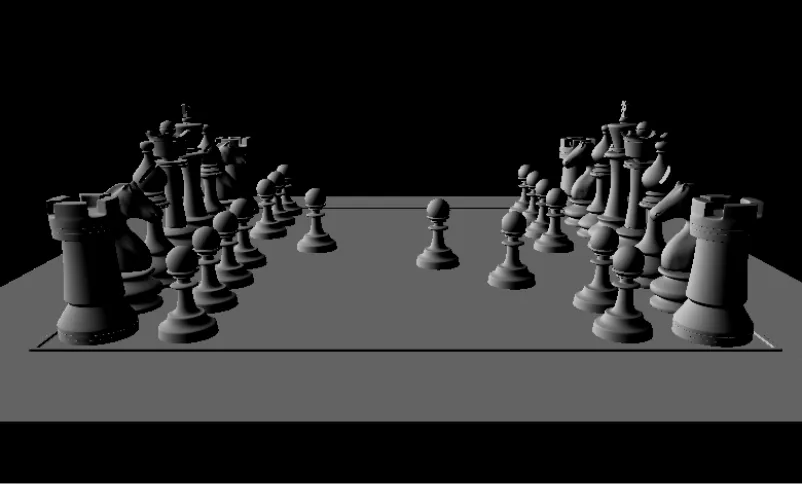

# フォンシェーディング  
前回はグローシェーディングをやった[^1].  
グローシェーディングは行ってしまえば、頂点シェーダでライティングを計算して、それを補完する方式.  

  

PhongShadingは法線側を補間して、これを使ってライティングを計算する方式.  

  

さて、そうなると今回大事なのは手順だけで、あとは今までやってきたことの組み合わせだ.  

まず最初は前回のグローシェーディングをちょっと改造して、法線を渡すようにする.  

```c++
Vec4 normal{ input->normal, 1.0f };

// 移動方向を消してWorld行列の逆行列を計算
auto mat = input->worldMatrix;
mat.value.r[3] = DirectX::XMVectorSet(0.0f, 0.0f, 0.0f, 1.0f);
DirectX::XMVECTOR determinant;
mat.value = DirectX::XMMatrixInverse(&determinant, mat.value);
mat.value = DirectX::XMMatrixTranspose(mat.value);

auto tempN = DirectX::XMVector4Transform(DirectX::XMVectorSet(normal.x, normal.y, normal.z, normal.w), mat);

output->worldNormal = Vec3{ tempN.m128_f32[0], tempN.m128_f32[1], tempN.m128_f32[2] };
```

前回はライティング結果を渡していたけど、今回は法線を渡すだけ.  

そしたら次に法線を重心座標で補間する.  
重心座標に関しては詳しくはこっちの記事[^2]を見てほしい.  
```c++
const Vec3 normal = w * vert1->worldNormal + v * vert2->worldNormal + u * vert3->worldNormal;
shaderInput->normal = normal.normalized();
```

これで各ピクセルでの滑らかな法線が求まった！  

あとはこれを使ってライティングを計算するだけである.  
Pixel Shaderであとはランバート反射を計算して、適用をしてやるだけでよい.  
```c++
double NoL = Abs(Dot(-input->directionalLight, input->normal));
(*m_image)[input->screenPos.y][input->screenPos.x] = ColorF({ NoL * input->lightColor,1.0 });
```

これで完成！  
あとは結果を見てみよう.  

  

うん、いい感じ！  
こちらでもちゃんと滑らかなライティングが実現できている.  
基本的に実際にPixel Shaderで各方式はこのPhong ShadingをAPI側がRasterize段階で勝手にやってくれている.  
なので、意識することはないけど、基礎として知っておくのは大事ですね.  

[^1]: [グローシェーディング](./GourandShading.md)  
[^2]: [デプスバッファ法](./DepthBuffer.md)