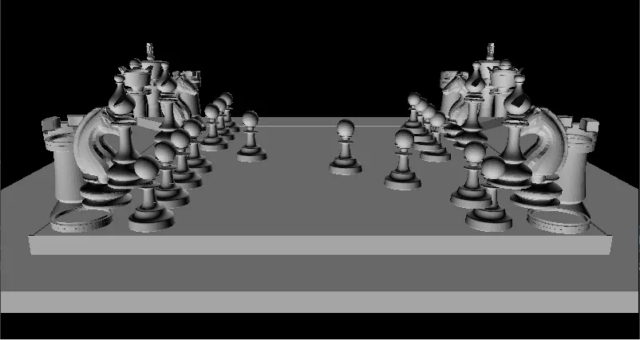
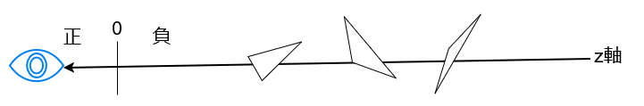
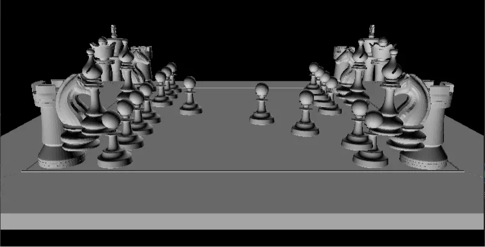

# Z-Sort法  
今回はZ-Sort法をやっていく.  
まず単純にモデルを描画した場合を見ていこう.  

  

今回はCPU Rasterizerで試しに何も考えずにモデルを描画してみたものである.  
なんか歯抜けになってたり、被さってたりと色々問題のある見た目になっている...  
理由は簡単で塗る順序を適当にすると、ポリゴンが奥にあるとかそういうのも関係なくばらばらになっちゃうからである.  
これを解決するための方法は色々あるけど、今回はZ-Sort法というのから始めよう！  

  

ZSortでやることは非常にシンプル.  
Z方向を図のように正の場合が視点に近く、負の場合は遠いようにする.  
つまりZ値が小さければ小さいほど奥にあるということである.  
このとき奥にあるものから塗っていけば、ちゃんと順序通りになるよね？というのがZSort法.  
こういう奥から塗っていくのは「画家のアルゴリズム」[^1]とも言ったりするね.  
というかZSort法はWikiにないのか...そうか...  

さて、となるとやることは結構簡単である.  
まず各三角形の頂点から重心の位置を計算する.  
全部足して3で割ったものです.  
```c++
for (int i = 0; i < tempIndices.size(); i += 3)
{
    const Vec4& v1 = tempVertices[tempIndices[i]]->viewPos;
    const Vec4& v2 = tempVertices[tempIndices[i + 1]]->viewPos;
    const Vec4& v3 = tempVertices[tempIndices[i + 2]]->viewPos;

    double faceDepth = (v1.z + v2.z + v3.z) / 3.0;
    zSortList.push_back({ faceDepth, i });
}
```
あとは子の重心のデータを見て、小さい順にソートするだけ！  
```c++
std::sort(zSortList.begin(), zSortList.end(),
[](const std::pair<double, int>& a, const std::pair<double, int>& b)
{
    return a.first < b.first;
});
```
あとはソートされている順にデータを参照するだけ.  
凄いシンプルだね.  
```c++
for (const auto& sortData : zSortList)
{
    //...
}
```
結果を見てみよう.  

  

うん、ちょっと改善してるね.  
特に手前のルークの駒は上手～くふさがってる.  
しかし、まだまだ埋まってない駒も散見している...  
これは単純にポリゴン単位にソートしてるので、ピクセル単位では重なってる場合はそこは無視されちゃう.  

ではこれをどう解決するか？次回のDepth Buffer編でお会いしましょう.  

[^1]: [画家のアルゴリズム](https://w.wiki/Wmxn)