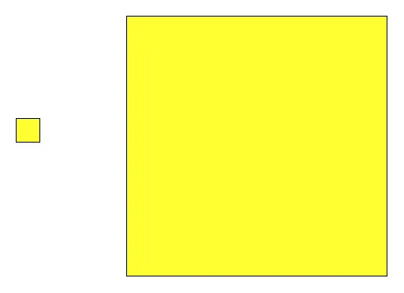
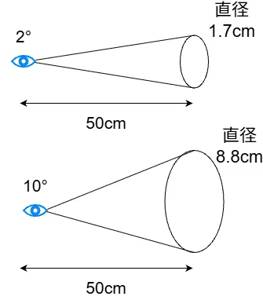
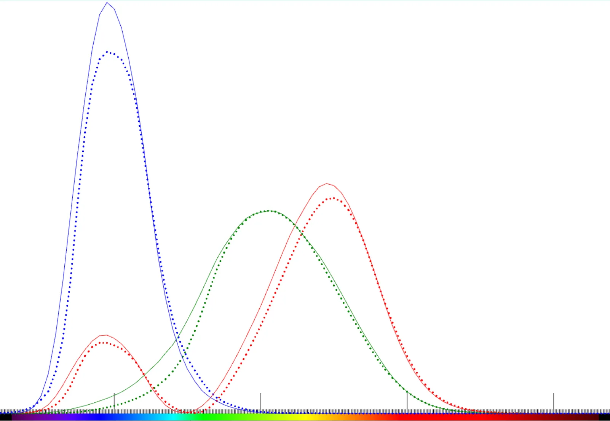
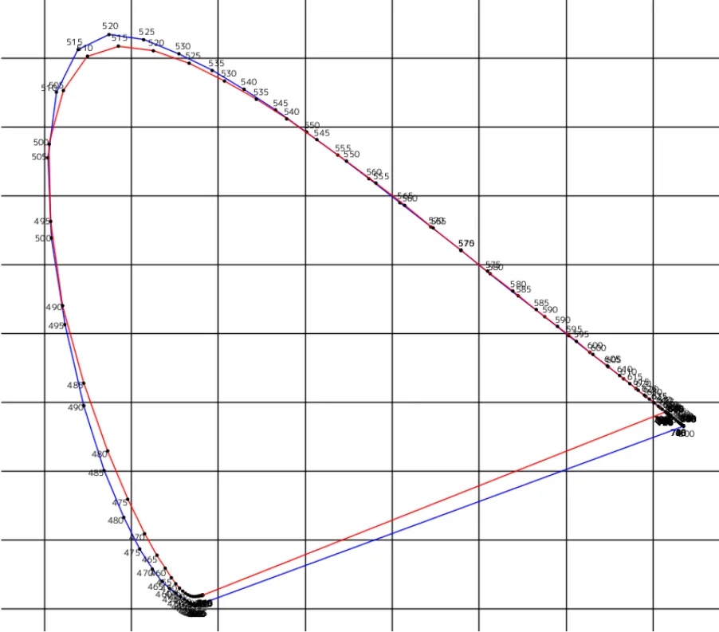

# CIE1964 XYZについて  
CIE1931では等色実験を行い、その結果を用いて等色関数を求めていた.  
しかし、この実験をやる過程であることを仮定しており、これが地味に問題になる.  
色々な記事[^1][^2][^3]を調べてみると分かるが,実は視覚の変化によっても色の感覚は変化するのである!!  

これの良い例が「色の面積効果」[^4]というやつである.  
例えば黄色の異なるサイズの四角形を用意する

  

どうだろうか？面積が大きい方が明るく見える感じがしない？  
黒い場合も試してみよう.  

    

面積が大きい方がなんかちょっと暗い感じ...  
明るい方が個人的には分かりやすい気がする.  
こんな風に面積が大きいと視野として見える範囲が広くなった結果、なぜかそっちの方が明るく見えるのである.  

なんでこんなことが起こるのかというと、目には網膜がある.  
網膜の中心には黄斑があり、更にその黄斑の中心あたりに中心窩がある.  
この中心窩がほぼ視野角2°に相当するわけで、2°というのはCIE1931で行っていた測定である.  

実際にはこの2°というのは結構狭い範囲で、この範囲の外側とは色覚特性ももちろん違う.  
そうなると、更に広い範囲のものが欲しくなってくる...  
そこで現れるのがCIE1964のXYZである.  
この問題を解決するために10°における測定を実施.  



こうして2°とは違う10°の分布が得られたのがCIE1964のXYZとなる.  
Stiles&BurchとSperanskayaの実験によって得られたものである.[^5]  
因みにStiles&BurchはCIE1931の実験もやって定義したらしいが、CIEには認められてないそう.[^6]  
悲しいね.  

さて、実際に描画して比較してみようか.  
CIE1964 XYZのデータは`CVRL DataBase/CMFs/CIE functions/CIE 1964 10-deg, XYZ CMFs`というので手に入る.  
自分「ここの`deg`って何なんだ...？」と思ってたけど、今気づいた.これ角度か.  

そしたら今回はCIE1964とCIE1931で比べたいので、読み込み周りを関数化してしまう.  
```c++
auto LoadCIEData = [](const String& path, int rows, Array<double>* wave, Array<double>& X, Array<double>& Y, Array<double>& Z)
    {
        CSV csvData{ path };
        if (!csvData) { throw Error(U"Failed to load csv."); }

        while (true)
        {
            const double waveLength = Parse<double>(csvData[rows][0]);
            if (800 < waveLength) { break; }

            // データの抽出
            if (wave) { wave->push_back(waveLength); }
            Float3 entry{ Parse<double>(csvData[rows][1]),Parse<double>(csvData[rows][2]), Parse<double>(csvData[rows][3]) };

            // XYZなので、そのまま突っ込む
            X.push_back(entry.x);
            Y.push_back(entry.y);
            Z.push_back(entry.z);

            rows++;
        }
    };
```
波長は片方から取れればいいので、ポインタで見分ける力技実装.  
そして、rowsを指定するようにしてある.  
なんかよくわからんけど、CIE1931は2行目までコメントが入ってたのに、CIE1964の方はないっぽい...  
なので、指定できるようにしてあります.  
CIE1964の場合のみ貼りますが、以下のようにルックアップ可能.  
```c++
	// CIE1964 XYZ 10Deg
	Array<double> CIE1964_X;
	Array<double> CIE1964_Y;
	Array<double> CIE1964_Z;
	// ここはrowsが0から読みこむ必要有
	LoadCIEData(U"example/csv/ciexyz64.csv", 0, &wavelengthes, CIE1964_X, CIE1964_Y, CIE1964_Z);
```

さて、そしたら結果を見てみよう.  



ドット側がCIE1931で通常の線がCIE1964である.  
形状はほぼ同じだけど、若干差があるのが分かるね.  

実際に使用する際は4°以下の場合はCIE1931,それ以上はCIE1964を使用という明確な基準があるっぽい.  
グラフィックスでも細かく考えたい場合はどっちかを選択する必要がある.  
...が、まあCIE1931で良い気はする.  

一応表色系の差も描画しておこうか.  
プログラムとして新しいことはないので、結果をドドンっと見てみよう.  



青がCIE1931で赤がCIE1964である.  
描画したグラフと実際にプロットしてるここの記事[^7]で見た目が一致してるので、描画としては合ってるものかと思う.  
こう見るとCIE1964の方が色度図としては範囲が狭くなってるね.  
これつまりは認知できる色の範囲は10°と広くなると、2°よりも狭くなっちゃうってことなんだろうね.  
あくまで神経の集中してる中心窩が色の範囲としては一番幅広く、そこから外側までを認知する場合は色の認識率は少し下がるって感じなのかなと個人的には思った.  
とはいえ、sRGB何かに比べると圧倒的に広いと思うので、そこに関しては問題なさそうではあるけども...  

といったところで、CIE1964のXYZはこの辺でやめておこうかなと思う.  

[^1]: [第30回 色の客観的な表現と伝達 （その4）](https://www.ccs-inc.co.jp/guide/column/light_color/vol30.html)  
[^2]: [14. 色彩値の2°と10°？](https://www.xrite.com/ja-jp/blog/color-value-two-degree-and-ten-degree)  
[^3]: [05 2°視野と10°視野](https://www.konicaminolta.jp/instruments/knowledge/color/section5/5-02/)  
[^4]: [面積効果とは･･･](https://shikisai101.com/topics/What-is-the-area-effect-shikisaikentei-Grade-3/)  
[^5]: [CIE (1964) 10-deg colour matching functions](http://www.cvrl.org/database/text/cmfs/ciexyz64.htm)  
[^6]: [CIE 1964 X10Y10Z10](https://w.wiki/WkDC)  
[^7]: [05色度図](https://www.konicaminolta.jp/instruments/knowledge/color/section5/5-07/)