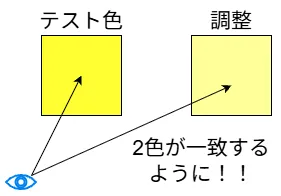
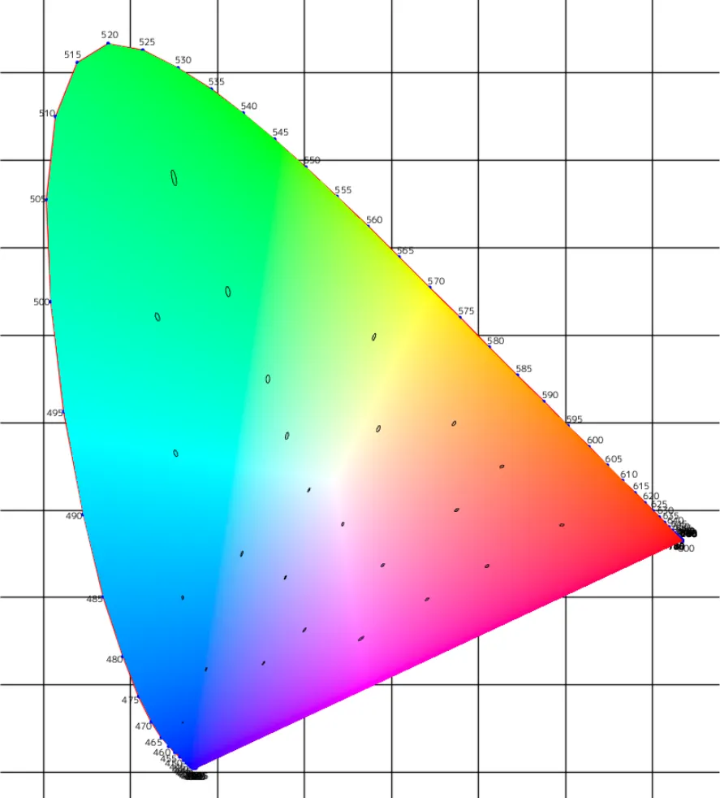
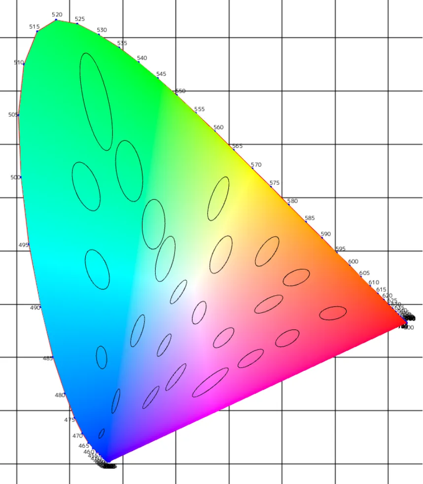
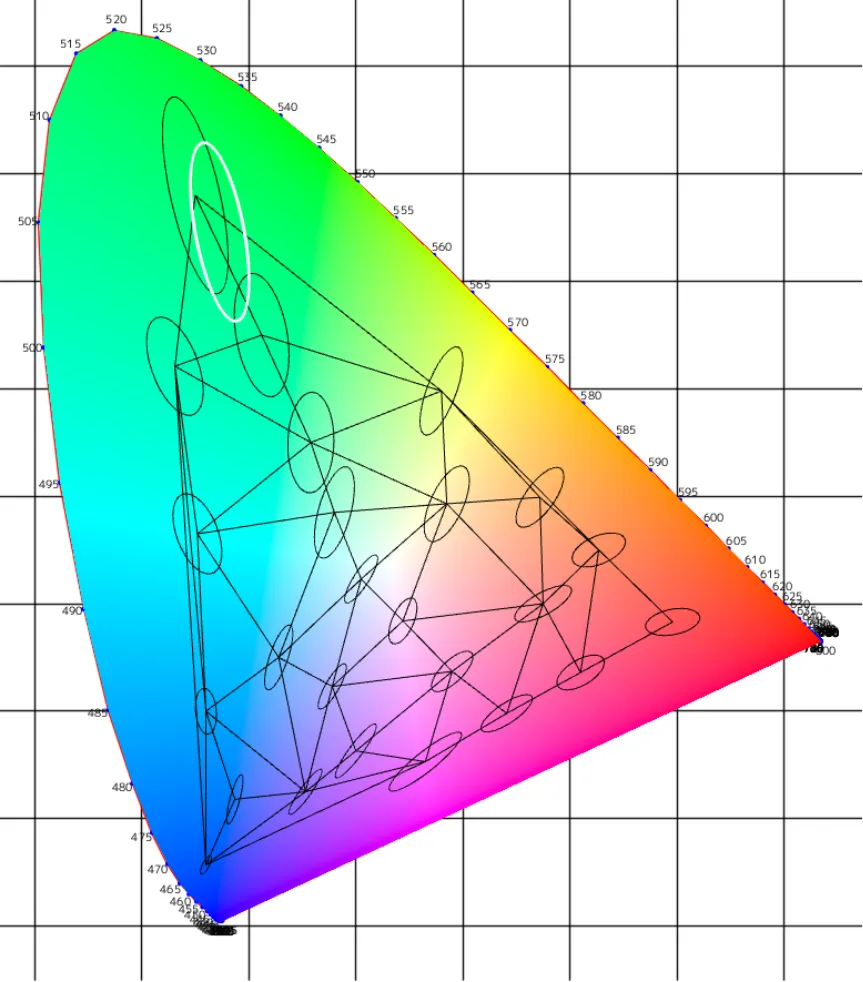
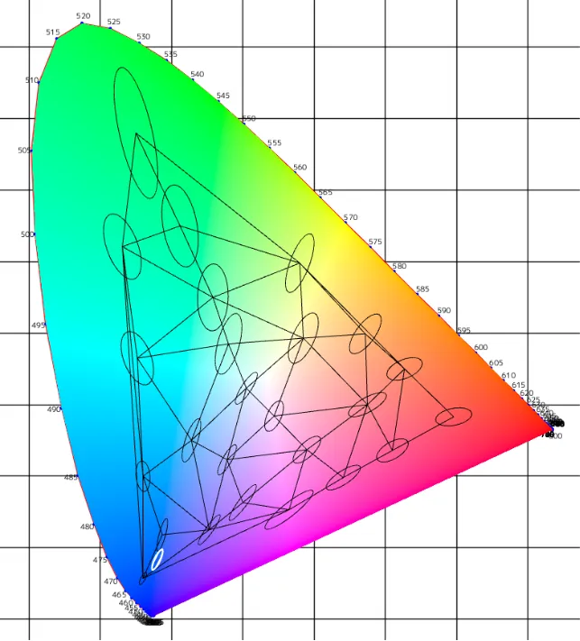

# UCS色度図準備編 ～MacAdam楕円の可視化と補間～  
前回言った通りUCS色度をやろうかと思ったが、そのためのちょっとした準備をしようと思う.  
外堀を埋めることって大事よね、うん.  

さて、CIE1931の色度図に関して考える.  
XYZ空間の色の関係性を図式化したことで色々なことが理解できるようになったことは、今までの流れの中でも分かると思う.  
今までで言えば例えば、  

* 波長単体の色がスペクトル軌跡で表され、純紫軌跡という単体波長では表せないものもある
* 波長をどれだけブレンドさせればどの色に対応するかが分かる
* 色度図の外の色は人には見えない不可視領域
* 温度によって色が変わる、これはプランク軌跡で可視化される

といったようなことだ.  
色度図があれば色に関して色々と議論がしやすいというのが分かる.  
ということは、今回やるのも色に関する何かしらについて考えようというお話だ.  

今回考えるのは色差(しきさ)[^1]というものについて考える.  
2色の$`C_{A},C_{B}`$が用意されたとする.  
この二色に対して目で見た際,

* $`C_{A}`$と$`C_{B}`$は同じ色に見える: 色差が小さい
* $`C_{A}`$と$`C_{B}`$は違う色に見える: 色差が大きい

簡単に言えばこんな感じで2つの色が与えられたときに、似ているかどうかを判断する量として定義するわけだ.  
ではこの色差を表す式はどんな感じになるんだろう？  

まず一番最初に思いつくのはユークリッド距離.  
色度図内の2点を取って、そこの距離を求めればいいんじゃない？というのは真っ先に思いつくはず.  
つまり、

```math
ColorDiffrence = \sqrt{(C_{A}.r - C_{B}.r)^2 + (C_{A}.g - C_{B}.g)^2 + (C_{A}.b - C_{B}.b)^2}
```

という式が成り立つんじゃない？ということ.  
確かに滑らかに色度図内では色が変わっているため、これはありえそうな気がする...  

ここで出てくるのがデビッド・マクアダム先生[^2].  
1942年の論文でマクアダム楕円[^3]というものを発表した.  

マクアダム先生の実験は非常に簡単だ.  

  

2色の色を用意して片方をテスト色とし、もう一方を調整できる色にする.  
調整できる色を観察者は調整して、テスト色と一致させる.  
もちろん人間の目なので完全に一致はしないが、その差はある範囲内に収まることが分かった.  
この収まる範囲は楕円形状で定義ができ、CIE1931上に描画することで確認が可能.  

今回はまずこの楕円を描画してみよう.  
今回のデータもcolour[^4]にあったので、こちらを参考にデータを取ってみた.  
どうもObserveとCalculateの2つがあるが、Calculateの方が正確らしい.  
一応コード上ではどちらも定義しておいたが、今回はCalculateの方を描画してみよう.  

まず最初に今回のデータは楕円のデータとその回転値で構成することにする.  

```c++
Array<std::pair<double, Ellipse>> m_calculate;
```

Siv3DではEllipseに楕円の中心位置、そして長軸短軸の2つを定義可能.  
今回のMacAdamのデータも

* 中心位置
* 長軸
* 短軸
* 回転

で構成されているため、これを代入してあげればよい.  

実際の描画は以下の手順で行う.  
まず楕円の中心はxy空間なので、事前にシーン空間に移しておく.  
```c++
for (auto& v : macAdam.m_calculate)
{
    // CenterをScene座標にしておく
    Vec2 center = v.second.center;
    center.x = (center.x - X_BOUND.x) / (X_BOUND.y - X_BOUND.x);
    center.y = 1.0 - (center.y - Y_BOUND.x) / (Y_BOUND.y - Y_BOUND.x);
    center.x = Math::Lerp(sceneMin.x, sceneMax.x, center.x);
    center.y = Math::Lerp(sceneMin.y, sceneMax.y, center.y);

    v.second.setCenter(center);
}
```

描画時には回転値と楕円を取り出す.  
```c++
for (const auto& v : macAdam.m_calculate)
{
    double angle = v.first;
    auto ellipse = v.second;
```

回転値はマイナスしているのに注意.  
どうも回転行列が時計回りを正としてるっぽいので、今回は反時計回りが欲しいためマイナスにしてるだけ.  
あとは楕円の縁が欲しいので`drawFrame`で描画すればよい.  
```c++
    const Transformer2D transformer{ Mat3x2::Rotate(ToRadians(-angle), ellipse.center) };
    ellipse.drawFrame(1.0, Palette::Black);
}
```

さて、ここまで来たら描画をしてみる.結果は以下だ.  

  

う～ん...あまりにも小さい...  
小さいが、この範囲が色としては同じに見える範囲ということになる.  

分かりやすいように実際の色差とは異なるが、10倍にして描画してみよう.  

  

うん、分かりやすくなった！  
ネットとかでよく見るのはこの図が多いですね.  
自分はここ[^5]の図と比較してましたが、まああってる気がする.  

この図の大事なのは個人的に2つあると思っている.  
1つ目は同じ色かどうかを実験することで色差の小さい部分を測定したこと.  
これによって楕円状に色差が同じ範囲がどうなるのかが分かるようになったともいえる.  

2つ目は色空間の位置によって色差の幅は違うという点.  
10倍にすることで浮き彫りになったのは、一番わかりやすい部分と緑の色度の部分と青の色度の部分では全く楕円の大きさが違う点.  
絶対的に青の範囲は小さいし、緑の部分は大きい.  
しかも全部の方向が同じ距離で測れるなら、本来は円にならないとおかしいのである...

これからわかることは色差でユークリッド距離を使うことができないことを表している.  
色度図内の距離の差と人間の感じる色差というのは単純に同じとは言えないということだ.  
緑は楕円が大きいため色差を感じにくいけど、青は敏感で色差を感じやすい.  
そのため、同じ距離として測ることが出来ない...  

まあ、確かに感覚的にもこれはいえそうな気がする.  
LMS視錐体[^6]を考えれば緑の量が圧倒的に多いので、色差を同じと捉える範囲も大き目.  
逆に圧倒的に小さい青は圧倒的に少ないので、色差も感じやすい.  
勝手な予想ではあるけど、この辺はなんか言えそうな気はする.  

さて、ではどうにかしてこの楕円を大体同じくらいの大きさにできないか？  
もしこれができるのであれば、ユークリッド距離みたいな感じで測ることが可能になる.  
そのために今のXY色度図を別の形に変形することで、つまりUCS色度図に変形させることで大体同じくらいの大きさにしようよ！というのが次回の内容である.  

さて、UCS色度図は次回に回すこととして,今回はこのMacAdamの楕円の補間を最後にやってみよう.  
まあ色度も統一されたものではないので正確ではないんだけど、こちら[^7]でやってるのを見てかなり面白いなと重い挑戦.  

まず現状の楕円の中心から三角形を導出.  
導出後に三角形の内部化を判定し、内部だった場合は重心座標系で補間する.  
これだけで三角形ないの楕円をすべて定義できるという寸法.賢い～.  

実際にやってみよう.  
まずは頂点だけで三角形を構築する必要がある.  
有名なのはドロネー三角形分割とかだけど、これに関してはSiv3Dでは機能として入ってる.  
自分で実装するのは面倒なので、機能を使わせてもらおう.  

やることは簡単で、楕円の頂点を`SubDivision2D`に突っ込む.  
追加後は`calculateTriangles`を呼び出すのみ.  
```c++
Subdivision2D div{ Scene::Rect()};

// 楕円の全頂点を突っ込む
for (const auto& v : macAdam.m_calculate)
{
    auto ellipse = v.second;
    div.addPoint(ellipse.center);
}

// ドロネー三角形分割
div.calculateTriangles(triangles);
```

これで三角形が完成！  
自分で定義したVertexに対して作って参照とかにしてくれると嬉しくはあるんだけど、まあそこは言っても仕方ない.  

あとは頑張って補間していく.  
まず、`contains`関数でどの三角形の内側かを判定する.  
全ての三角形において外側の場合は終了としてしまう.  
```c++
// 三角形の内側にあるものを探す
bool isInside = false;
Triangle* target = nullptr;
for (auto& t : triangles)
{
    if (t.contains(targetPos))
    {
        isInside = true;
        target = &t;
    }
}
isDrawTarget = isInside;
if (!isInside) { return; }
```
次に重心座標系を計算.  
これは以前Depth Buffer[^8]でやったのと同じ処理を書けばよいだけ.  
```c++
// 重心座標系uvwを計算
auto p0 = target->p0, p1 = target->p1, p2 = target->p2;
double polyArea = Cross(p1 - p0, p2 - p0);
const double u = Abs(Cross(p1 - p0, targetPos - p0) / polyArea);
const double v = Abs(Cross(p2 - p0, targetPos - p0) / polyArea);
const double w = Abs(Cross(p2 - p1, targetPos - p1) / polyArea);
```
現状三角形の頂点は位置しか持っていないため、その頂点がどの楕円と対応してるかが分からない...  
そのため、三角形の頂点と対応する楕円を見つける.  
見つけ方は単純に一番近い距離のものを採用.  
ついでに角度も保持しておく.  
```c++
// 点を持つ楕円を探索
auto FindPoints = [&](Vec2 p, Ellipse& e, double& a)
    {
        double distance = 1e+10;
        for (const auto& d : macAdam.m_calculate)
        {
            const auto& ellipse = d.second;
            const double length = (ellipse.center - p).length();
            if (length < distance)
            {
                distance = length;
                e = ellipse;
                a = d.first;
            }
        }
    };

Ellipse e0, e1, e2; double a0, a1, a2;
FindPoints(p0, e0, a0); FindPoints(p1, e1, a1); FindPoints(p2, e2, a2);
```
最後に重心座標系を使って補間すれば終わり.  
こうして完成した`targetEllipse`を描画すればよい.  
```c++
// 補間
auto center = e0.center * w + e1.center * v + e2.center * u;
auto axes = e0.axes * w + e1.axes * v + e2.axes * u;
targetAngle = a0 * w + a1 * v + a2 * u;
targetEllipse.setCenter(center);
targetEllipse.setAxes(axes);
```

実際に描画した結果が以下である.  

  

うん、実際にそれっぽく補間されてるのが分かる.  
見やすいように緑に近い範囲を可視化してみたが、青の方を可視化してみると、

    

こんな感じでちょっと小さくなってるので動作としては問題なさそう.  
実際に自分たちが感じてる色差とはまったく一致しないけど、とにかくある点において色差がほぼ同じ範囲が欲しい時とかには使えるかもしれない.  
といったところで今回はここまで.  

[^1]: [色差](https://w.wiki/Cyge)  
[^2]: [デビッド・マクアダム](https://w.wiki/eRE9)  
[^3]: [マクアダム楕円](https://w.wiki/9oHR)  
[^4]: [macadam_ellipses.py](https://github.com/colour-science/colour/blob/develop/colour/models/datasets/macadam_ellipses.py)  
[^5]: [色彩工学 (2) - 均等色空間](https://henatips.com/page/37/)  
[^6]: [三色説と分光感度グラフ](./SmithPokorny.md)    
[^7]: [■2次元不規則分布データの補間の例 ～ 色彩工学におけるマクアダム楕円の補間 ～](http://www.enjoy.ne.jp/~k-ichikawa/Interpolation_2D.html)  
[^8]: [デプスバッファ法](../Basics/DepthBuffer.md)