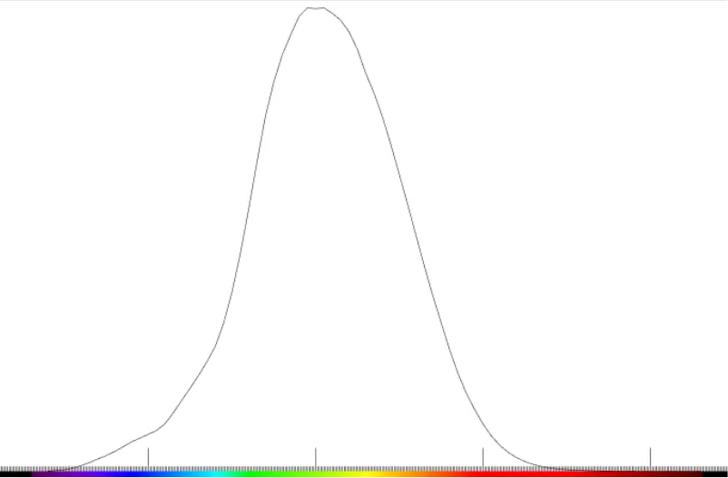
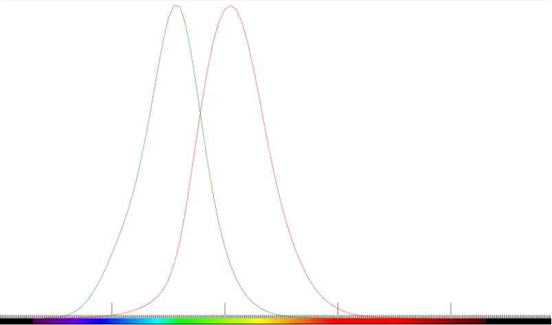

# 明所視と暗所視について  
分光視感効率の部分をちょっと深堀してみよう.  

以前の分光視感効率において、そもそも波長毎に明るさというのは全く違ってみえるということが分かっている.  
図を出しておくが、実際は分光視感効率はこんな感じだった.  

つまり、黄色から緑辺りを明るく感じやすいというのが人間の感覚なわけだ.  

この描画した分光視感効率は明所視[^1],つまり明るい部分に対するものである.  
実は明るい場所と暗い場所では明るく感じる波長がまた変わってくる.  
この暗い場所での知覚を暗所視[^2]というものである.  

この辺は色彩工学の本[^3]にも書いてある通り、CIE1924でまず明所視が定められた.  
次にCIE1951に暗所視が定められている.  
まずはこれを実際に描画してみよう.  

データ自体はCVRL[^4]に落ちているため、利用は簡単.  
`CIE (1924) Photopic`と`CIE (1951) Scotopic`を取ってくれば良い.  
コードに関しては分光視感効率とほぼ変わらないので省略.  
結果を見てみよう.  

緑が暗所視,赤が明所視という対応のグラフとなっている.  
どうだろうか？明所視はピークが黄色くらいにあるのに、暗所視は青の方にピークがよっている.  
これが明るい場所と暗い場所における明るいと感じる波長の違いである.  

これを表す良い例がプルキンエ現象[^5].  
明るいところでは明所視が働くため、赤が鮮やかに見えて青は暗めに見える.  
そして、暗いところでは暗所視が働くので、同じ赤と青だったとしても、なぜか青の方が明るく見えるという現象だ.  
不思議な現象だけど、分光視感効率のグラフを見れば一目瞭然である.  
まさにこのグラフこそがプルキンエ現象を表してるともいえる.  

余談だけど、このプルキンエ現象について面白いものを見つけた[^6].  
茶といえば戦国時代の秀吉の側近で有名な千利休.  
彼は茶室において、浅黄色の足袋を好んで身に着けていたらしい.  
これは速水宗達の「喫茶明月集」に書いてある.  
浅黄色は水色というかその辺の色と思われるが、茶室といえばちょっと暗いイメージがあると思う.  
となると、暗所視も働くことになるため、赤や黄色のような色より青や緑がの方が明るく見えることになる.  
ある意味茶に関しても深い緑なので、暗所視においてはより明るく見えるのではと個人的には思ったり.  
ともかく、千利休のすばらしい洞察と直感は時を超えて科学的に説明がつくということなんだなぁ...  

さて、では明所視と暗所視が起こる理由は何か？  
これはずばり、今までも触れてきた錐体と桿体という細胞にある.  

錐体というのはLMSだったり、CIE1931にも表れる通り非常に色と関係がある細胞.  
光量の高い時に働く、つまり感度が低いのである程度の光量がないと働かない.  
とはいえ、色の違いが分かるというのが錐体のすごいところ.  
これは光量が高いということからも分かる通り、明所視の時に働く細胞である.  
基本的に明るい時はこの細胞のみが働いている状態となる.  

この逆が桿体である.  
光量が少なくなってくると、段々と動き始める細胞.  
光量が一定の場合は桿体と錐体の両方が動くため、この時を薄明視と言う.  
そしてさらに少なくなると、桿体のみが動くようになり、これが暗所視.  
桿体は錐体とは違い、LMSといった風に3種類もなく1種類のみ.  
そのため、色感覚はなく物の形が暗い場所で認識できても、色は分からないということになる.  
その分感度は非常に高いので、暗い場所でも見えるわけだ.  

さて、表にまとめると次のような感じ.  

|細胞|視|感覚|分光視感効率|
|:---:|:---:|:---:|:---:|
|錐体|明所視or薄明視|色+明暗|黄/赤辺りが高め|
|桿体|暗所視or薄明視|明暗のみ|緑/青辺りが高め|

最後に暗所視/明所視の移行を考える.  
実はこれの切り替えにも差異がある！[^7][^8]  

まず暗いところから明るいところ,つまり`暗所->薄明->明所`のプロセス.  
これを「明順応」というが、錐体の応答が速いため一瞬で慣れる.  
例えば暗いトンネルから出たとき、一瞬まぶしい...となるがすぐになれると思う.  

次に明るいところから暗いところ,つまり`明所->薄明->暗所`のプロセス.  
これを「暗順応」というが、錐体とは逆に桿体は順応が比較的遅い.  
これは数分から数十分かかるため、中々に暗い場所には慣れない.  
簡単に時間があるときに寝る前に電気消して試せば理解できるんじゃないかな.多分...  

そんなわけでトンネルなんかは急に暗くなると、運転してる時が非常に危ない.  
そのため、トンネルは入り口付近のライトは密になっている.  
そして中央に行くほどライトが減っていき、出口に近づくとまたライトが増えてくる.  
なるほど、非常に賢いつくりだ.  

ということで結構奥が深い暗所視と明所視について見ていった.  
意外とプルキンエ現象や明/暗順応辺りは、知ってると豆知識としても良いかなと思う.  

[^1]: [明所視](https://w.wiki/gBMg)  
[^2]: [暗所視](https://w.wiki/gBPf)  
[^3]: [色彩工学 第2版](https://www.tdupress.jp/book/b350224.html)  
[^4]: [cvrl](http://www.cvrl.org/lumindex.htm)  
[^5]: [プルキンエ現象](https://w.wiki/gBci)  
[^6]: [茶室からエレクトロニクスへ](http://www.i-repository.net/contents/outemon/ir/301/301940612.pdf)  
[^7]: [明るいところから暗いところにいくと、最初は見えにくいのに、だんだん慣れてくるのはなぜ？](https://www.acuvue.com/ja-jp/memamori/question/14/)  
[^8]: [第38回　色彩の心理　（その1）・・・・・ 暗順応、明順応、色順応 ・・・・・](https://www.ccs-inc.co.jp/guide/column/light_color/vol38.html)