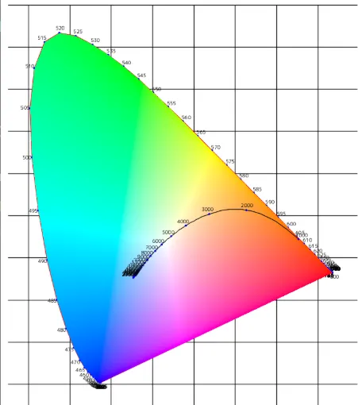
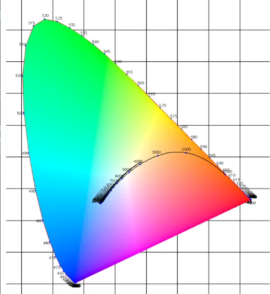
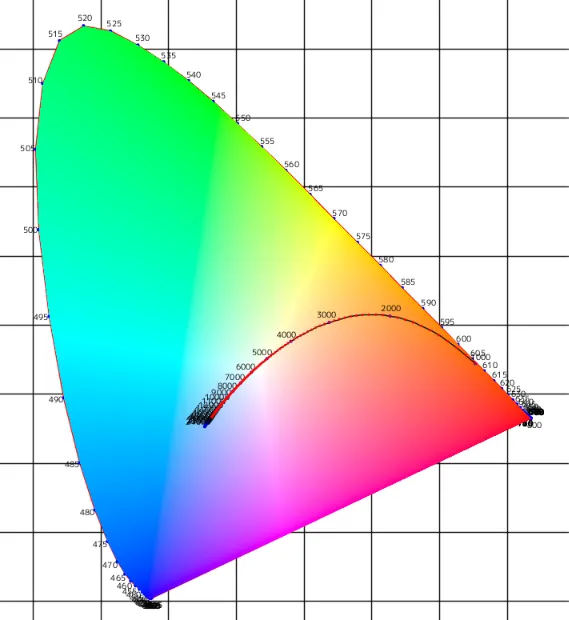
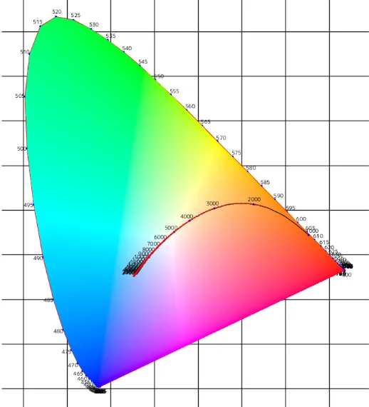

# 黒体への道 その4: 黒体軌跡で色を見る  
さて、前回で温度と各波長を与えてやることでプランクの法則によって、放射輝度が計算できた.  
これによってスペクトル分布から色の推測が出来たわけだが、現状のままだとちょっと理解がしづらい...  
そのため、今回は黒体軌跡,プランク軌跡ともいえるものを描画して見ていく.  

黒体軌跡[^1]はプランクの法則のある温度$`T`$におけるXYZの値を色度図に落とし込んだものである.  
やることは簡単でプランクの法則で求まる放射輝度$`L(T,\lambda)`$とする.  
この時、色度図なので可視光を$`\lambda \in [380,780]`$の範囲とする.  
XYZは全波長範囲を足し合わせた結果で表せるため、以下のように計算をすれば厳密なXYZが求まる.  
```math
\begin{split}
& X = \int_{380}^{780} L(T, \lambda) \bar{x} d\lambda \\
& Y = \int_{380}^{780} L(T, \lambda) \bar{y} d\lambda \\
& Z = \int_{380}^{780} L(T, \lambda) \bar{z} d\lambda \\
\end{split}
```
こうしてXYZが求まれば、後は色度図内の位置が分かるため,これを繋いであげればよい.  
今回はまずこれを実装してみよう.  

今回はXYZの計算を行うようにしてみた.  
温度の求める範囲は$`T \in [1000,25000]`$.何でこの範囲なのかは後程分かるかと思う.  
```c++
constexpr double minTemperature = 1000;
constexpr double maxTemperature = 25000;
```

積分で計算するのはXなら$`L(T, \lambda) \bar{x}`$のような値.  
$`L`$は`PlanckLaw`から計算する、ただしテーブルから取ってる波長はnmなので`1e-9`を掛けて調整をしておく.  
$`\bar{x}`$は`color_X`に入ってるので、これを参照.YとZも同様の計算.  
最後に`value`に足して蓄積を繰り返した結果を`planckianLocus`に入れれば良い.  
```c++
// 積分してPlankの法則を適用して、XYZを求める
for (int t = minTemperature; t <= maxTemperature; t += 100)
{
    Vec3 value = Vec3::Zero();
    for (int i = 0; i < wavelengthes.size() - 1; i++)
    {
        const double waveLength = wavelengthes[i];
        const Vec3 valueCurrent{ color_X[i], color_Y[i], color_Z[i] };
        double L = PlankLaw(waveLength * 1e-9, t);
        value += L * valueCurrent;
    }

    planckianLocus.push_back(std::make_tuple(value, t));
}
```

これでXYZが求まったので、実際に描画をしてみよう！  
結果はこちら.  



黒い線で描かれているのが黒体軌跡である.  
オレンジの範囲から始まり、5500Kくらいで白.  
それ以降は青の範囲に次第に入っていく...  
前回の最後に考察したグラフの読み解き通りに色度図内に軌跡が作られている！  

さてこの黒体軌跡、厳密に求める場合はこのように波長に対して積分が求められるため、非常に計算が面倒...  
そのため、いくつかの近似手法が提示されている.  
次はこれを見てみよう.  

まず一番最初は1973年初出のJIS Z 8720(測色用の標準イルミナント（標準の光）及び標準光源)[^2]で定義されているもの.  
これは日本規格だけど、なんかCIEが1964年にも制定したというのもあるらしい.  
ただ、調べてる感じ違いが分からないのでう～ん...  
とはいえそれらしきことは英語のWikiのStandard illuminant[^3]に書かれており、これはIlluminant series Dに関連して制定されたらしい.  
なので、つまりはここが起源ってことになるのかな？  
この辺、以前から参考にしてるここ[^4]も分かりやすい.  
標準光はまた別途分けてやる予定なので、今回はスキップ...  

さて、式を見ていこう.  

```math
\begin{split}
x_{D} &=
\begin{cases}
-4.6070 \frac{10^{9}}{T_{CCT}^{3}} + 2.9678 \frac{10^6}{T_{CCT}^{2}}+0.09911\frac{10^3}{T_{CCT}} + 0.244063 & 4000 \leq T_{CCT} \leq 7000 \\
-2.0064 \frac{10^{9}}{T_{CCT}^{3}} + 1.9018 \frac{10^6}{T_{CCT}^{2}}+0.24748\frac{10^3}{T_{CCT}} + 0.237040 & 7000 \leq T_{CCT} \leq 25000 \\
\end{cases} \\
y_{D} &= -3.000 x_{D}^{2} + 2.870 x_{D} - 0.275
\end{split}
```

この式は$`T \in [4000,25000]K`$で定義されており、太陽の表面が$`T=5500K`$なので、自然光に合わせてチューニングされているものである.  
先程光の最大値を$`T=25000K`$にしていたが、これはこの式と比較するためであった...  
コードとしては以下のような感じ.式通りに計算するだけ.  

```c++
auto CalculateDIlluminantChromaticity = [](double CCT)
    {
        CCT *= 1.4388 / 1.438; // D65の補正
        double rCCT = 1.0 / CCT;
        Vec2 v;

        if (CCT <= 7000)
        {
            v.x = 0.244063 + (0.09911e+3 + (2.9678e+6 - 4.6070e+9 * rCCT) * rCCT) * rCCT;
        }
        else
        {
            v.x = 0.237040 + (0.24748e+3 + (1.9018e+6 - 2.0064e+9 * rCCT) * rCCT) * rCCT;
        }

        v.y = -3.000 * v.x * v.x + 2.870 * v.x - 0.275;

        return v;
    };
```

ちょっと変わってるのが最初に$`\frac{1.4388}{1.438}`$で補正してる点.  
光源が定義された後にプランク定数の改定が入ったらしく、それにより補正が必要とのこと[^6].  
なので、実際よりはちょっとCCTが大きめなのが正しいんだね.  

また、これは余談ですがUnrealEngineでも`TonemapCommon.ush`に`D_IlluminantChromaticity`という関数で同様のものが実装されている.  
これは何に使われてるか見た感じ`WhiteBalance`の計算時に使用してるっぽい、この辺Tonemapと関連あるんだね.  

さて、では実際に結果を見てみよう.  

  

ちょっと上側にずれていますが、それっぽく描画できてる.  
ここの記事[^7]の「標準の光の座標」の図と同じなので、多分合ってると思う.  
これはSeries Dについてもうちょっと学ぶとずれてる理由も分かりそうだけど、今回はそこには踏み込まないでおく.  

次は1985年発表の「Krystekのアルゴリズム」こちらはCIE 1960 UCSについての近似を扱ったアルゴリズム.  
CIE1960 UCSはまだ自分は詳しく調べてないけど、uv空間というまたxy色度図とはまた違った空間を元にしてる.  
詳しく知りたい人はここ[^8]を見てください,そのうち自分も触れるとは思う.  

この空間でKrystekは論文のタイトル[^9]を見る感じuv空間の数値から温度$`T`$を求めることができるように近似をしたっぽい.  
が、これ以外にも$`T`$からuvを求める方法も書いてある.  
更にこのuvが求まれば、xyへの変換も可能.  
ということで、結果として$`T`$からxyを求めることが可能ということになる.  

このアルゴリズムは以下の式でuvを計算できる[^10].  

```math
\begin{split}
u(CCT) &= \frac{0.860117757 + 1.54118254 \times 10^{-4} T + 1.28641212 \times 10^{-7} T^{2}}{1 + 8.42420235 \times 10^{-4} T + 7.08145163 \times 10^{-7} T^{2}} \\
v(CCT) &= \frac{0.317398726 + 4.22806245 \times 10^{-5} T + 4.20481691 \times 10^{-8} T^{2}}{1 - 2.89741816 \times 10^{-5} T + 1.61456053 \times 10^{-7} T^{2}}
\end{split}
```

これの範囲は$`T \in [1000, 15000]K`$となっている.  
なので、最初の時の$`T`$の下限を$`T=1000`$としていた.  
さて、結果を見てみよう.  

  

うん、この式の場合は綺麗に線の上を走っている！  
近似精度としては結構良さそうな気がする.  

さて、さらに余談ですがUnrealEngineでは`TonemapCommon.ush`に`PlanckianLocusChromaticity`という関数でこれも実装されている.  
これも`WhiteBalance`の計算時に使用してるっぽい.  
$`4000K`$未満の場合はKrystekのアルゴリズムを使用して、それ以外はちゃんと定義されてる`JIS Z 8720`を使用するという感じか.  
確かに範囲外になるので小さい場合は切り替えが必要というのは気持ちとして理解できる.  

さて、ここまで来たところで他にもなんか手法ないかなと思ってしらべたところ,Colour[^11]に色んな手法が載っていた.  
hernandez,mccamry辺りはニュートン法で近似でめんどくさそうなので除外.  
Robertson,ohnoも中々に大変そうなので、この辺も除外.  
となると残ったのはkangの方法.  
これは近似手法でkrystekとかと同じで式に当てはめるだけで行けそう！  
ということで最後にこのkangの方法だけやってみよう.他の方法はやる気があったらまた別記事でやるかも？  

Kangのアルゴリズムは2002年に発表された論文で[^12]定義されたものっぽい.  
Abstract的にはハイビジョンテレビ関係の色温度の向上とか、そういう感じかなぁ？  
論文自体には目を通してないのであれだが、コードを見る感じはこういう感じの式.  

```math
\begin{split}
x &=
\begin{cases}
-0.2661239 \frac{10^{9}}{T_{CCT}^{3}} - 0.2343589 \frac{10^6}{T_{CCT}^{2}}+0.8776956\frac{10^3}{T_{CCT}} + 0.17991 & 1667 \leq T_{CCT} \leq 4000 \\
-3.0258469 \frac{10^{9}}{T_{CCT}^{3}} + 2.1070379 \frac{10^6}{T_{CCT}^{2}}+0.2226347\frac{10^3}{T_{CCT}} + 0.24039 & 4000 \le T_{CCT} \leq 25000 \\
\end{cases} \\
y &= 
\begin{cases}
-1.1063814 x^{3} -1.34811020 x^{2} + 2.18555832 x - 0.20219683 & 1667 \leq T_{CCT} \leq 2222 \\
-0.9549476 x^{3} - 1.37418593 x^{2} + 2.09137015 x - 0.16748867 & 2222 \le T_{CCT} \leq 4000 \\
3.0817580 x^{3} - 5.87338670 x^{2} + 3.75112997 x - 0.37001483 & 4000 \le T_{CCT} \leq 25000
\end{cases}
\end{split}
```

今回の描画範囲は$`T \in [1667,25000]K`$である.  
範囲としては結構広い.  
コードは単純にこれを落とし込んだものとなる.  

```c++
auto CalculateKang = [](double CCT)
    {
        double T2 = CCT * CCT;
        double T3 = CCT * T2;

        Vec2 r;

        if (CCT <= 4000.0)
        {
            r.x = -0.2661239e+9 / T3 - 0.2343589e+6 / T2 + 0.8776956e+3 / CCT + 0.179910;
        }
        else if (4000.0 < CCT && CCT <= 25000.0)
        {
            r.x = -3.0258469e+9 / T3 + 2.1070379e+6 / T2 + 0.2226347e+3 / CCT + 0.240390;
        }

        double x = r.x;
        double x2 = x * x;
        double x3 = x * x2;
        if (CCT <= 2222.0)
        {
            r.y = -1.1063814 * x3 - 1.34811020 * x2 + 2.18555832 * x - 0.20219683;
        }
        else if (2222.0 < CCT && CCT <= 4000.0)
        {
            r.y = -0.9549476 * x3 - 1.37418593 * x2 + 2.09137015 * x - 0.16748867;
        }
        else if (4000.0 < CCT && CCT <= 25000.0)
        {
            r.y =  3.0817580 * x3 - 5.87338670 * x2 + 3.75112997 * x - 0.37001483;
        }

        return r;
    };
```

こうして描画した結果が以下.  



うん、こちらもKrystekと同じようにちゃんと沿った形状になっている！  
ただ、分岐も多くて計算する量も増えるので、Shader的には範囲狭くなってもKrystekに軍配上がるかな...とは思う.  

さて、ここまでで一旦今回の目標は終わりではあるけども、最後にもう1つだけやっておこう.  
そういえばここまで来て、まだ各温度に対する色を表示していなかった.  
この色に関するテーマの一番最初にやったBrutonのアルゴリズム[^13]の波長の帯のように、横軸に温度を取って色を表示してみよう.  
参考になるのはこの辺[^5][^10],色味のそれっぽさに関しては[^10]の方を基に比較して確認している.  

やることは簡単でまずKrystekのアルゴリズムでxyを求める.  
ここで、xyが色度図上の値なので$`x+y+z=1`$が成り立つため、$`z=1-x-y`$でXYZを求める.  
この値をXYZ色空間からsRGB色空間に変換！  
その後最大値が1.0になるように、最大値で割ってスケーリングしておく.  
```c++
// Krystekのアルゴリズムを適用
Vec2 v = CalculateKrystek(t);

// Bを求める
double Z = 1.0 - v.x - v.y;

// XYZからsRGBに戻して色にする
Vec3 entry = Vec3{ v.x,v.y,Z };
Vec3 color;
color.x = entry.dot({ 3.2404542, -1.5371385, -0.4985314});
color.y = entry.dot({ -0.9692660, 1.8760108, 0.0415560 });
color.z = entry.dot({ 0.0556434, -0.2040259, 1.0572252 });
color /= color.maxComponent();
```
後は最後に色に戻す際にガンマ補正を掛けておけばよい.  
Siv3Dには`ApplySRGBCurve`という関数があり、こいつを使えばガンマ補正を勝手に掛けられる.   
中身を見た感じ[^14]はちゃんとガンマ補正っぽい式になってるので問題なさそう.   
```c++
RectF{ start, end }.paint(image, ColorF{ color, 1.0 }.applySRGBCurve());
```

これで結果を見てみよう.  

  

うん、いい感じだ.  
ロウソクとかの火はそこまで熱くないので赤とかオレンジとかそういう色.  
太陽光は白辺り、それ以上の色温度になると青くなっていく...  
これでちゃんと各温度の色も可視化できてハッピーですね.  

といったところで一旦一通り黒体は終わりかな！  
ちょっと長くなりましたが、黒体について少しは詳しくなれた気がする.  
さて、次回は今回上げてたけど深堀してなかったUCS色度図辺りに手を付けようかなと思う.  
まだまだ勉強できることはいっぱいあるぞい.  

[^1]: [黒体軌跡](https://w.wiki/dpPM)  
[^2]: [JIS Z 8720:2012
測色用の標準イルミナント（標準の光）及び標準光源 Standard illuminants and sources for colorimetry](https://webdesk.jsa.or.jp/books/W11M0090/index/?bunsyo_id=JIS+Z+8720%3A2012)  
[^3]: [Standard illuminant](https://w.wiki/dqSM)  
[^4]: [色彩工学 (1) - CIE 1931色空間](https://henatips.com/page/37/)  
[^5]: [色温度からRGB（sRGB）に変換（完成版）](https://zwxadz.hateblo.jp/entry/2017/05/02/065537)  
[^6]: [D65光源](https://w.wiki/dqs8)    
[^7]: [CIE 関連の色空間について](https://qiita.com/smileyFace/items/ea9ca266fba3874c6319)  
[^8]: [色彩工学 (2) - 均等色空間](https://henatips.com/page/38/)  
[^9]: [An algorithm to calculate correlated colour temperature](https://onlinelibrary.wiley.com/doi/abs/10.1002/col.5080100109)  
[^10]: [Direct lighting（直接光）](https://zenn.dev/sashi0034/books/filament-md-ja/viewer/13-direct-lighting)  
[^11]: [Colour: All modules for which code is available](https://colour.readthedocs.io/en/latest/_modules/index.html)  
[^12]: [Design of advanced color - Temperature control system for HDTV applications](https://www.researchgate.net/publication/290516208_Design_of_advanced_color_-_Temperature_control_system_for_HDTV_applications)  
[^13]: [Dan Brutonの波長近似アルゴリズム](./BrutonWavelength.md)  
[^14]: [SivColor.cpp](https://github.com/Siv3D/OpenSiv3D/blob/main/Siv3D/src/Siv3D/Color/SivColor.cpp)