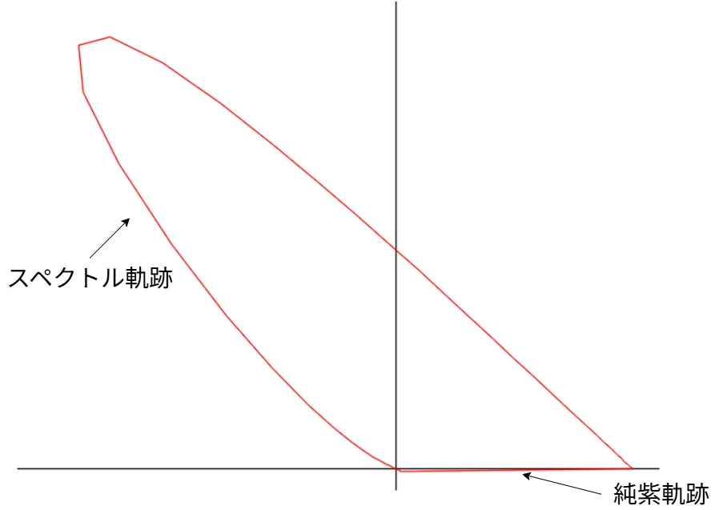
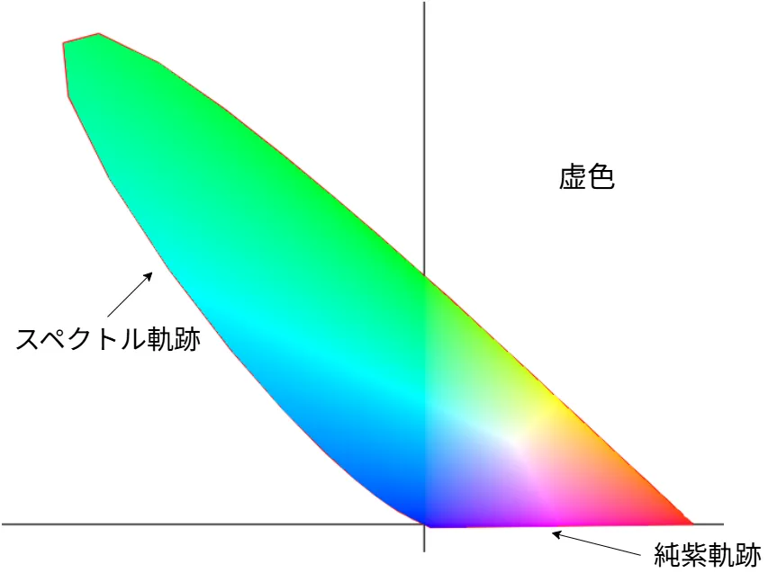

# RGB空間について  
今回は色空間から始めよう.  
前と同じで主に参考にしているのはこの記事[^1].  
また、ここの記事[^2]も前回同様に参考にした、非常に分かりやすくて好き.  

前回、CIE1931のRGBをグラフとして表した.  
R,G,Bの3つのグラフだけど、これをグラフで表せるのであれば、関数のようにプロットもできそうである.  
とはいえ3次元で扱うのは中々にめんどい...そこで、上手く2次元に射影するように考える.  
ここで$`\bar{r^{\prime}}+\bar{g^{\prime}}+\bar{b^{\prime}}=1`$のような空間を考え,これを射影したい.  
しかし、等色関数は基本的に正規化されてるわけではないため、使えない...  
なら、正規化すればいいじゃない！ということで正規化を行う.  

```math
\begin{equation}
    \begin{split}
    & R = \frac{r^{\prime}}{\bar{r^{\prime}}+\bar{g^{\prime}}+\bar{b^{\prime}}} \\
    & G = \frac{g^{\prime}}{\bar{r^{\prime}}+\bar{g^{\prime}}+\bar{b^{\prime}}} \\
    & B = \frac{b^{\prime}}{\bar{r^{\prime}}+\bar{g^{\prime}}+\bar{b^{\prime}}} \\
    \end{split}
\end{equation}
```


こうすれば$`R+G+B=1`$を満たすようになる！  
ここでは三次元になっているが、$`B`$に着目すると以下のようなことが言える.  

```math
\begin{equation}
    \begin{split}
    B = 1 - R - G
    \end{split}
\end{equation}
```

つまり、$`R,G`$があれば自然と$`B`$は求まるわけだ！  
なので、Bは考えずに$`G,B`$のみをプロットすれば2次元となる.  
こうやってプロットしたものを`色度座標`[^3]というらしい.  
総和が1で、$`R,G`$という自由度2を決定することで一意に決まるものということなので、確かに正しそう.  

そしたらまずはプロットするコードを実際に書いてみよう.  
やることは非常に簡単、前回でRGBは求まっている.  
そのためそれを参照して内積を上手く使って$`\bar{r^{\prime}}+\bar{g^{\prime}}+\bar{b^{\prime}}`$を計算する.  
今回は下部分にも線を引きたいので、最後の線は開始地点にひくように`index`を考慮した.   
```c++
int index = i + 1 < wavelengthes.size() ? i + 1 : 0;
const Vec3 valueCurrent{ color_R[i], color_G[i], color_B[i] };
const Vec3 valueNext{ color_R[index], color_G[index], color_B[index] };

const double currentSum = valueCurrent.dot(Vec3::One());
const double nextSum = valueNext.dot(Vec3::One());
```
あとは$`R,G`$の場合のみを計算すればOK.  
これをLineとしてプロットすればよい.  
```c++
const double current_R = color_R[i] / currentSum, current_G = color_G[i] / currentSum;
const double next_R = color_R[index] / nextSum, next_G = color_G[index] / nextSum;
```

プロットした結果は以下のような感じ.  



うん、それっぽい形が表れている！  

図にも書いた通り、色度座標においてこの赤線は「スペクトル軌跡」と呼ばれる.  
単一波長の純粋なスペクトルの色を波長順に並べた軌跡みたいなものだ.  
虹なんかが分かりやすいよね、様々な波長が混ざっている光が、水滴によって屈折して各波長に別れて、結果「単色光」になる.  
この単色光に別れた軌跡がスペクトル軌跡ともいえそうだ.  

虹は色々な波長に屈折して別れる.  
ということは青の波長と赤の波長といったものが混ざり合った色は表現されることは決してない.  
こういう混色で単色光では表せない軌跡を「純紫軌跡」[^5]と呼ぶ.  
この線は1つの波長のみでは絶対に表せない色なので、虹にあらわれない色の軌跡というわけだ.  

さて、実際に見る図では中の色を$`x:R,y:G,1-R-G:B`$のように対応させて表示させている.  
どうせなら塗りたいよね！塗りたい！ということで塗っていきましょう.  

まずはそもそもの色度座標の内部かの判定をする必要がある.  
一般的にどうやってるのかは知らないけども(知ってる人いたら教えてください)、今回は完全に多角形して表示を行っている.  
そういえば以前に多角形での内部塗りつぶしをやっていたではないか！[^4]  
あの時と同じ手順で内部判定をしてやればよいね.  
今回は内部判定の詳しい解説はSkip,気になる人はリンクを飛んで読んでもらえればと.  

ということでまず最初はEdgeを作成する.  
作成するEdgeは可視範囲のみでOK.人間に見えない範囲は別段今回の色空間として意味がないからだね.  
そして、先程の計算でまず$`R,G`$を求める.  
```c++
struct Edge
{
    Vec2 m_origin;
    Vec2 m_length;
};

Array<Edge> edges;

for (int i = 0; i < wavelengthes.size() - 1; i++)
{
    bool isVisible = wavelengthes[i + 1] <= 700;

    const Vec3 valueCurrent{ color_R[i], color_G[i], color_B[i] };
    int index = isVisible ? i + 1 : 0;
    const Vec3 valueNext{ color_R[index], color_G[index], color_B[index] };

    const double currentSum = valueCurrent.dot(Vec3::One());
    const double nextSum = valueNext.dot(Vec3::One());

    const double current_R = color_R[i] / currentSum, current_G = color_G[i] / currentSum;
    const double next_R = color_R[index] / nextSum, next_G = color_G[index] / nextSum;
```
次に$`R,G`$を$`x,y`$に変換する.  
```C++
    // 線をつくる
    Vec2 start;
    start.x = (current_R - X_BOUND.x) / (X_BOUND.y - X_BOUND.x);
    start.y = 1.0 - (current_G - Y_BOUND.x) / (Y_BOUND.y - Y_BOUND.x);
    start.x = Math::Lerp(sceneMin.x, sceneMax.x, start.x);
    start.y = Math::Lerp(sceneMin.y, sceneMax.y, start.y);

    Vec2 end;
    end.x = (next_R - X_BOUND.x) / (X_BOUND.y - X_BOUND.x);
    end.y = 1.0 - (next_G - Y_BOUND.x) / (Y_BOUND.y - Y_BOUND.x);
    end.x = Math::Lerp(sceneMin.x, sceneMax.x, end.x);
    end.y = Math::Lerp(sceneMin.y, sceneMax.y, end.y);
```
最後にEdge Function用のEdgeを保存すれば終わり.  
これを可視範囲のみ行う.  
```c++
    // edgeを作成
    Edge e;
    e.m_origin = start;
    e.m_length = start.xy() - end.xy();
    edges.push_back(e);

    if (!isVisible)
    {
        break;
    }
}
```
そしたら、各Pixelに対してEdge Functionの判定を行う.  
ただしあまりにも$`dx,dy`$が小さいと判定がおかしくなってたので、こいつはskipしておいた.  
```c++
for (int x = sceneMin.x; x <= sceneMax.x; x++)
{
    for (int y = sceneMin.x; y < sceneMax.y; y++)
    {
        bool isInside = true;
        for (const auto& edge : edges)
        {
            double compare =
                (static_cast<double>(x) - edge.m_origin.x) * edge.m_length.y
                - (static_cast<double>(y) - edge.m_origin.y) * edge.m_length.x;

            if (Abs(edge.m_length.x) <= 1e-1 || Abs(edge.m_length.y) <= 1e-1)
            {
                continue;
            }

            if (compare < 0.0) {
                isInside = false; break;
            }
        }
```
そして、中と判定された場合は色を付ける.  
まず最初に$`x,y`$を$`R,G`$に戻す.  
戻した$`R,G`$から、$`B`$を算出.  
```c++
        if (isInside)
        {
            // RGをカラーに
            double R = (x - sceneMin.x) / (sceneMax.x - sceneMin.x);
            double G = 1.0 - (y - sceneMin.y) / (sceneMax.y - sceneMin.y);
            R = Math::Lerp(X_BOUND.x, X_BOUND.y, R);
            G = Math::Lerp(Y_BOUND.x, Y_BOUND.y, G);

            // Bを求める
            double B = 1.0 - R - G;
```
そしたら最大値を計算して、正規化をする.  
正規化したのを割ることで$`0.33,0.33,0.33`$みたいなものは$`1,1,1`$になる.  
また、負の値は色としては表示が不可なので、0にクランプしておく.  
まあ、そもそも数値上の色でしかないのでこうするしかない...  
最後にディスプレイに合わせるためにガンマ補正をすればOK.  
```C++
            double maxElement = Max({ R,G,B });

            // 負を潰しつつ正規化
            R = Max(R/maxElement, 0.0);
            G = Max(G/maxElement, 0.0);
            B = Max(B/maxElement, 0.0);

            image[y][x] = ColorF{ R,G,B,1.0 }.gamma(2.2);
        }
    }
}
```

結果は以下のような感じ.  
これがrg色度図となるわけである.  



ここにおいて先程も言った通り、スペクトル軌跡という単色光があって、そのブレンドによって色が決まる.  

* 中心部分: ちょうど$`1:1:1`$で混ぜたもので白
* 下の方の純紫軌跡付近: 赤と青の混合でマゼンタ
* 左の線付近: 緑と青の混合でシアン
* 右の線付近: 緑と赤の混合でイエロー

といった風にスペクトル軌跡を基準にして、その軌跡の下側に混色した色があらわれるわけである.  
では、この曲線の外側は？これは人には認知することができない範囲で「虚色」という.  
ということはディスプレイに表示する色とかはすべてこの範囲に含まれていえるというわけだ.  
実際にsRGB何かはこの矩形内だね、この表示もやりたいけどそれはまた今度.  

といったところで、今回はやめておこうかな.  
次回は一気にXYZ色空間を駆け抜ける予定です.  

[^1]: [XYZ色空間に迫る(1)](https://qiita.com/Ushio/items/203f16ad1e23fd42231c)  
[^2]: [色彩工学 (1) - CIE 1931色空間](https://henatips.com/page/37/?id=37)  
[^3]: [色度(光学)](https://w.wiki/VexS)  
[^4]: [ラスタライズをやってみる](../Basics/Rasterization_01.md)  
[^5]: [LEDの色度図・色度座標とは？](https://www.my-craft.jp/html/aboutled/led_shikidozu.html)