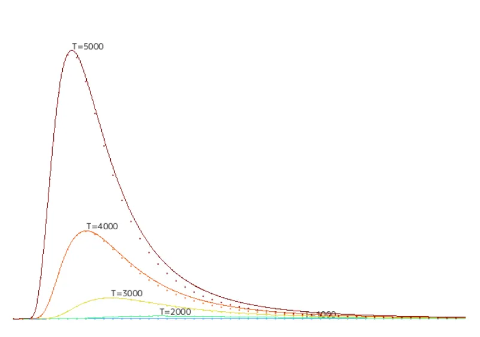
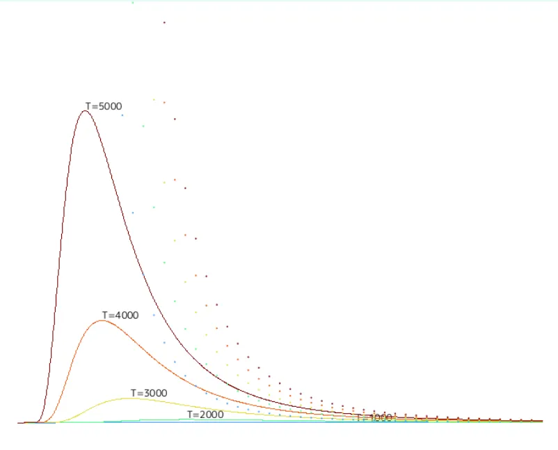
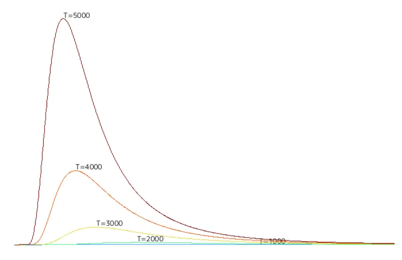
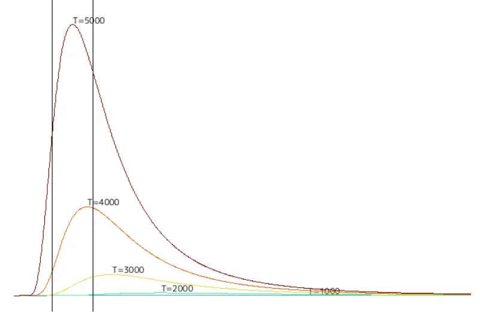
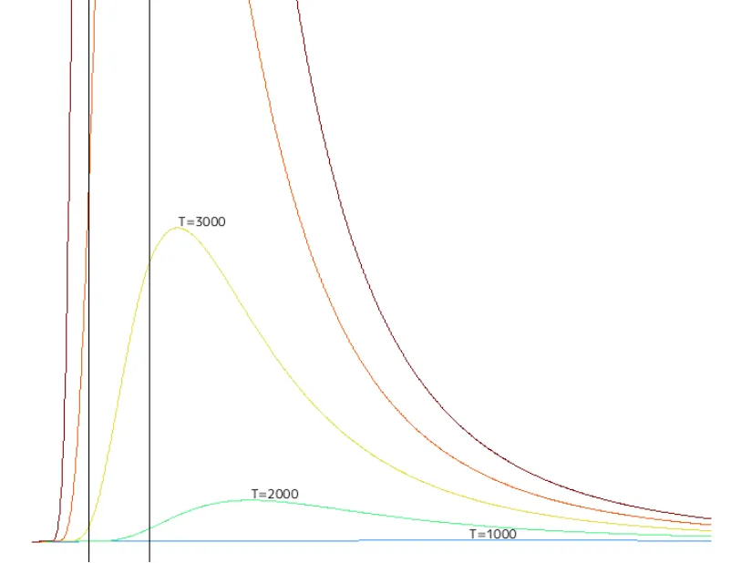

# 黒体への道 その3: そしてプランクの法則へ  
今回は波長の全体像であるスペクトルと放射輝度をグラフに描画しつつ、その形状の予測の歴史に迫っていく.  
こういうのは実際に描画を自分で書いた方が理解がしやすい...  
また、よくネットで見る図は振動数で記述されているが、今回は波長を元にして記述していこうと思う.  
それでは始めようか.  

さて、まず前回のキルヒホッフの法則[^1]で空洞放射をやった.  
炉の中に入った光は反射していくうちに吸収されて、出てくることがないため黒体に近い状態になっているというやつ.  
この黒体に近い状態で放射される波長を分光器で分離し、分離した光の強さを実測してデータを集めたらしい.  
この時、予測ではあるが多分温度に関しては固定していると思う.  

さて、この横軸が波長(or振動数)で縦軸が光の強さとなっているのがスペクトル分布である.  
スペクトル分布は温度が固定だとすれば、この形状のモデルが作ることが出来れば、スペクトル分布の形状のみで温度が分かる.これが大事.  

前回の時にも述べたが、この時の時代背景として溶鉱炉の正確な温度を知りたい...というものがある.  
普通の温度計だと基本的にこの温度だと溶けるので使えない、そのためには別の方法が必要だったのである.  
この分布が予測できれば、スペクトル分布を測ると形状が分かるので、後はモデルから実測値に合う温度を求めることが可能.ということだと思う.  
他にも天文学であれば、遠くの恒星でとても直接測ることは無理そうな天体でも、そこから放射される電磁気のスペクトル分布を取ることさえできれば、恒星の温度もわかる.  
こういう応用範囲も広いものって面白いよね.  

さて、ここからが大事なモデルの推測の歴史.  
軽く触れるだけであれば、ここ[^2][^3]の資料が分かりやすいかなと思う.  

まず一番最初に出てくるのは1897年の「ウィーンの放射法則」である.[^4]  
実験結果のスペクトル分布に基づいて推測したモデルであるが、これは以下の形をしている.  

```math
L(\lambda, T) = \frac{2hc^{2}}{\lambda^{5}} \exp(-\frac{hc}{\lambda kT})
```
ここで$`h`$はプランク定数,$`c`$は光速,$`k`$はボルツマン定数である.  
定数なので、これはそのまま置けばOK.  
実際にコードでは以下のようにした.  

```c++
	constexpr double h = 6.62607015 * 1e-34;	// プランク定数
	constexpr double c = 2.99792458 * 1e+8;		// 光速
	constexpr double k = 1.380649 * 1e-23;		// ボルツマン定数
```

そして、ウィーンの放射法則も式通りにコードを記述.  

```c++
auto WienLaw = [h, c, k](double lambda, double T)
    {
        double L2 = lambda * lambda;
        double L5 = L2 * L2 * lambda;
        double Term1 = 2.0 * h * c * c / L5;
        double Term2 = Exp(-h * c / (lambda * k * T));

        return Term1 * Term2;
    };
```

これを実際にプロットして、実測値と合わせて比較してみよう.  

  

実線が正しい値で、点線がウィーンの放射法則だ.  
低波長の時は非常によくフィットしているが、長波長の場合若干下の方に外れている.  
当時の話にはなるが、周波数の低い方,つまり長波長の実験はまだ実用的でなく、データも十分ではなかった.  
そのため、この式でもフィットしてたらしいが、実際に長波長が取られた状態で比較すると合わない部分が出てきた...ということになる.  

次に見るのは「レイリー・ジーンズの法則」である.[^5]  
古典統計力学を用いて理論的にレイリー卿が1900年6月に発表したモデルである.  
しかし、ちょっと誤りがあったため、ジーンズが1905年にそれをちょっと修正したので、二人の名前が入っているという感じだ.  
式としては以下のような形をしている.  

```math
L(\lambda, T) = \frac{2ckT}{\lambda^{4}}
```

なんか式を見てるだけだと上手くいかなそう...  
短波長になればなるほど分母が小さくなっていって発散していくような...  
まあとりあえずプロットしていくことにしよう.  
コードは以下のような感じだ.  

```c++
	auto RayleighJeansLaw = [h, c, k](double lambda, double T)
		{
			double L2 = lambda * lambda;
			double L4 = L2 * L2;
			return 2 * c * k * T / L4;
		};
```

あとは比較！  

  

うん、知ってた.  
今回の式は前回のウィーンの放射法則と違い、長波長に関しては合っている.(スケールとして見づらいが...)  
が、しかし短波長の場合式の形状通りに発散してしまい、明らかにおかしいことになっている.  
ただし、これはちゃんと理論的に問題なく導出されていたものである.  
今では疑いようもない事実だけども、当時はやっぱり量子論がなかったため当時の理論的に正しくても問題は発生するというわけだ...  
逆に「当時の」理論的に正しいということが、理論の方に問題があるというのを示す決定的な証拠となり、量子論の扉を開く1つのピースとなったともいえる.  

因みにレイリー卿についてWiki[^6]で見てたけど、晩年もやはり古典主義を信じ続けていたらしい...  
まあそうよね、簡単に受け入れられない人もいるよね.  
ある意味、今のAIを受け入れる/受け入れない論争と近しいところがあるのかも？  

さて、そしたら最後に見るのが正しいモデル、「プランクの法則」.[^7]  
発表されたのは1900年の10月.  
このモデルは低波長では合う「ウィーンの放射法則」と長波長では合う「レイリー・ジーンズの法則」を上手く補間するようなモデルを作った.  
とはいえ面白いことに年代から見て分かる通り、レイリー・ジーンズの法則を実際に知ってたから補間した...というわけではなく、全く別の考察から求めたというのも面白いところ.  
そもそもジーンズが修正したのは1905年で、プランクの法則よりも後.  
まだまだプランクの式を信じるには中々厳しい背景がそこには詰まっている.  

さて、プランクの式は以下の式である.  

```math
L(\lambda, T) = \frac{2hc^{2}}{\lambda^{5}} \frac{1}{\exp(\frac{hc}{\lambda kT}) - 1}
```

まず短波長の場合、$`\exp(\frac{hc}{\lambda kT})`$は非常に大きな値となるため、$`1`$は些細なものとなる.  
つまり,

```math
\exp(\frac{hc}{\lambda kT}) - 1 \approx \exp(\frac{hc}{\lambda kT})
```
となる.これを当てはめると,  

```math
\begin{split}
L(\lambda, T) & \approx \frac{2hc^{2}}{\lambda^{5}} \frac{1}{\exp(\frac{hc}{\lambda kT})} \\
& = \frac{2hc^{2}}{\lambda^{5}} \exp(-\frac{hc}{\lambda kT})
\end{split}
```

なるほど、確かに短波長の場合はウィーンの放射法則になってるっぽい！  

次に長波長の場合,先程の$`\exp`$をテイラー展開すると,

```math
\begin{split}
\exp(\frac{hc}{\lambda kT}) &= 1 + \frac{hc}{\lambda kT} + \cdots \\
& \approx 1 + \frac{hc}{\lambda kT}
\end{split}
```

これを適用すると、

```math
\begin{split}
L(\lambda, T) & \approx \frac{2hc^{2}}{\lambda^{5}} \frac{1}{1+ \frac{hc}{\lambda kT} - 1} \\
&= \frac{2hc^{2}}{\lambda^{5}} \frac{\lambda kT}{hc} \\
&= \frac{2ckT}{\lambda^{4}}
\end{split}
```

となる.  
確かに長波長の場合はレイリー・ジーンズの法則になっている！  
ここまで求めると確かにそれっぽいね.  

実際にコードで書いてみよう.  
とはいえ、式通りに当てはめるだけである.  

```c++
auto PlankLaw = [h, c, k](double lambda, double T)
    {
        double L2 = lambda * lambda;
        double L5 = L2 * L2 * lambda;
        double Term1 = 2.0 * h * c * c / L5;
        double exponent = Exp(h * c / (lambda * k * T));
        double Term2 = 1.0 / (exponent - 1.0);

        return Term1 * Term2;
    };
```

こうして描画されたのが以下.今までも描いてたやつだ.  



因みに1900年の10月時点では実験結果を元に式を示しただけだったらしい.  
実際に理論的な考察をして12月に更にその内容を発表してるっぽい.  
この考察が偉大で、その中で考察したエネルギーは$`\epsilon = h \nu`$という値を導いた.  
このエネルギーが飛び飛びにしかとれない、つまり量子であるというのにつながるわけだが、今回は量子論をやりたいわけではないので深くは入らないでおこう.  

さて、最後に可視光の範囲に直線を引こう.  
あくまで理論としては全波長区域に対して求まったが、色に関して言えば大事なのは可視光の域である.  
これがどんな範囲なのかを見てみる.  
実際に引いたのが以下である.  

  

まずは分布として高い位置から.  
$`T=5000`$とかは太陽光に近く、太陽の表面温度の方に近いような温度.  
太陽の表面温度は$`T \in [5500,6000]`$くらい.  
この時の波長は中心部に近いので、緑が一番多くはあるが、全体的に波長を含んでいるので白.  
もしこれよりも大きくなればなるほど、ピークは青の方によって行く.  
つまり、$`T`$が高くなれば青色になっていくということになる.  
ここの図[^9]を見ると$`T=10000`$まで書かれているので、青になるのも分かりやすいと思う.  

さて、そしたら次に低温度にフォーカスして図を出力してみよう.  

  

まず$`T \in [1500,2000]`$くらいがろうそくの火くらいの温度.  
$`T=2000`$で見ると、ほぼほぼ赤の領域で緑や波長は含まれていない.  
そのため、基本的には赤からオレンジの間くらいの色になる.  

次に$`T= 3000`$くらいが電球くらいの色.  
この辺になると青はまだ少ないが緑は程よく入るようになってきて、黄色になり段々と白に近い暖色となっていく.  

こんな感じでグラフから簡単に色を読み取ることが可能！  
だが、ちょっと面倒な気もする...  
確かに読み取れはするが、ちゃんとCIE1931のようなものを脳内で照らし合わせなきゃいけない.  
もう少し分かりやすく理解できる図が欲しい...  

ということで次回はプランク軌跡をやろうと思う.  

[^1]: [リンク張り]()  
[^2]: [空洞放射](https://hooktail.sub.jp/quantum/hollow/)  
[^3]: [3-4：　プランクの公式](https://ne.phys.kyushu-u.ac.jp/seminar/MicroWorld/Part3/P34/Planck_formula.htm)  
[^4]: [ウィーンの放射法則](https://eman-physics.net/statistic/wien.html)  
[^5]: [レイリー・ジーンズの理論](https://eman-physics.net/statistic/rayleigh.html)  
[^6]: [ジョン・ウィリアム・ストラット (第3代レイリー男爵)](https://w.wiki/6ju6)  
[^7]: [プランクの理論](https://eman-physics.net/statistic/planck.html)  
[^8]: [3-5：　エネルギー量子の発見](https://ne.phys.kyushu-u.ac.jp/seminar/MicroWorld/Part3/P35/energy_quantum.htm)  
[^9]: [光と色の話　第一部](https://www.ccs-inc.co.jp/guide/column/light_color/vol33.html)  