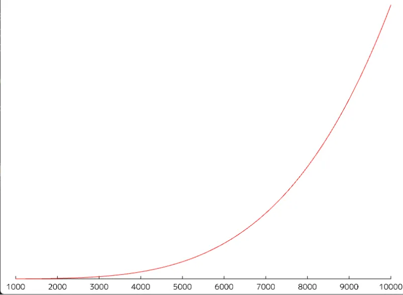

# 黒体への道 その1: シュテファン＝ボルツマンの法則  
ちょっとずつ黒体についてもちゃんと勉強をしておこうかなと思い、
ここからは色空間を離れてちょっと物理っぽい話に突っ込んでいこうかなと思う.  
今回の内容はEMANの物理学さんの記事が[^1]個人的に参考になった.  

光は電磁波の一種というのは今となっては当たり前だけど、光という電磁波を受けた物体は熱くなる.  
そとで太陽に直射で浴びると暑い...となることからも感覚的に分かる気もする.  

光というのは熱とも密接に関係している.  
松明を持ってる時は辺りが見えた状態だけど、消えると見えなくなる...
これは松明に点いた火が光を放っているからと考えられると思う.  
とくに熱が強ければ強い光や温度が発生するというのも感覚的にはありえると分かると思う.  
刀鍛冶の鍛冶場で発生している熱を浴びたら汗がダラダラ出てくると思うが、松明だとそうはならないだろうし...  

こういった熱によって光や電磁波が出ることを「熱放射」というらしい.  
名前の通りで分かりやすいね.  
そうなるとある温度$`T`$の熱が行う熱放射のエネルギー$`K`$というのを考えられそう,というのは感覚的に分かると思う.  
これを実際に実験して提案された式が以下である.  

```math
K = \sigma T^{4}
```

これを「ステファン・ボルツマンの法則」というらしい.  
見つけ方としてはデュロン,プティが求めた実験結果がある.  
それを見たステファンが熱の多くが失われてるので成り立たないのでは...と考えた.  
そして他の人の似た実験も合わせて検討し直し、経験的に求まった式が上の式ということらしい[^2].  
そうして求まったステファンの式をボルツマンが理論的証明をしたということで、両者の名前が入ってるってわけだ.  
このとき$`\sigma`$は以下のような定数となる.  

```math
\sigma = 5.670374419... \times 10^{-8} [Wm^{-2}K^{-4}]
```

となるらしい.  

また,上記式は理想的状態のため、そうはいかない場合もあるため、係数をつける場合もある[^3].  

```math
K = \epsilon \sigma T^{4}
```

この$`\epsilon`$を放射率というらしい.  

さて、そしたら実際にグラフの描画をしてみよう.  
横軸に温度で縦軸がエネルギーとなるようなものだ.  
今回は温度の範囲は$`[1000,10000]K`$だ.  
色関係だとこの範囲が多いし、自分が参考にしてるところもこの範囲だったのでこの範囲に決定した[^4].  

やることは簡単、温度を渡したらエネルギーを返す関数を用意するだけ.  
```c++
	auto f = [](const double T, const double epsilon = 1.0)
		{
			constexpr double sigma = 5.670374419 * 10e-8;
			const double T2 = T * T;
			const double T4 = T2 * T2;
			return Clamp(epsilon, 0.0, 1.0) * T4 * sigma;
		};
```
お試しに$`\epsilon`$も持たせるようにしたけど、まあ今回は$`\epsilon=1.0`$で考える.  
これで計算した結果を描画したのが以下.  

  

徐々に温度が上がるほど急激にエネルギーも上がっていくということか.  
ちょっとグラフを最大値を1.0にして正規化しているため、2000K辺りがつぶれている.  
ただ、ろうそくが大体2000Kなので、指数対数的に増えてつぶれてるだけで、自分たちが見る分には結構影響のあるものというのは大事.  

まあとはいえ、温度,つまり熱が高まれば高まるほどエネルギーも大きくなるというのが分かれば、今回はいい感じかなと思う.  

[^1]: [ステファン・ボルツマンの法則](https://eman-physics.net/statistic/stefan.html)  
[^2]: [A Brief History of the T4 Radiation Law](https://www.researchgate.net/publication/267650295_A_Brief_History_of_the_T4_Radiation_Law)  
[^3]: [シュテファン＝ボルツマンの法則](https://w.wiki/WBbr)  
[^4]: [Blackbody](https://www.scratchapixel.com/lessons/cg-gems/blackbody/blackbody.html)  
[^5]: [色温度](https://www.hibino.co.jp/glossary/iroondo.html)  