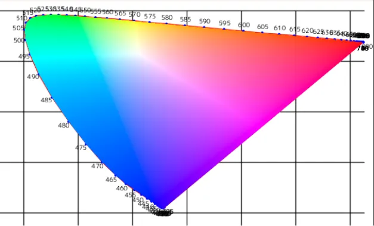
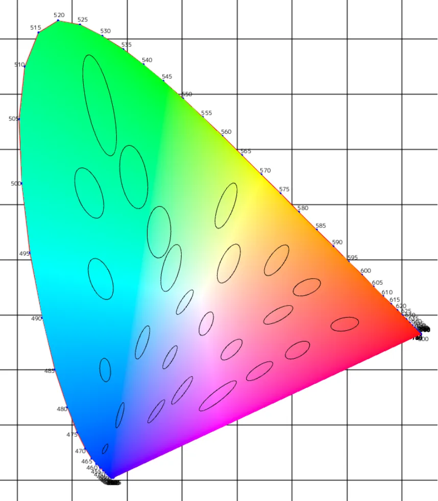
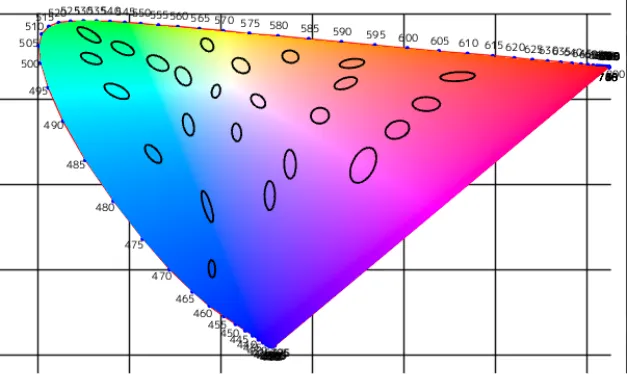
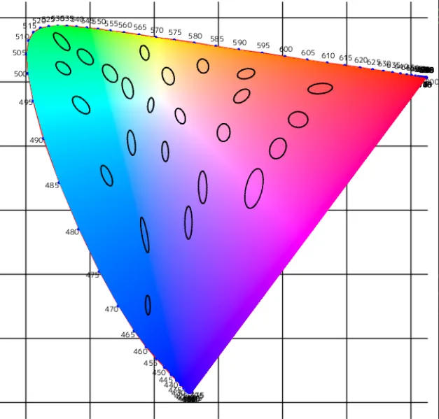

# UCS色度図 ~CIE1960とCIE1976によるUV空間~
前回はMacAdam楕円で色差が近い範囲というのを求めた[^1].  
今回はこれを考慮したUCS色度図に迫っていく.  
参考としてはWiki[^2]がこの辺は詳しい.ここ[^4]も参考になる.    

さて、そもそもMacAdam楕円よりも前にさかのぼると、1935年にJudd先生[^3]が均一空間になるような空間を射影変換により定義をしていた.  

```math
\begin{pmatrix}
R_{Judd} \\
G_{Judd} \\
B_{Judd}
\end{pmatrix}
= 
\begin{pmatrix}
3.1956 & 2.4478 & -0.1434 \\
-2.5455 & 7.0492 & 0.9963 \\
0.0000 & 0.0000 & 1.0000
\end{pmatrix}
\begin{pmatrix}
X \\
Y \\
Z
\end{pmatrix}
```

これの後、MacAdam先生が1937年にこれと同じような空間を提案しており、これがuv色度図空間なわけである.  
この空間だと、1942年に提案したMacAdam楕円の歪み方がXY色度図よりも均一になっているため、1960年に晴れてCIE 1960 UCS色度図として採用されることになる.  

このuvの変換は以下のようにして行われる.  
```math
\begin{split}
u &= \frac{4x}{12y-2x+3} \\
v &= \frac{6y}{12y-2x+3}
\end{split}
```

因みに余談だけど自分は結構使うので、逆変換も見ておく.  
uvからxyに変更する際は以下の式となる.  

```math
\begin{split}
x &= \frac{3u}{2u-8v+4} \\
y &= \frac{2v}{2u-8v+4}
\end{split}
```

合ってるのか気になる人は実際に逆変換の計算をやってみるといいと思う.  
自分は$`x(u,v,y)`$の形で表した後、これを$`y`$に代入することで解いた.  
結果として$`y = \frac{v}{u-4v+2}`$が出てきてうん～？となったけど、単純に分子分母2倍したら合いますねこれ.  
$`x`$に関しては$`x(u,v,y)`$に対して求まった$`y`$を代入すればいけるはず.  
ここは自分は計算してない.  

さて、そしたら今まで書いてきたコードを改変して、実際にまずはUV空間を描画してみよう.  
まずはUV空間の範囲,XYとは空間をずらした結果範囲が変わるため、別途定義をしておく.  
```c++
    // UV空間
	Vec2 U_BOUND = Vec2{ -0.05, 0.65 };
    Vec2 V_BOUND = Vec2{ -0.05, 0.4 };
    // XY空間
	Vec2 X_BOUND = Vec2{ -0.05, 0.8 };
	Vec2 Y_BOUND = Vec2{ -0.05, 0.9 };
```

そして、座標系変換処理.  
これは先程定義したXY空間からUV空間への変換.  
そして、UV空間からXY空間への変換を定義.  
これで自由に行き来が可能になった！  
```c++
auto ConvertUV = [](Vec2 xy)
    {
        double denom = 12.0 * xy.y - 2.0 * xy.x + 3.0;
        return Vec2{ 4.0 * xy.x, 6.0 * xy.y } / denom;
;		};

auto ConvertXY = [](Vec2 uv)
    {
        double denom = 2.0 * uv.x - 8.0 * uv.y + 4.0;
        return Vec2{ 3.0 * uv.x, 2.0 * uv.y } / denom;
    };
```
基本的にはXYに対して`ConvertUV`を適用すればOK.  
```c++
Vec2 current_uv = ConvertUV({ current_X, current_Y });
Vec2 next_uv = ConvertUV({ next_X, next_Y });
```
これを使うだけで、ちゃんとUV空間での作用と考えることが可能！  

内部の色空間の塗りつぶしはまず判定はUV空間で行う.  
内部と判定された場合はXY空間に持っていき,そこから今までと同じように色を求める.  
つまり、UV空間(判定)->XYZ空間->RGB空間で色に戻しているわけだ.  
今まではXYZ空間(判定)->RGB空間という流れだったので、ちょっと面倒になってるがやることは変わってない.  
```c++
if (isInside)
{
    // UVをXYに変換
    double U = (x - sceneMin.x) / (sceneMax.x - sceneMin.x);
    double V = 1.0 - (y - sceneMin.y) / (sceneMax.y - sceneMin.y);
    U = Math::Lerp(U_BOUND.x, U_BOUND.y, U);
    V = Math::Lerp(V_BOUND.x, V_BOUND.y, V);

    auto xy = ConvertXY({ U,V });

    // Bを求める
    double Z = 1.0 - xy.x - xy.y;

    // XYZからRGBに戻して色にする
    Vec3 entry = Vec3{ xy ,Z };
    Vec3 color;
    color.x = entry.dot({ 0.418466, -0.158661, -0.082835 });
    color.y = entry.dot({ -0.091169, 0.252431, 0.015707 });
    color.z = entry.dot({ 0.000921, -0.002550, 0.178599 });
    color /= color.maxComponent();

    image[y][x] = ColorF{ color,1.0 }.applySRGBCurve();
}
```

これで完成！実際にUCS1960を見てみよう.  

  

うん、いい感じ.  
なんかおかしい部分として、ここのサイトの図[^3]はxの最大値が0.6より手前くらいになっている.  
が、Wiki[^2]に関しては0.6をちょっと超えたもので、自分が描画したときはこれと同じ形状になった.  
個人的にはWikiと整合が取れたので、まあこれが合ってるのかなと思う.  

これが均等色空間であり、人間の感じる色差の知覚とその色度図上の距離が一致しているであろうとする図となるわけである.  

さて、そうなると距離が一致しているということは色差の範囲がどこも同じであるべき.  
となると、MacAdam楕円もできるだけどこでも同じような形状になるはずである.  
つまり青の領域のMacAdam楕円と緑の領域のMacAdam楕円では、前回はこんな風に差があった.  



この差がなくなるはずであろう.ということである.  
こういうのは確認してみるのが一番速い.  
実際にコードでUV空間にもMacAdam楕円が出るようにしてみよう.  

まず面倒なんだけど、前回のXYZ空間の解像度と合うようにSceneSizeは補正する.  
そのため、現状のシーンサイズではなく前回のMacAdam描画で使用したものを用意.  
```c++
	auto macAdamSceneSize = Vec2{ 850,950 };
	Vec2 macAdamSceneMin = Vec2::One() * sceneOffset;
	Vec2 macAdamSceneMax = macAdamSceneSize - sceneMin;
```
MacAdamの中心座標もこれを使って計算しておく.  
```c++
for (auto& v : macAdam.m_calculate)
{
    // CenterをScene座標にしておく
    Vec2 center = v.second.center;
    center.x = (center.x - X_BOUND.x) / (X_BOUND.y - X_BOUND.x);
    center.y = 1.0 - (center.y - Y_BOUND.x) / (Y_BOUND.y - Y_BOUND.x);
    center.x = Math::Lerp(macAdamSceneMin.x, macAdamSceneMax.x, center.x);
    center.y = Math::Lerp(macAdamSceneMin.y, macAdamSceneMax.y, center.y);

    v.second.setCenter(center);
}
```
MacAdamの描画は空間を移していくため、単純にEllipseのみでは難しい.  
空間を移すと、楕円の中心位置が移動するだけではなく、長軸短軸や回転値も変わるからだ...  
ではどうするか？今回は楕円状の点を自前で計算して、それを変換で移していくことにする.  

まず最初にデータを取るところ、これは前回と同じだ.  
```c++
auto DrawMacAdam = [&]()
    {
        for (const auto& v : macAdam.m_calculate)
        {
            const double angle = v.first;
            const auto ellipse = v.second;
```

今回は楕円を複数個の点に分けて描画するようにする.  
そのため、分割を行うようにする.  
この分割数に応じて、回転値を求めればよい.  
```c++
            constexpr int DividePoints = 100;
            constexpr double PointScale = 8.0;

            for (int i = 0; i <= DividePoints; i++)
            {
                double theta = i * Math::TwoPi / DividePoints;
```
そしたらまずはXYのScene空間での計算を行う.  
楕円の式を計算してスケールを掛ける.  
その後、回転を適用.まだ原点にある楕円なので、回転させても問題ない.  
最後にこの楕円を中心位置にずらせばOK.  
```c++
                // XY-Scene空間
                Vec2 SceneXY = Vec2{ ellipse.a * std::cos(theta), ellipse.b * std::sin(theta) } * PointScale;
                SceneXY.rotate(ToRadians(-angle));
                SceneXY = SceneXY + ellipse.center;
```
次にXY-Scene空間となっているものをXY空間に移す.  
```c++
                // XY-空間へ
                Vec2 xy;
                xy.x = (SceneXY.x - macAdamSceneMin.x) / (macAdamSceneMax.x - macAdamSceneMin.x);
                xy.y = 1.0 - (SceneXY.y - macAdamSceneMin.y) / (macAdamSceneMax.y - macAdamSceneMin.y);
                xy.x = Math::Lerp(X_BOUND.x, X_BOUND.y, xy.x);
                xy.y = Math::Lerp(Y_BOUND.x, Y_BOUND.y, xy.y);
```
ここまでくれば後は簡単、XY空間からUV空間に移して、UV-Scene空間に移せばOK.  
```c++
                // UV-空間へ
                Vec2 uv = ConvertUV(xy);

                // UV-Scene空間へ
                uv.x = (uv.x - U_BOUND.x) / (U_BOUND.y - U_BOUND.x);
                uv.y = 1.0 - (uv.y - V_BOUND.x) / (V_BOUND.y - V_BOUND.x);
                uv.x = Math::Lerp(sceneMin.x, sceneMax.x, uv.x);
                uv.y = Math::Lerp(sceneMin.y, sceneMax.y, uv.y);

                Circle{ uv, 1.0 }.draw(Palette::Black);
            }
        }
    };
```

さて、そしたら結果を見てみよう.  

  

うん、いい感じで描画されている.  
今回は先程のここのサイト[^2]にプラスして、こちらも[^5]参考にして合ってるか確認した.  
結果のサンプルがあるのはありがたいね.先駆者に感謝.  

こうやって見ると、確かに前回よりは楕円の均一性は上がった気がする.  
とはいえやっぱり差は大きい気がしてならない...単純な変換で色差を測るのは中々無理そうな気がこれだけでもわかると思う.  

さて、これから少しの時が流れCIE1976として、Eastwoodによって更に次のようにすればより均一性を高められるのでは？と提起された.  

```math
\begin{split}
& u^{'} = u \\
& v^{'} = \frac{3}{2}v
\end{split}
```

単純にvを1.5倍しただけである、簡単.  
ちゃんと書くなら以下のような感じ.  

```math
\begin{split}
u &= \frac{4x}{12y-2x+3} \\
v &= \frac{9y}{12y-2x+3}
\end{split}
```

uvからxyは以下の式で行ける.  

```math
\begin{split}
x &= \frac{9u^{'}}{6u^{'}-16v^{'}+12} \\
y &= \frac{4v^{'}}{6u^{'}-16v^{'}+12}
\end{split}
```

単純に$`u^{'}=u,v^{'}=\frac{3}{2}v`$を当てはめれば、ちゃんと`uv->xy`の変換と同じ式になるはず.  
余談だが、$`v^{'} \to v`$の時、分子もちゃんと$`\frac{3}{2}`$を掛けるのを忘れないように.  
自分はこれを忘れて成り立たなくない...？となってしまった(1敗).  

さて、次はこれを実際に見てみよう.  
コードで変えるのは簡単、座標系の変換部分をちょっと書き換えるだけ！  
```c++
	auto ConvertUV = [](Vec2 xy)
		{
			double denom = 12.0 * xy.y - 2.0 * xy.x + 3.0;
			return Vec2{ 4.0 * xy.x, 9.0 * xy.y } / denom;
		};

	auto ConvertXY = [](Vec2 uv)
		{
			double denom = 6.0 * uv.x - 16.0 * uv.y + 12.0;
			return Vec2{ 9.0 * uv.x, 4.0 * uv.y } / denom;
		};
```

さて、結果を見てみよう.  

  

うん、それっぽくなりました！  
前回よりも確かに均一性は上がってる気はする.  
とはいえやはり小さいところは小さいので、まあそういうもんでしょう.  

といったところで今回はここまで.  
次回はUV空間上でCCTをもう少し深堀していこうと思います.  

[^1]: [UCS色度図準備編 ～MacAdam楕円の可視化と補間～](./MacAdam.md)  
[^2]: [CIE 1960 色空間](https://w.wiki/f8cA)  
[^3]: [ディーン・B・ジャッド](https://w.wiki/f8uV)  
[^4]: [色彩工学 (2) - 均等色空間](https://henatips.com/page/38/)  
[^5]: [色彩工学　その2](https://zemax.seesaa.net/article/407396540.html)  