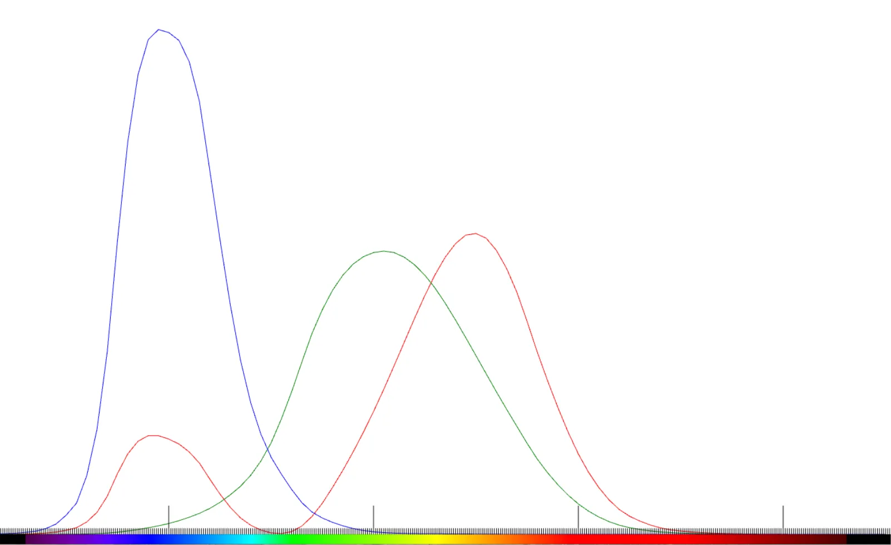
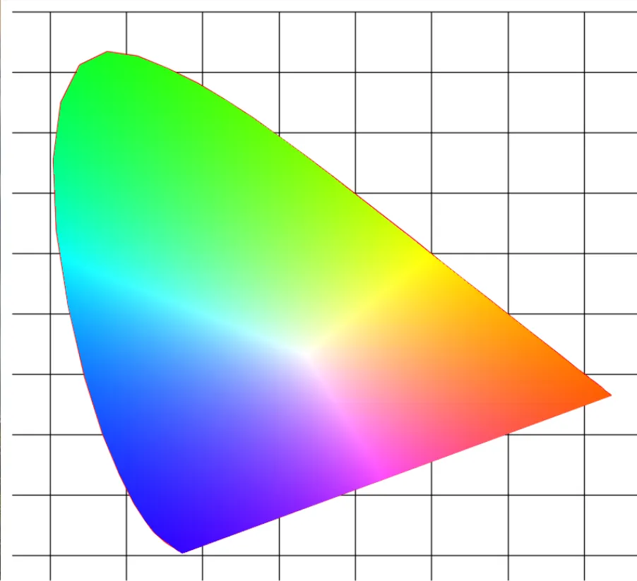
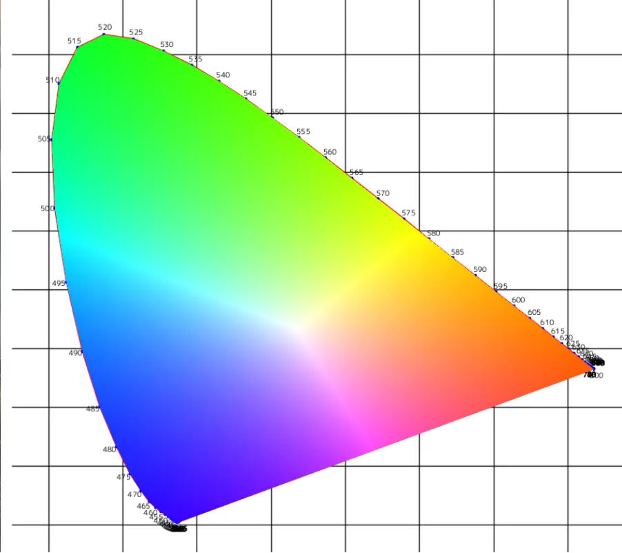

# XYZ表色系と色度図  
今回でやっとXYZ表色系に入っていく.  
前と同じで主に参考にしているのはこの記事[^1]だけど、ついに(2)に.  
また、ここの記事[^2]も前回同様に参考にした.  

以前まで長々とCIE1931をRGB空間で見てきた.  
しかしRGBを混ぜるだけでは表現できない色があるため、混ぜる方向をちょっと工夫することで解決をしていた.  
これによって、RGB空間では「色が負になる」ということが起こっていたのである.  
やっぱり負の値があるのは気持ち悪い...どうにか正の範囲になるようにしたい...  
これがXYZ表色系に向かう動機である.  

さて、ではどうすれば負の発生しないようにできるか？  
単純にRGBの空間からXYZの空間に座標変換を行えばよい.  

```math
\begin{equation}
    \begin{split}
        \begin{bmatrix}
            X \\ Y \\ Z
        \end{bmatrix}
        &= A 
        \begin{bmatrix}
            R \\ G \\ B
        \end{bmatrix} \\
        &= 
        \begin{bmatrix}
            x_{r} & x_{g} & x_{b} \\
            y_{r} & y_{g} & y_{b} \\
            z_{r} & z_{g} & z_{b} \\
        \end{bmatrix}
        \begin{bmatrix}
            R \\ G \\ B
        \end{bmatrix}
    \end{split}
\end{equation}
```

こんな感じで行列$`A`$を掛けて座標変換を行うことで非負の空間に移してしまおうという魂胆である.  
もちろん逆方向も可能.  

```math
\begin{equation}
    \begin{split}
        \begin{bmatrix}
            R \\ G \\ B
        \end{bmatrix}
        &= B 
        \begin{bmatrix}
            X \\ Y \\ Z
        \end{bmatrix} 
    \end{split}
\end{equation}
```

この変換行列の導出、どうやるのかがイマイチぴんと来ていない...  
なんかまたちゃんと資料見つけたら計算してみようかなと思う.  
ということで$`A`$と$`B`$は以下のような感じで定義されている.  

```math
\begin{equation}
    \begin{split}
        A = 
        \begin{bmatrix}
            2.76883 & 1.75171 & 1.13014 \\
            1.0 & 4.59061 & 0.06007 \\
            0.0 & 0.05651 & 5.59417 \\
        \end{bmatrix}
        ,
        B = 
        \begin{bmatrix}
            0.418466 & -0.158661 & -0.082835 \\
            -0.091169 & 0.252431 & 0.015707 \\
            0.000921 & -0.002550 & 0.178599 \\
        \end{bmatrix}
    \end{split}
\end{equation}
```

ここにおける$`B`$は今まで使ってたデータが$`XYZ`$だった関係上、ソースコードで暗黙的に使ってました.  
CIEの最初の回[^3]のコード部分でもちゃんと使ってます.  
今回の座標変換だけど、$`RGB`$を$`XYZ`$に変換しても特徴はそのままなのでそこは注意.  
$`RGB`$で$`R`$が明らかに負だった場合、この色は表せないのは$`XYZ`$空間でも同じ.  
$`XYZ`$空間に移したことで正になり、見た目上はなんか色として表せそうだけども...実際は表せない.  
ここは大事なので頭に入れておきたいところ.  

さて、そしたら実際にまずはXYZ空間を表示してみよう.  
変える部分は非常に簡単で、単純にXYZを突っ込むだけ！  
RGBには変換が必要だったけど、逆に楽になっちゃった.  
```c++
	while (true)
	{
		const double waveLength = Parse<double>(csvData[rows][0]);
		if (800 < waveLength) { break; }

		// データの抽出
		wavelengthes.push_back(waveLength);
		Float3 entry{ Parse<double>(csvData[rows][1]),Parse<double>(csvData[rows][2]), Parse<double>(csvData[rows][3]) };

		// XYZなので、そのまま突っ込む
		color_X.push_back(entry.x);
		color_Y.push_back(entry.y);
		color_Z.push_back(entry.z);

		rows++;
	}
```

そしたら結果を表示してみる.  



うん、いい感じに負の部分がなくなってきっちり収まってる！  

そしたら次に色度図も表示をしてみよう.  
rgではなくxyなのでxy色度図というやつ.  
計算に関しては前回までと同様でOK.  

```math
\begin{equation}
    \begin{split}
    & X^{\prime} = \frac{X}{X+Y+Z} \\
    & Y^{\prime} = \frac{Y}{X+Y+Z} \\
    & Z^{\prime} = \frac{Z}{X+Y+Z} \\
    \end{split}
\end{equation}
```

これを計算するだけでOK.  
特に前回とのコードのと差はないので、このまま結果に行ってみよう！  

  

うんよく見る感じの図に変換された！  
よく見るxy色度図にはものによっては各波長を示している場合もある.  
そのため、最後に各波長の点を図の中に打って波長値も表示してみよう！  

とはいってもやることは簡単で、線を引く際のstartの位置に円を表示するだけである.  
文字の表示は難しそうだけど、Siv3Dには線を引くために`Line`というクラスがある.  
このクラスは法線を計算できる！これが結構便利.  
以前に自分のやったものだとこの辺のクリッピング[^4]でも使いました、この法線には助かってるのよね～.  
```c++
Circle{ start, 2 }.overwrite(image, Palette::Blue);
font(Format(wavelengthes[i])).paintAt
(image, start + Line{ start, end }.normal() * offset, Palette::Black);
```
これで描画完了！実際に結果を見てみる.  



うん、いい感じ！  
結構よく見る図に近づいてきたのではないでしょうか？  
さて、XYZも一旦キリがいいのでここまで.  
次回は黒体に触れようかなと思ってます.  

[^1]: [XYZ色空間に迫る(2)](https://qiita.com/Ushio/items/7a5d80612796c4bcfca6)  
[^2]: [色彩工学 (1) - CIE 1931色空間](https://henatips.com/page/37/?id=37)  
[^3]: [CIE1931のRGB値を描画してみる](./CIE1931RGB.md)  
[^4]: [Cyrus-Beckのアルゴリズム](../Basics/CyrusBeck.md)  