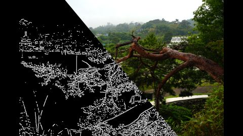

# DoG(Difference of Gaussian) Filter  
これは単純に2つの異なる$`\sigma`$を用意することで、新しくフィルタを作成したもの.  

```math
DoG(x,y) = G(x,y, \sigma_{1}) - G(x,y,\sigma_{2})
```

場合によっては$`\sigma`$とスカラー$`k`$を用いて以下のような感じにしてもよい.  

```math
DoG(x,y) = G(x,y, k\sigma) - G(x,y,\sigma)
```

さてこのDoG、実はLoGを近似したようなものと言えるらしい.  
詳しい実装が非常にありがたいことにこちら[^1]に乗っていたので、今回は実際にその計算を追ってみる.  
前にLoG自体は自分でもやったが[^2],この際に求めた式は以下の形であった.  

```math
LoG(X,Y) = \Delta G(x,y)
= \frac{x^{2} + y^{2}-2 \sigma^{2}}{2 \pi \sigma^{6}}
\exp{(-\frac{x^2+y^2}{2 \sigma^2})}
```

さて、これを考慮しつつ、次に$`\sigma`$で微分してみよう.  

```math
\begin{split}
\frac{\partial G(x,y)}{\partial \sigma} &= 
\frac{\partial}{\partial \sigma}(\frac{1}{2\pi\sigma^{2}}
\exp{(-\frac{x^2+y^2}{2 \sigma^2})}) \\
&= (\frac{1}{2\pi\sigma^{2}}(\frac{x^{2}+y^{2}}{\sigma^{3}}) - \frac{2}{2\pi\sigma^{3}})
\exp{(-\frac{x^2+y^2}{2 \sigma^2})}) \\
&= (\frac{x^{2}+y^{2}}{2\pi\sigma^{5}} - \frac{1}{\pi\sigma^{3}})
\exp{(-\frac{x^2+y^2}{2 \sigma^2})}) \\
&= \frac{x^{2}+y^{2} - 2\sigma^{2}}{2\pi\sigma^{5}}
\exp{(-\frac{x^2+y^2}{2 \sigma^2})}) \\
&= \sigma \frac{x^{2}+y^{2} - 2\sigma^{2}}{2\pi\sigma^{6}}
\exp{(-\frac{x^2+y^2}{2 \sigma^2})}) \\
&= \sigma \Delta G(x,y)
\end{split}
```

LoGの際と同じ式が出てきた.  
ここで微分の定義において、分母の$`\Delta x`$が小さい場合は$`\lim`$を外して近似ができる.  
これを利用して、以下のような式が書ける.  

```math
\frac{\partial G(x,y)}{\partial \sigma} \approx
\frac{G(x,y,k\sigma)-G(x,y,\sigma)}{\sigma (k-1) }
```

上の式と組み合わせると

```math
\begin{split}
& \frac{G(x,y,k\sigma)-G(x,y,\sigma)}{\sigma (k-1) } \approx \sigma \Delta G(x,y) \\
& DoG(x,y) \approx (k-1) \sigma^{2} LoG(x,y)
\end{split}
```

どうもこのPaper[^3]を参考にしたっぽいが、個人的にはLoGの部分は上記のような感じになり、$`\sigma^{2}`$はLoGではない気がする.  
とはいえ$`(k-1)\sigma^{2}`$の数値は小さいので、DoGとLoGが近似関係というのは結局いえると思う.  

さて、実装は簡単だ.  
まず$`\sigma^{2}`$の部分を2パターン用意する.  
```c++
// sigmaを用意
double sigmaK = sigma * K;
double sigma2 = sigma * sigma;
double sigma2K = sigmaK * sigmaK;
```
そして、各々でGaussianを計算.  
```c++
// SigmaのGaussian
double exp1 = Exp(-(i * i + j * j) / (2.0f * sigma2));
double denom1 = 2.0 * Math::Pi * sigma2;
double conv = exp1 / denom1;

// Sigma*KのGaussian
double denomK = 2.0 * Math::Pi * sigma2K;
double expK = Exp(-(i * i + j * j) / (2.0f * sigma2K));
double convK = expK / denomK;
```
最後に引いてDoGを計算し、これを重みとして使えば終わり.  
```c++
// DoGの重みへ
double convResult = convK - conv;

result += convResult * next;
sum += convResult;
```

今回の結果を見てみよう.  



うん、DoGの場合もちゃんとそれっぽい値が取れてそうだね.  
木とベンチ辺りが丁度良く取れそうな気がする.  

因みにここ[^3]にも書いてあるが、SHIFTは計算量として軽いのでDoGを使ってるっぽい.  
LoGはラプラシアンを使うけど、あれはフィルタの分離による高速化が出来ない.  
そのためDoGのようなガウシアンのみだと高速化が効かせやすいからだと思う.  
CGでもGaussianは2-passにして計算量落とすもんね、あれが分かりやすい例か.  
といったところで今回は終わっとこう.  

[^1]: [【DoGフィルタとは】計算式の仕組みとLoGと近似である理由](https://algorithm.joho.info/image-processing/difference-of-gaussian-filter/)  
[^2]: [LoG(Laplacian of Gaussian) Filter](./LoGFilter.md)  
[^3]: [Gradientベースの特徴抽出-SIFTとHOG](https://mprg.jp/data/MPRG/F_group/F051_fujiyoshi2007.pdf)