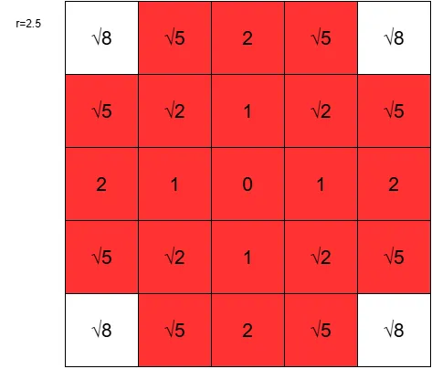
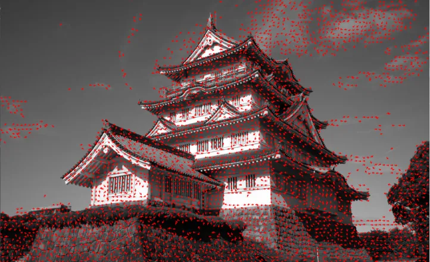

# ETF(Edge Tangent Flow)を実装してみる  
前回のXDoGでFDoGをやるかもという話をした.  
このFDoGを理解するためにはどうもETF(Edge Tangent Flow)というものを使うらしい.  
こいつを理解しないと先に進めないので、まずはこれからやっていこうかなと思う.  

流れとしては  
ETF -> FDoG -> XFDoGの順でやることになると思います.  
結構長いね.  

さて、このETFについてはCoherent Line Drawing[^1]という論文で説明が行われている.  
この論文、FDoGについても書いてあるので、これだけ読んでおけば$`\frac{2}{3}`$は実装できるわけだ.  
ETFの解説はこちら[^2]も為になりそう,自分はここで論文の存在を知った.  
日本語で解説してくれているのは本当にありがたい...  

まずはETFの式をドンっと見てみよう.  

```math
t^{new}(x) = \frac{1}{k} \sum_{y \in \Omega (x)} \phi (x,y)
t^{cur}(y) w_{s}(x,y) w_{m}(x,y) w_{d}(x,y)
```

さて、この式を計算したものがETFとなるわけである.  
細かい部分が分かってないのでなんもわからん状態ですね.  
個別に見ていきましょう.  

まず$`\frac{1}{k}`$,これは単純に正規化してるだけ.  
3x3のフィルタなら9で割ればいいって感じの奴かと思う.  

次に重み$`w_{s},w_{m},w_{d}`$についてみていこう.  
まず最初に$`w_{s}`$,これは`spatial weight function`,空間重みづけ関数というやつか.  
式としては以下のようになる.  
```math
w_{s} = 
\begin{cases}
    1 & \| x-y \| < r \\
    0 & otherwise
\end{cases}
```
$`x`$は現在処理をしているPixel.  
$`y`$は$`x`$の周辺Pixelを表す.  
$`r`$はフィルタの半径,5x5なら$`r=2.5`$という感じ.  
これを考慮すると、例えば5x5の場合は次のように決定可能.  

  

赤い部分が$`1`$となるピクセルで、白い部分が$`0`$となるようなピクセル.  
要はピクセル中心に近いピクセルの影響のみを考えるということだね.  

ただ、マンハッタン距離ではなく単純にユークリッド距離なので、3x3とかだと全ピクセルに反映されてしまう...  
3x3は$`r=1.5`$で、一番離れているものでも$`\sqrt{2}`$だからだ.  
5x5まで離れると,やっと評価しないピクセルが生成されるようになる.  

実際の実装は以下のように半径とピクセルの位置を求めた後、距離を取って判定をすればよい.  

```c++
double r = (filterSize * 2.0 + 1.0) / 2.0;
Vec2 current{ w, h };
Vec2 next{ Clamp(w + j, 0, image.width() - 1), Clamp(h + i, 0, image.height() - 1) };

// ws
double ws = (next-current).length() < r ? 1.0 : 0.0;
```

次に見るのは$`w_{m}`$,`magnitude weight function`.  
距離重みづけ関数ってっところかなぁ.  
式としては以下の感じ.  

```math
w_{m}(x,y)= \frac{1}{2} (1+ \tanh(\eta \cdot (g(y) - g(x))))
```
XDoGでもあったような$`T`$の関数に近い形だ.  
$`\frac{1}{2}`$している点を除けば全く同じ,何ならハイパーパラメータで$`\eta`$を導入してるところとかもかなり似ている.  
ここで$`g`$はソーベルフィルタでgradientを計算した後、このgradientを正規化した距離を表す.  
まあつまりは中心と比較した変化の強さを表しているわけだ.  
これを$`g(y)-g(x)`$としているということは、急激な変化が起こってる場所を探知して保持しているということになる.  
良い例がエッジとかかな、そもそもソーベル取ってる時点でそれはそう感あるけど.  
さて、$`\eta`$ですがこいつは論文では一貫して$`\eta=1`$を使ってるらしい.なら今回の実装は1で固定でいいか...  

さて、実装としてはまずSobelを計算する.  
2方向のSobelを取って正規化した値を格納すればよい.  
今回は`g`の配列を使いまわすため、画像の初期状態を`g`に入れておき、正規化後の値で最後に`g`に上書きする.  

```c++
// ソーベル
gx = SobelFilter(g, weightsX);
gy = SobelFilter(g, weightsY);

// 正規化
for (int w = 0; w < width; w++)
{
    for (int h = 0; h < height; h++)
    {
        double x = gx[h][w];
        double y = gy[h][w];
        g[h][w] = Sqrt(x * x + y * y);
    }
}
```
ここまでくれば後は式通りに計算すればOK.  

```c++
// wm
double wm = 0.5 * (1.0 + Tanh(Eta * (g[next.x][next.y] - g[current.x][current.y])));
```

最後に$`w_{d}`$,これは`direction weight function`.  
方向重みづけ関数かな？  

```math
w_{d}(x,y) = | t^{cur}(x) \cdot t^{cur}(y) |
```

現在求めている方向$`t`$を基準にして内積を取る.  
内積を取るということは、今のピクセルと周囲のピクセルを比較して

* $`\theta = 0 or \pi`$の場合、つまり同じ向きなら大
* $`\theta = \frac{\pi}{2}`$の場合、つまり垂直で違う向きなら小

という風になるようにしてるわけだ.  
とはいえこれをやるとなると、どうしても疑問として初期状態の$`t`$はどうすんの？という気分になる.私はなりました.  
これは先程Sobel Filterで計算した値から勾配ベクトルを生成し、それを反時計回りに90度回したものを初期状態として採用すればいいらしい.  

そうとなればまずは$`t`$を計算してみよう.  
xyをベクトルに格納してやり、それを正規化.  
そして、Siv3Dには90度回転させる関数があるので、それを適用すればOK.  
```c++
double x = gx[h][w];
double y = gy[h][w];

// tの初期化
Vec2 t{ x,y };
t.normalize(); // 正規化して
t.rotate90(-1); // 90度回転！
f[h][w] = t;
```

ここまでくれば$`w_{d}`$の計算は非常に簡単.  
内積を計算後に絶対値を取るだけだ.  
```c++
double tot = Dot(f[next.y][next.x], f[current.y][current.x]);
double wd = Abs(tot);
```

さて、最後に見るのは$`\phi (x,y)`$.  
これはベクトルが似てるけど方向が真逆の時にswapするための処理だ.  
式は以下のような感じ.

```math
\phi (x,y) = 
\begin{cases}
1 & t^{cur}(x) \cdot t^{cur}(y) > 0 \\
-1 & otherwise
\end{cases}
```

うん、単純だ.  
マイナスの場合は無理矢理フリップしてあげてるだけだね.  
計算の判定も単純で先程計算した内積を利用するだけで行ける.  
コードで書くならこう.  

```c++
double phi = tot > 0 ? 1.0 : -1.0;
```

これで全係数の計算が終わった！  
あとは組み合わせれば計算が終わりである.  
全てを足し合わせた後、実際に格納する際は正規化すればよい.  

```c++
        // 和として計算
        sum += phi * f[next.y][next.x] * ws * wm * wd;
    }
}

// 正規化して格納,これが次に使うtの値
f_next[h][w] = sum.normalized();
```

今回の$`t`$の計算に関しては数回処理を掛けることが可能.  
実際に経験的には2,3回繰り返すのが良いらしい.  
ということで、3回試しに繰り返してみた.  

```c++
// 繰り返し
for (int i = 0; i < Iteration; i++)
{
    // フィルタ処理
    for (int w = 0; w < width; w++)
    {
        for (int h = 0; h < height; h++)
        {
            filterProcess(w, h);
        }
    }

    // next
    f = f_next;
}
```
最後に可視化をどうするか.  
自分が調べた感じだと矢印を表示するかLICを行うかのどっちかだった.  
LICは地味に面倒な感じがあったので、簡単にできる矢印を選択.  

やることは簡単で数Pixel間隔で矢印を描画するだけである.  
`start`はPixel位置にして、`end`は計算した$`t`$の値を利用してスケールさせただけ.  
これを使って線を作るだけである.Siv3Dはこの線から矢印を描画できる.楽だね.  
```c++
// 矢印を描画
for (int w = 0; w < width; w+=DrawOffset)
{
    for (int h = 0; h < height; h+=DrawOffset)
    {
        Vec2 start{ w,h };
        Vec2 end = start + f[h][w] * LineScale;

        Line{ start, end }.paintArrow(resultImage, 1, Vec2{ 5,5 }, Palette::Red);
    }
}
```

そしたら結果を見てみよう.   

  

特にエッジ部分が分かりやすいが、流れっぽいのが出来てるね.  
特に城の格子(？)というかそこの部分はぐるっと流れができてるので分かりやすい.  
こうやって流れの場を作るのがETFということでした.  
ということでFDoGに続く...  

[^1]: [Coherent Line Drawing](https://dl.acm.org/doi/10.1145/1274871.1274878)  
[^2]: [Edge Tangent Flowを使用してベクトル場の流れを整えてから、画像のエッジを検出する。](https://qiita.com/naotokimura/items/1987559cd375fe9784dd)  