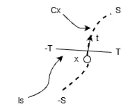
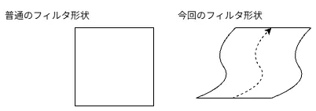
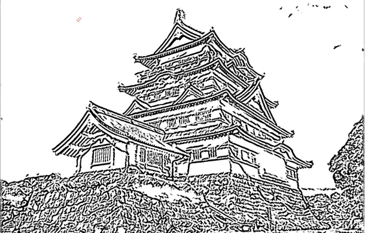

# FDoG Filter  
前回Coherent Line Drawing[^1]を読むことで、まずETFというものを求めた.  
これはTangent方向を求めたのに等しいわけである.  
これを使ってフィルタ処理を掛けるのが目標.  
そのため、前回のETF[^2]は前提となるため、読んでない人は読んでおくといいかもしれない.  
因みに今回やるFDoGは「Flow based Difference of Gaussians」の頭文字を取って「FDoG」というわけだ.結構長い名前だね.  

さて、今回考えるのはこんな感じの図だ.  

  

現在のピクセル位置$`x`$があり、これに対して流れの方向を表す$`t`$が存在する.  
この流れ$`t`$を前回のETFでは計算したことになる.  
$`t`$は各Pixelで定義されており、この方向に進むことで流れ$`C_{x}`$が形成される.  
この流れの端を$`-S`$と$`S`$としよう.  
ここまでくるとちょっと雰囲気が出てきませんか？線積分の.  

この流れに沿って処理をするわけではあるが、基本的にフィルタは2次元の処理.  
そのため、線に対してだけではなく直交方向のデータを集めることから始める.  

まず直交方向をパラメータ化し、$`l_{s}`$と定義しよう.  
この$`l_{s}`$の端は$`-T`$と$`T`$だ.  
画像を$`I`$とし、フィルタを$`f`$とすると、この直交方向のデータを集める処理は以下のようになる.  

```math
F(s) = \int_{-T}^{T} I(l_{s}(t))f(t) dt
```

式だけ見ると難しそうに見える.  
これは直交方向に進めつつ、フィルタと画素を足し合わせてる.  
ということは、単純にフィルタを掛けた結果を作ってるだけである.  

実際にこの計算をするために知っておかないといけないものは3つある.  
まず1つ目はフィルタに何を採用するか？  
直交方向のフィルタには単純にDoGフィルタを採用する.  

```math
f(t) = DoG(x,y) = G(x,y, \sigma) - \tau G(x,y,k\sigma )
```

FDoGで定義されてるのはこの形だった.  
$`\tau`$のハイパーパラメータありなので、どちらかというとXDoGのときに近い気もするが...  
まあひとまずはこれでいいでしょう.  
因みに$`t`$は画像空間上の点なので、$`x,y`$と対応します.  

2つ目の問題はどうやって直交方向を手に入れるか？  
これは深く考えなくても$`t`$が分かるので、それを$`90`$度回転させるだけでいい.  
実際の所その方向が分かればいいだけなので、別段$`-90`$度でも良い.  
一旦この方向は$`n = Rot(t, 90)`$とかにしておこうか.  

3つ目はどれくらいの幅で探索をするか？  
要は$`T`$をどれくらいで取るかというお話.画像上を移動するので、ピクセル分移動しないと変化が起きないことになってしまう.  
まず1stepの動きは

```math
x_{next} = x_{current}+\epsilon_{n} n
```

で計算するらしい.  
どうも$`\epsilon_{n}=1`$が良いらしく、ということは

```math
x_{next} = x_{current}+n
```

みたいな単純なステップで良いということになる.  
まあ、とはいえあまり細かく刻んでも1pixel動いてくれないと意味がない...  
ということで、1pixel毎のステップでやろうと思う.  
ステップが分かったところで幅に関して.  
幅はガウシアンの$`\sigma`$に応じてすきに取ればよいっぽい.  
あまり遠くまで取っても意味ないので、$`2\sigma`$くらいにしようかな.  

さて、実際にコードにまずはここまでを落とし込んでみよう.  

今回は与えられた位置`pos`に対して、その位置のtangentである`t`を渡すように対応してみた.  
```c++
auto PerpendicularConv = [&](Vector2D<int> pos, Vec2 t)
    {
```
まず最初に`t`を90度回転して、tangentに垂直な方向を生成.  
```c++
        Vec2 n = t.rotate90(-1); // gradを形成
```
その後、stepを1pixel毎に動くようにしてみた.  
もう少し細かく規定してもよいが、今回は簡略的にそれっぽくね...  
```c++
        // それっぽく1進むように,もっと勾配を見て細かく規定してもよい
        Vector2D<int> step = Vector2D<int>::Zero();
        step.x = Sign(n.x); step.y = Sign(n.y);
```
何回やるかはGaussianの$`\sigma`$から決めるんだった.  
```c++
        double T = Sigma_L * 2.0;
```
ここまでくれば実際に計算するだけ.  
まずは$`I(l_{s}(t))`$を求める.  
```C++
        double sum = 0.0;
        double result = 0.0;
        for (int i = -T; i <= T; i++)
        {
            Vector2D<int> p = pos + static_cast<double>(i) * step;
            p.x = Clamp(p.x, 0, values.width() - 1);
            p.y = Clamp(p.y, 0, values.height() - 1);

			double imageValue = ft[p.y][p.x];
```
この後は実際にガウス分布を計算して,$`DoG`$を計算するだけで終わり.  
ここで注意点がある.  
今回は$`t`$と垂直な$`n`$方向に対して、直線にサンプルを取る.  
つまりこれは$`1D`$で取っているのと変わらない.  
そのため、2次元のガウシアンではなく1Dのガウシアンで適用する.  
`sqrt`をしてる点や$`\sigma`$が2乗にしない点を注意しよう.  
```C++
            // Sigmaの1D Gaussian
            double exp1 = Exp(-(pos-p).lengthSq() / (2.0f * Sigma_L * Sigma_L));
            double denom1 = Sqrt(2.0 * Math::Pi) * Sigma_L;
            double conv = exp1 / denom1;

            // Sigma*Kの1D Gaussian
            double denomK = Sqrt(2.0 * Math::Pi) * Sigma_kL;
            double expK = Exp(-(pos-p).lengthSq() / (2.0f * Sigma_kL * Sigma_kL));
            double convK = expK / denomK;

            double convResult = conv - tau * convK;

			result += imageValue * convResult;
            sum += convResult;
        }

        return result / sum;
    };
```

これで垂直方向は終わり.  
次は$`t`$方向についてみていく.  
やることは実は垂直方向とほぼほぼ同じで、こちらも線積分のような形で記述可能.  

```math
H(x) = \int_{-S}^{S} G_{\sigma}(s)F(s) ds
```

$`F(s)`$に関しては先程計算したものであるため、特に問題ない.  
$`G_{\sigma}(s)`$に関しては単純にその点にいるときのガウス関数である.  
$`F(s)`$が積分形式なので、結局$`H(x)`$二重積分みたいな形になるため、結局やってることとしては普通の2Dガウシアンみたいなのと変わらない.  
イメージを図示すると分かりやすいが、流れに沿って上手くフィルタ形状を変えているくらいである.  

  

うん、まあ実際は垂直方向を考えるともう少しうねるはずだがイメージとしてはこんな感じ.  
フィルタ形状が流れに沿って生成され、そこに重みを考慮して計算しているというわけなんだなぁ.  

さて、では実際にコードに移ろう.  
まずは最初に現在の位置の$`t`$を取得する.  
```c++
auto FDoG = [&](Vector2D<int> pos)
    {
        auto t = f[pos.y][pos.x];
```
$`S`$の繰返し範囲も$`\sigma`$から求める.  
```C++
        double S = Sigma_M * 2;
```

そしたら必要なパラメータを用意する.  
今回は今までのステップが決まってるようなものと違い、移動の距離が可変.  
そのため、`distance`という距離を保持する値も用意する.  
そして、移動距離を計算する必要があるため、今の位置`p`と前の位置`p_prev`を用意.  
```c++
        double result = 0.0, sum = 0.0;

        for (auto dir : Array<double>{1, -1})
        {
            double distance = 0.0;
            Vector2D<int> p = pos, p_prev = pos;
```
追えるかどうかの判定はSだけ動いたかどうか.  
動いてたら終わり.動いてなければ評価を繰り返す.  
```c++
            while (distance < S)
            {
```

stepの計算は大体同じ、ただし移動量が$`0`$の場合は動けなくなるので終わるようにする.  
```c++
                Vector2D<int> step = Vector2D<int>::Zero();
                step.x = Sign(t.x); step.y = Sign(t.y);

                if (step == Vector2D<int>::Zero()) { break; }
```
移動はstepで行う.  
ただし正方向と負の方向の両方の探索が必要なため、`dir`で反転している.  
範囲外の場合はこれ以上移動できないので終わりにする.  
```c++
                // 移動
                p += step * dir;

                // 範囲外は行かないようにしとく
                if (p.x < 0.0 || ft[0].size() - 1 < p.x) { break; }
                if (p.y < 0.0 || ft.size() - 1 < p.y) { break; }
```
距離を加算したら移動量に応じて1Dのガウシアンを計算.  
その後,$`F`$を計算して、先程のガウシアンと掛け合わせたものを蓄積する.  
これで$`G_{\sigma}(s)F(s)`$が計算できたことになる.  
```C++
                // 距離を加算
                distance += (p-p_prev).length();

                // Sigmaの1D Gaussian
                double exp1 = Exp(-distance * distance / (2.0f * Sigma_M * Sigma_M));
                double denom1 = Sqrt(2.0 * Math::Pi) * Sigma_M;
                double conv = exp1 / denom1;

                double F = PerpendicularConv(p, t);

                result += F * conv;
                sum += conv;
```
次のループのために$`t`$を次のものに差し替え.  
前回の位置も更新しておく.  
```c++
                // つぎの位置へ
                t = f[p.y][p.x];
                p_prev = p;
            }
        }
```
さて、これで$`H(x)`$は求まったが最後に白黒の判定が必要.  
この論文では以下のような感じで白黒の判定をしてるっぽい.  
```math
\tilde{H}(x) = 
\begin{cases}
0 & H(x)< 0 \quad and \quad 1 + \tanh(H(x)) < r \\
1 & otherwise
\end{cases}
```
まず負となっている位置を探す.  
見つかったらあとはそこの値を$`\tanh`$で計算してそれっぽくしてる.  
負の値ということは$`[-1,0]`$となるはず.なので、上手く丸め込むために$`+1`$をしてるわけだ.  
```c++
        result = sum == 0.0 ? 0.0 : result / sum; // 正規化
        result = result <= 0.0 && (1 + Tanh(result) < selector) ? 0.0 : 1.0;

        return result;
    };
```
今回のFDoGの処理に関してもETFと同様で、何度も処理を適用するのは有効.  
ということでこちらもitration出来るようにしておく.  
```c++
// フィルタ処理
for (int i = 0; i < IterationFDoG; i++)
{
    auto temp = ft;
    for (int w = 0; w < width; w++)
    {
        for (int h = 0; h < height; h++)
        {
            temp[h][w] = FDoG(Vec2{ w, h });
        }
    }

    // next
    ft = temp;
}
```
これで結果を見てみよう.  

  

うん、ちゃんと輪郭を取れていそう.  
今回は試しに特定のピクセルにおける$`ds`$の軌道と$`dt`$の起動も点で表示するようにしてみた.  

ちょっと左上の空を見てほしい.  
ここに赤色で$`T`$の軌跡を左右の二本の線で引き、$`S`$の軌跡を中心の線で引いている.  
普通だと縦横の箱のような形状でサンプルするはずだけど、こうやって見ると斜めにサンプルしているのが分かる.  
あまり$`t`$の変化がない位置なので面白味はないけど、どういう挙動をしてるのかは分かりやすいと思う.  

ということでこれでFDoGも終了！  
残りはFXDoGだけど、これに関してはもう語ることがほぼなさそうだけど、次回はこれをやってフィナーレとしよう.  

[^1]: [Coherent Line Drawing](https://dl.acm.org/doi/10.1145/1274871.1274878)  
[^2]: [ETF(Edge Tangent Flow)を実装してみる](./EdgeTangentFlow.md)  