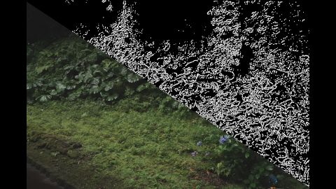

# LoG(Laplacian of Gaussian) Filter  
名前の通りガウシアンフィルタとラプラシアンフィルタを組み合わせたもの.  
やることとしてはガウシアンフィルタを先に掛けてぼかす、つまりはノイズを除去する.  
その後ラプラシアンを掛けることでノイズを低減しつつも、ラプラシアンで輪郭を取ったりできるというわけである.  

処理としては

1. ガウシアンフィルタを掛ける
2. ラプラシアンフィルタを掛ける
3. 輪郭抽出

といった流れだけど、ちょっと面倒なので今回は式を計算して1と2をまとめてしまおう.  
今回の流れはここ[^1]の内容がめちゃんこ分かりやすいです.  

まずガウシアンだけど、これは前にもやった[^2]通り、以下の式で行ける.  

```math
G(x,y) = \frac{1}{2 \pi \sigma^2} \exp{(-\frac{x^2+y^2}{2 \sigma^2})}
```

さて、ラプラシアンを求めるためには2次微分が必要.  
面倒だけど、頑張って偏微分をやるしかない...  
まずは$`x`$の1次微分からやってみよう.  

```math
\begin{split}
\frac{\partial G(x,y)}{\partial x} &= 
\frac{\partial}{\partial x}(\frac{1}{2 \pi \sigma^2} \exp{(-\frac{x^2+y^2}{2 \sigma^2})}) \\
&= \frac{1}{2 \pi \sigma^2} \frac{\partial}{\partial x} (\exp{(-\frac{x^2+y^2}{2 \sigma^2})}) \\
&= \frac{1}{2 \pi \sigma^2} \exp{(-\frac{x^2+y^2}{2 \sigma^2})} 
\frac{\partial}{\partial x}(-\frac{x^2+y^2}{2 \sigma^2}) \\
&= \frac{1}{2 \pi \sigma^2} \exp{(-\frac{x^2+y^2}{2 \sigma^2})} 
(-\frac{x}{\sigma^2})
\end{split}
```

更に微分して2次も求める.  
積の微分を行えばよい. 

```math
\begin{split}
\frac{\partial^{2} G(x,y)}{\partial x^{2}}
&= \frac{1}{2 \pi \sigma^2} \frac{\partial}{\partial x}(\exp{(-\frac{x^2+y^2}{2 \sigma^2})} 
(-\frac{x}{\sigma^2})) \\
&= \frac{1}{2 \pi \sigma^2}( 
\frac{\partial}{\partial x} (\exp{(-\frac{x^2+y^2}{2 \sigma^2})}) (-\frac{x}{\sigma^2})
+ \exp{(-\frac{x^2+y^2}{2 \sigma^2})} \frac{\partial}{\partial x} (-\frac{x}{\sigma^2})) \\
&= \frac{1}{2 \pi \sigma^2}( 
\exp{(-\frac{x^2+y^2}{2 \sigma^2})} (\frac{x^{2}}{\sigma^{4}})
+ \exp{(-\frac{x^2+y^2}{2 \sigma^2})}(-\frac{1}{\sigma^2}) )\\
&= \frac{1}{2 \pi \sigma^2} 
(\frac{x^{2}}{\sigma^{4}}-\frac{1}{\sigma^2})
\exp{(-\frac{x^2+y^2}{2 \sigma^2})}
\end{split}
```

これを$`y`$でも同様に計算すると、

```math
\frac{\partial^{2} G(x,y)}{\partial y^{2}}
= \frac{1}{2 \pi \sigma^2} 
(\frac{y^{2}}{\sigma^{4}}-\frac{1}{\sigma^2})
\exp{(-\frac{x^2+y^2}{2 \sigma^2})}
```

よって、ラプラシアンは二次微分の各成分を足したものなので、

```math
\begin{split}
\Delta G(x,y) &= 
\frac{\partial^{2} G(x,y)}{\partial x^{2}} +
\frac{\partial^{2} G(x,y)}{\partial y^{2}} \\ 
&= \frac{1}{2 \pi \sigma^2}
(\frac{x^{2}}{\sigma^{4}} + \frac{y^{2}}{\sigma^{4}} -\frac{2}{\sigma^2})
\exp{(-\frac{x^2+y^2}{2 \sigma^2})} \\
&= (\frac{x^{2} + y^{2}}{2 \pi \sigma^{6}} -\frac{2}{2\pi \sigma^4})
\exp{(-\frac{x^2+y^2}{2 \sigma^2})} \\
&= \frac{x^{2} + y^{2}-2 \sigma^{2}}{2 \pi \sigma^{6}}
\exp{(-\frac{x^2+y^2}{2 \sigma^2})}
\end{split}
```

これで求めたい式が求まった！  
あとはこれをフィルタとして利用するだけである.  
計算の部分のみ示す、本当に式の通り計算するだけ.  
まずは左の定数項を求めた後、右の$`\exp`$部分を計算し、それを組み合わせている.  
```c++
// 重み計算
double sigma2 = sigma * sigma;
double sigma4 = sigma2 * sigma2;

double factor1 = (i * i + j * j) - 2.0 * sigma2; // 分子
double factor2 = 2.0 * Math::Pi * sigma4 * sigma2; // 分母
double factor = factor1 / factor2;

double exp1 = Exp(-(i * i + j * j) / (2.0f * sigma2)); // exp

double conv = factor * exp1; // 合成

result += conv * next;
sum += conv;
```
これで計算完了！  
今回は試しにエッジ検出をやってみよう.  
エッジ検出においては「ゼロ交差」という処理が必要.  
これは周囲の情報で符号が変わった場合、そこにエッジがあるとみなすわけだ.  

ちょっと真面目にやるとめんどくさそう...と思って調べてたらStackOverflowに簡単な実装が載ってた[^3].  
内容としては非常に簡単で、フィルタ内の最大値と最小値をまず求める.  
```c++
auto ZeroCrossProcess = [&](int w, int h)
    {
        double current = resultImage[h][w];
        double minLoG = 1.0e+10, maxLoG = -1.0e+10;
        for (int i = -1; i <= 1; i++)
        {
            for (int j = -1; j <= 1; j++)
            {
                int filterW = Clamp(w + j, 0, image.width() - 1);
                int filterH = Clamp(h + i, 0, image.height() - 1);

                double next = resultImage[filterH][filterW];

                // 最小最大を求める
                minLoG = Min(minLoG, next);
                maxLoG = Max(maxLoG, next);
            }
        }
```
これに対して、現在対象となってるピクセルが正か負かを判断.  
そのうえで、

* 対象Pixelが正で周辺Pixelに負がある
* 対象Pixelが負で周辺Pixelに負がある

この2パターンを探索する.  
正負がひっくり返るところは急激な変化がある証拠で、これをエッジと見なせばよい.  
今回はこれが起こる部分を$`1`$,そうでない部分を$`0`$とした.  

```c++
        bool isCross = minLoG < 0.0 && current > 0.0;
        isCross |= maxLoG > 0.0 && current <= 0.0;

        image[h][w] = ColorF(Vec3::One() * static_cast<double>(isCross), 1.0);
    };
```

これで結果を見てみよう.  



蓮の部分は取れてるかな？エッジ検出自体はできてるっぽい.   
LoGの派生でDoGというのもあるらしいので、次はこれを見ていけたらなと思う.  

[^1]: [【画像処理】LoGフィルタの原理・特徴・計算式](https://algorithm.joho.info/image-processing/laplacian-of-gaussian-filter/)  
[^2]: [OnePassGaussianFilter](./OnePassGaussianFilter.md)  
[^3]: [Laplacian of Gaussian in openCV, how to find zero crossings?](https://stackoverflow.com/questions/25105916/laplacian-of-gaussian-in-opencv-how-to-find-zero-crossings)  