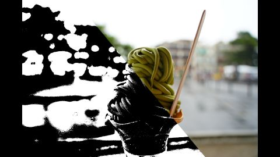

# XDoG(eXtended Difference of Gaussian) Filter  
DoG[^1]で色々調べてる際、別途XDoGというのをやってる記事[^2]を見つけた.  
2012年の論文[^3]が元になってるっぽい.  
今回はこちらの実装をちょっとやってみようかなと思う.  

まず大事なこととして2階調、つまり白黒の画像を作る場合は基本的に2つの方法があり,

* 白を基準にして、基準から外れる領域を黒にする
* 黒を基準にして、基準から外れる領域を白にする

となる.  
前回のDoGで言えば、ゼロ交差,つまり符号が変わってるかどうかを基準に白黒の判定を行ってたと言える.  
DoGには近傍を暗くするかどうかを表すデータが入ってるともいえる.  
なら直接「活性化関数」みたいなもので処理しちゃえばよくない？というのが肝.  
実際のDoGはフィルタなので、画像と合わせて$`D_{\sigma,k} * I`$となっていた.  
これを$`T`$という関数を通して$`T(D_{\sigma,k} * I)`$とすることで、値を決定しようというわけである.  
この論文の一番最初の$`T`$は以下のような形.  

```math
T_{\epsilon}(U) = 
\begin{cases}
1 & (u \ge \epsilon) \\
0 & otherwise
\end{cases}
```

実際のコンピュータビジョンではゼロ交差みたいな極端な場所をエッジというが、Stylizedに考えるなら閾値の方がエッジっぽいのでそう置いてるらしい.  
なので実際の文脈の「エッジ」とはちょっと違うけど、まあ今回はこれをエッジとしましょうというわけだ.  
また、ガウス関数の抑制を上げるために以下の形式に変更を行う.  

```math
XDoG(x,y) = G(x,y,\sigma) - \tau G(x,y, k\sigma)
```

前回のDoGに対して$`\tau`$を掛けたわけだ.  
これがハイパーパラメータになるってわけね.  
試しにここまでを実装してみよう.  

まずはDoGに$`\tau`$を掛けるようにしておく.  
```c++
// DoGの重みへ
double convResult = conv - tau * convK;
```

そして、step関数を行うだけ.  
今回は他結果も色々用意しようと思うので、switchで切り分けているが、そこはあまり気にしないで良い.  

```c++
switch (state)
{
case State::threshold:
    // step function
    result = static_cast<double>(result > epsilon);
    break;
}
```

結果は以下のような感じ.  



確かに二値化っぽい感じになってる、stepだしそれはそうか...  

さて、最初に作ってたのはstepだが、ちょっとなめらかでもいいよね...ということでちょっと改良する.  
次のような関数を定義する.  

```math
T_{\epsilon,\phi}(U) = 
\begin{cases}
1 & (u \ge \epsilon) \\
1 + \tanh{(\phi(u-\epsilon))} & otherwise
\end{cases}
```

$`tanh`$はよくある活性化関数だね、これであれば確かにすらっとした滑らかさが手に入る.  
そのため上手く形状を定義してるっぽさはある.  
$`+1`$の部分は多分だけど$`tanh \in [-1,1]`$なので、負の値が来ないようにしてるだけだと思う.  

そして、先程のXDoGにも変更を加える.  

```math
\begin{split}
XDoG(x,y) &= G(x,y,\sigma) - \tau G(x,y, k\sigma) \\
&= (G(x,y,\sigma) - \tau G(x,y,\sigma)) + (\tau G(x,y,\sigma) - \tau G(x,y, k\sigma)) \\
&= (1-\tau)G(x,y,\sigma) + \tau DoG(x,y)
\end{split}
```

こんな感じで式変形して見易さをちょっと変えている.  
なんか$`1-\tau`$と$`\tau`$が揃うとlerpしてる感合っていいよね.  
要は加重平均を取ってるってことだ.  
これに合わせると、最初に$`\tau`$を調整して、その後に$`\phi`$と$`\epsilon`$を調整するのが良いという主張もなんとなく確かに...となれるはず.  

さて、これはコードに落とし込むとこんな感じ.  
```c++
// DoGの重みへ
double convResult = conv - convK;
convResult = (1 - tau) * conv + tau * convResult;
```

そして、$`tanh`$はこんな感じ.  
```c++
case State::XDoG:
    double t = 1.0 + Tanh(phi * (result - epsilon));
    result = result > epsilon ? 1.0 : t;
    break;
```
この結果は以下のような感じ.  

  

2値ではなくなったので滑らか～な感じもちゃんと出ている！  
とはいえパラメータが何が正しいのか分からない...  
$`\phi`$何かは暗さにダイレクトに影響あるんだけど、モノによっては0.01とかだったり10だったりとなんだかなぁという感じ.  

さて、このXDoGに対して、

* パラメータの相互依存性を消す
* ぼかしやシャープ化への既存手法への対応
* 可逆性

といったのを対応するためには$`\tau-1`$で先程の式を割ると良い.  
が、なんか論文の式がしっくりこない...  
無理くり合わせるとすれば、個人的には$`1-\tau`$で割り、$`p=\frac{\tau}{1-\tau}`$とすると、

```math
\begin{split}
S &= \frac{XDoG(x,y)}{1-\tau} \\
&= G(x,y,\sigma) + \frac{\tau}{1-\tau} DoG(x,y) \\
&= G(x,y,\sigma) + p (G(x,y,\sigma) - G(x,y,k\sigma)) \\
&= (1+p)G(x,y,\sigma) - pG(x,y,k\sigma)
\end{split}
```

こうなんじゃないかな...とは個人的には思う.  
これなら式変形として合理的かなとなるんだけど、まあそこまで論文を読みこんだわけでもないので、論文の式変形の方が合ってる可能性もある.  

さて、この$`p`$がシャープネスさを表すパラメータになるらしい.  
ただ、式としてはここまでくれば難しくないので、ぱっとやってしまおう.  

```c++
convResult = (1.0 + p) * conv - p * convResult;
```
うん、これだけだ.何も難しくない.  
結果を見てみよう.  

  

う～ん、シャープになってるんかなこれ...  
まあ単純に可逆なので式としては同じなのもあるかも.  
ということでXDoGはここまで.  
なんかFDoGというのがこの論文に書いてあったので、こっちももしかしたらやるかもしれない.  

[^1]: [DoG Filter](./DoGFilter.md)  
[^2]: [高クオリティな線画抽出を目指して](https://qiita.com/Shirataki2/items/813fdade850cc69d1882)  
[^3]: [XDoG: An eXtended difference-of-Gaussians compendium including advanced image stylization](https://www.kyprianidis.com/p/cag2012/winnemoeller-cag2012.pdf)