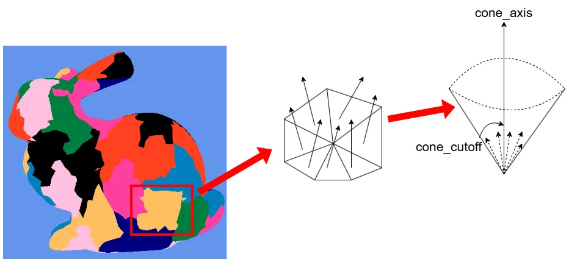
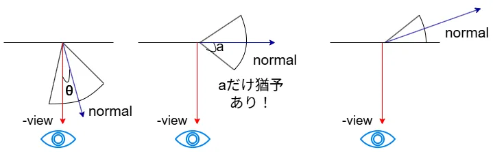
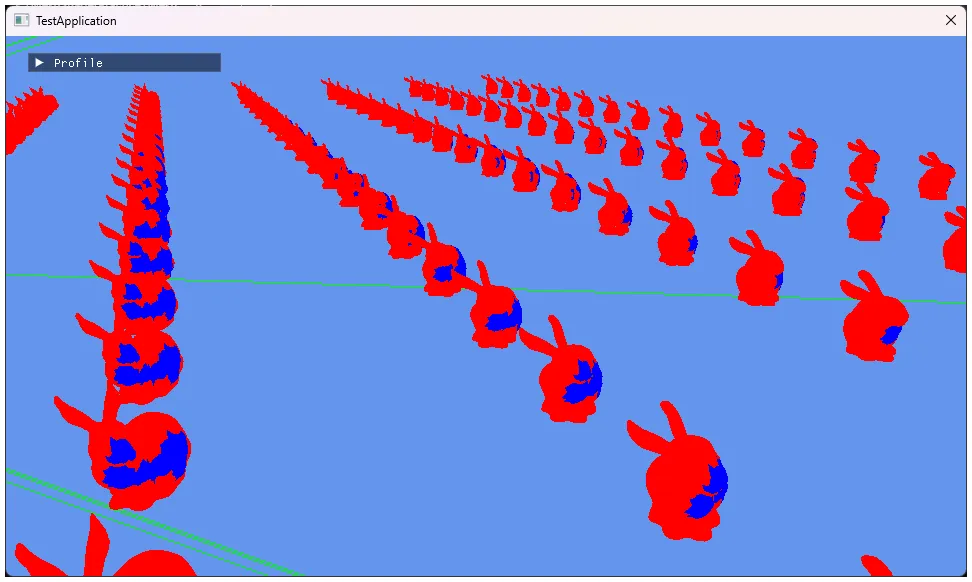

# Mesh Shaderによるカリング ～ Meshlet編2 Normal Cone Culling ～  
今回はASでのMeshlet Cullingの2つ目をやっていく.  
Normal Coneによるカリング、頑張っていこう.  
参考にするのはもちろんこちら[^1],非常にためになってます...  

さて、Normal Coneというのは何だろうというところから始める.  
そもそもMeshlet単位のカリングしかASはできないわけだけども、もしポリゴン単位であれば法線カリングという方法が使えた.  
法線カリングのやりたいことは簡単で、視線ベクトルと法線を比較して、明らかに裏面のものはカリングするというものだ.  
これをもしMeshletでやるとすると、Meshletはポリゴンの集まりであるため、法線が一つではなく複数あることになる.  

  

そこで、Meshlet内の法線全部を含むような円錐を作成する.  
法線ではなくこの円錐に対してカリング判定を取ればいいんじゃない～？というのがMeshlet版法線カリングのアイデアとなる.  
meshletは生成時に頂点の近い位置を選出しているため、ある程度方向も同じだしちょうどいい法錐になるので、こういうカリング法の実装でも中々うまくいくんだろうな～と個人的には思った.  

何はともあれ、まずは法錐のデータを作らないと始まらない.  
ということで、今回もこっから始めよう.  
この法錐も前回のBounding Sphereと同様,meshoptimizerを使うことで実装が可能!!  

まずは法錐のデータを入れる用の配列を用意、`uint32_t`でOK.  
```c++
    std::vector<uint32_t> meshletCones;
```

さて、前回のBounds計算で`meshopt_computeMeshletBounds`を行っていた.  
実はこれで投げると法錐のデータに関してもちゃんと用意ができている.  
そのため、まずはデータを抽出しよう.  
法錐は先ほどの上の図にある通り、

* 法錐の方向の軸となる`normal_axis`
* 法錐の角度となる`normal_cone`

この二つである.  
軸は$`xyz`$なのでfloat3つ分で、角度はfloat1つ分なので全部を`XMFLOAT4`に格納する.  
ただし、データは$`[-1,1]`$なので、$`[0,1]`$となるように調整をしておく.  
```c++
        XMFLOAT4 normalCone =
        {
            std::clamp(bounds.cone_axis[0] * 0.5f + 0.5f, 0.0f, 1.0f),
            std::clamp(bounds.cone_axis[1] * 0.5f + 0.5f, 0.0f, 1.0f),
            std::clamp(bounds.cone_axis[2] * 0.5f + 0.5f, 0.0f, 1.0f),
            std::clamp(bounds.cone_cutoff  * 0.5f + 0.5f, 0.0f, 1.0f) // sin(a)
        };
```

そして、そのあとは`XMFLOAT4`を8bitずつ`uint32_t`に収める.  
index bufferでもやってたのと同じような処理だ.  
```c++
        uint32_t packNormalCone = 0u;
        packNormalCone |= ((static_cast<uint8_t>(normalCone.x * 255.0f) & 0xFF) << 0);
        packNormalCone |= ((static_cast<uint8_t>(normalCone.y * 255.0f) & 0xFF) << 8);
        packNormalCone |= ((static_cast<uint8_t>(normalCone.z * 255.0f) & 0xFF) << 16);
        packNormalCone |= ((static_cast<uint8_t>(normalCone.w * 255.0f) & 0xFF) << 24);

        meshletCones.push_back(packNormalCone);
```
あとはResource側でも渡すのを忘れずに.  
```c++
        meshletResource.m_normalCone = meshletCones[count];
```

そしたらhlsl側、こっちも前回同様Meshletにデータを用意すればOK.  
```c++
struct Meshlet
{
    uint VertexOffset;
    uint VertexCount;
    uint TriangleOffset;
    uint TriangleCount;
    uint NormalCone; // 追加
    float4 BoundingSphere;
};
```
ここまででデータの追加は終わった！  
次は実際に法錐カリングの処理に入っていく.  

  

見えているかどうかは$`-view`$という視線ベクトルの逆方向と法線がどれくらいかで判定する.  
これは法線カリングの時も同じですね.  
法線カリングでは角度に対して以下の条件の時について考えていた.  

```math
\begin{equation}
    \begin{split}
    \theta <= \frac{\pi}{2} \quad (visible)
    \end{split}
\end{equation}
```

要は$`\theta`$が直角、つまり視線方向の逆方向と法線が垂直になるまでは可視とするわけだ.  
それ以上の角度の場合は見えないものと見なす.  
つまりこれが真ん中の図なわけだけど、今回は法線ではなくてあくまで法錐という名の円錐に対する判定である.  

一番右の図のように、円錐の一番端までが全て含まれている場合までを可視とする必要がある.  
つまり以下のような式に直す必要がある.  

```math
\begin{equation}
    \begin{split}
    \theta <= \frac{\pi}{2} + \alpha \quad (visible)
    \end{split}
\end{equation}
```

角度$`\alpha`$分までは見えるように調整するだけである.  
これ以外は全く法線カリングと同じ.  

さて、角度に$`\cos`$を適用する場合を考える.  
$`\cos`$を適用する場合、基本的に角度が大きくなるほど小さくなっていく.  
$`\pi`$を越えた辺りからまた大きくなりはするが、今回は$`\theta \in [-\pi, \pi]`$で考えよう.  
この時、

```math
\begin{equation}
    \begin{split}
    |\theta| <= \frac{\pi}{2} + \alpha \quad (visible)
    \end{split}
\end{equation}
```

とすると、$`\cos`$を適用した場合は以下のようになるはず.  

```math
\begin{equation}
    \begin{split}
    \cos{|\theta|} < \cos{(\frac{\pi}{2} + \alpha)} \quad (invisible)
    \end{split}
\end{equation}
```

上級グラフィックス入門及びここの資料[^1]ではこれとは真逆の不等式となっているが、今回求めた不等式の方が合ってると思う.  
資料の参考文献となるGDCの方[^2]も見たけど、これは今求めた式と同じになってるので、これが正しいはず.  
自分もカリングを実装したときになんか上手くいかず、その際に逆転してるのに気づいたので、手計算は大事ですね.  

さて、$`\cos`$の右辺をちょっと書き直してみよう.  

```math
\begin{equation}
    \begin{split}
    \cos{(\frac{\pi}{2} + \alpha)} &= \cos{\frac{\pi}{2}}\cos{\alpha}-\sin{\frac{\pi}{2}\sin{\alpha}} \\
    &= -\sin{\alpha}
    \end{split}
\end{equation}
```

また、左辺については内積を使うと、
```math
\begin{equation}
    \begin{split}
    \cos{|\theta|} = dot(-view, normal)
    \end{split}
\end{equation}
```

これらを合わせると,  

```math
\begin{equation}
    \begin{split}
    & \cos{|\theta|} < \cos{(\frac{\pi}{2} + \alpha)} \\
    & dot(-view, normal) < -\sin{\alpha} \\
    & \sin{\alpha} <= dot(view, normal) \quad (reversed \, by \, multiplied \, -1)
    \end{split}
\end{equation}
```

となる.  
2行目がGDC[^2]で最終的に求めた式.  
3行目はMeshoptimizer[^3]のREADMEに書かれてる式,確かにここまでやった方が余計なマイナスが消えて良いのかもしれない.  
意味としてはどちらも同じです.  

そしたら`cone_cutoff`のパラメータって、角度とは言うけど結局何が入ってるの～？ということについて考える.  

まず実際の定義を見に行くと、以下のようになっている.  
```c++
	float cone_cutoff; /* = cos(angle/2) */
```
なるほど、$`\cos{\alpha}`$みたいな風なものを収めてるっぽい.  

次に格納位置を見てみよう.  
```c++
	// cos(a) for normal cone is mindp; we need to add 90 degrees on both sides and invert the cone
	// which gives us -cos(a+90) = -(-sin(a)) = sin(a) = sqrt(1 - cos^2(a))
	bounds.cone_cutoff = sqrtf(1 - mindp * mindp);
```
mindpが$`\cos{\alpha}`$なので、なんかおかしい...  
どうも欲しいのは$`\cos{(\alpha+\frac{\pi}{2})}`$,これは先ほどの計算からわかる.  
更に言えば$`\sin{\alpha}`$だとベストなのもわかる.  
そのため、$`1-\sqrt{\cos^2{\alpha}}=\sin{\alpha}`$で直接$`\sin`$を収めてるっぽい.  
...いや、コメントの$`\cos{\frac{angle}{2}}`$はどうした...  

まあそういうことで、ちょっと自分もここ詰まりましたが、$`cone\_cutoff=\sin{\alpha}`$の認識で問題ないと思います.  

そしたら最後にこれを実際にshader側で実装してみよう、今回もASを変えていく.  

まず最初はデータの`normalCone`をUnpackする.  
CPU側からは$`[0,1]`$で渡したので、$`[-1,1]`$になるように整形を行う.  
そして、余りにも角度が小さい場合は打ち切っておく.  
法錐としてみなさないパターンですね.  
```c++
bool IsVisible(Meshlet meshlet, float3 cameraPosition, float4 planes[6], float4x4 world, float4x4 viewProj)
{
    // [0,1] -> [0, 2] -> [-1, 1]
    float4 normalCone = UnpackNorm(meshlet.NormalCone) * 2.0f - 1.0f;

    // judge degree near zero.
    if (normalCone.w <= 1e-6f)
    {
        return false;
    }
```

次にBoundingSphereの中心をViewが見る位置として、View方向を構築する.  
前回もそうだったけど、Meshletはポリゴンの集まりなので、こんな風に基準の位置が必要～.  
```c++
    float4 sphere = TransformSphere(meshlet.BoundingSphere, world);
    float3 viewDirection = normalize(sphere.xyz - cameraPosition);
```

axisも変換をしておく,もちろんワールド座標に.  
```c++
    float3 axis = normalize(mul((float3x3)world, normalCone.xyz));
```

最後に`NormalConeCulling`で判定を行う.  
これが`true`ならCullingされてるということで打ち切りをして終わり.  
```c++
    if (NormalConeCulling(float4(axis, normalCone.w), viewDirection))
    {
        return false;
    }

    return true;
}
```

`NormalConeCulling`を見てみよう. 
これは単純に見えない判定の$`\sin{\alpha} <= dot(view, normal)`$をやるだけ.  
これが`true`なら不可視領域ということですね.  
```c++ 
bool NormalConeCulling(float4 normalCone, float3 viewDirection)
{    
    // this writes representation by MeshOptimizer.
    return dot(normalCone.xyz, viewDirection) > normalCone.w;   
}
```

これでカリングの計算は終わり、最後に結果を見てみよう.  

  

今回は法錐カリングのみを適用した形で、前回のフラスタムカリングは適用していない.  
確かに背面だけが適度にカリングされているのが見える.  
ちゃんと効いてそうで良かった,ということでこれで終わり.  
次回でメッシュレットのカリングは終わりになると思います.  

[^1]: [メッシュシェーダカリング](https://www.project-asura.com/articles/d3d12/d3d12_022.html)  
[^2]: [Optimizing the Graphics Pipeline with Compute](https://www.gdcvault.com/play/1023109/Optimizing-the-Graphics-Pipeline-With)  
[^3]: [meshoptimizer](https://github.com/zeux/meshoptimizer/tree/master)