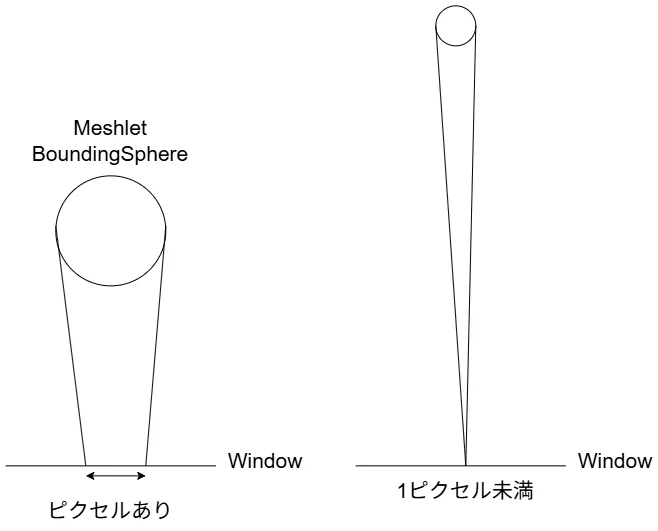
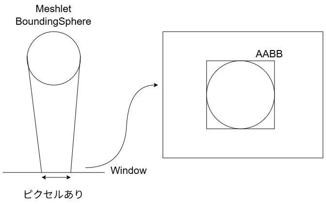
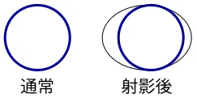
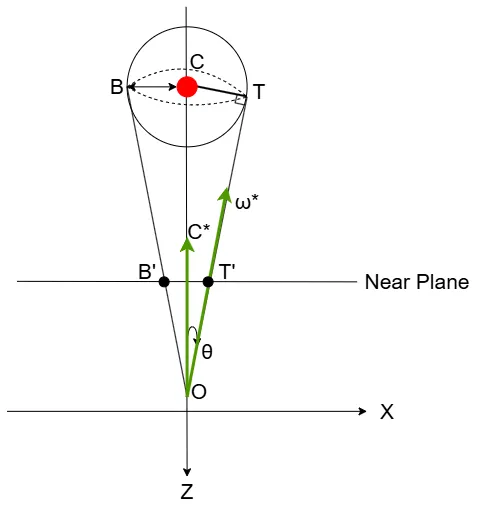
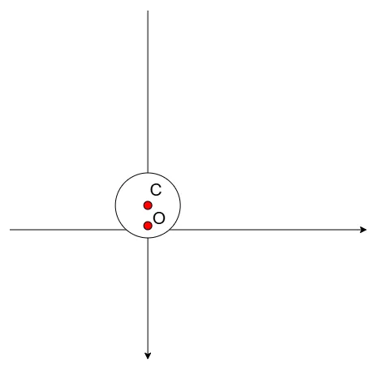
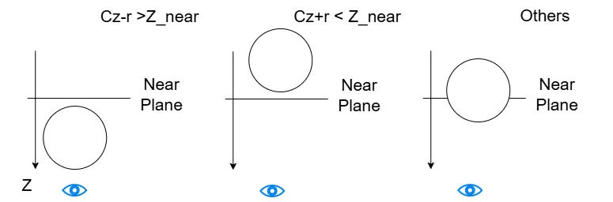

# Mesh Shaderによるカリング ～ Meshlet編3 Contribution Culling ～  
今回はASでのMeshlet Cullingの3つ目をやっていく,これでラスト.  
Contribution Culling、あまりにも小さいMeshletはカリングしようというやつ.  
参考にするのはもちろんこちら[^1],非常にためになってます...  

やりたいことは簡単、まず近くの物体と遠くの物体を考える.  



こんな感じで近くの物体はスクリーン上に現れるため、ピクセル上に描画が可能.  
逆に遠くの物体はあまりにも遠い場合はスクリーン上では1ピクセル未満となる可能性がある.  
この場合、1ピクセル未満ということは描画はできないため、描画はしなくてもよいわけである.  
Meshletはポリゴンの集まりなので、もしもここを通過したら1ピクセル未満でも128ポリゴンの処理がMSで行われちゃう...  
なので、そもそも1ピクセル未満は`DispatchMesh`を起動しないことで、処理負荷を削減していこうという訳である.  

では実際どうするか？MeshletのBoundingSphereを使う.  
これはカリングの一番最初の段階で用意しているので、わかっている情報である.  
このBounding Sphereは平面上では次のように見える.  

  

平面上では円のようになるわけである.  
この円に対してAABBを作れれば、スクリーン上のサイズが分かる.  
そしたら、スクリーン上でどれくらいのサイズかが分かるので、判定ができるわけだね.  
今回の一番面倒なところはこのAABBを求める点.  
こいつが結構面倒で、通常のAABBをそのまま使うという訳にもいかないのが面倒な点.  

  

実際に透視投影を行うと、球は歪んでスクリーン上では楕円に見える.  
そのため、歪んでいない球状にたいするAABBを計算しても、右のように見た目とは異なるものになってしまう...  
これを助けるためにConservation Rasterizeのように、ちょっと大き目な領域を取るという手もあるけど、これだとAABBが急に比べて大きくなるためぴったりが欲しい時にちょっと困る...  
これを解決するのが2D Polyhedral Bounds of a Clipped, Perspective-Projected 3D Sphere[^2]という論文.  
しっかりとぴったりになるように上手～く計算をしていく.  
この論文を基にして更に最適化をすることでAABBを計算していくというのが今回やりたいことだけど、まずはこの論文を理解するところから始めよう.  

一番最初に平面に射影した際について考えてみる.  

  

今回はBoundingSphereに対して、$`BTO`$という頂点を結んだ円錐を考える.  
円錐を考える際にベクトル$`OT`$のような方向が接線となるため、ここと垂直に$`\Delta OCT`$を考える.  
$`T`$を射影することで、BoundingBoxとなるような位置$`T^{\prime}`$が求まることになる.  
なので、まずは$`T`$を求めたい.  
今回のベクトルの内、わかっているデータを書き出そう.  

* BoundingSphereの位置: $`C`$
* BoundingSphereの半径: $`r`$
* 原点からベクトルCへの方向: $`C^{*}`$

これだけである.  
角度$`\theta`$なんかは求まっていないため、使うことはできない.  
今回はまず長さ$`OT=t`$を求めてみよう.  
$`\Delta OCT`$は垂直な三角形なので、以下のことが言える.  

```math
\begin{equation}
    \begin{split}
    CT^{2} + OT^{2} = OC^{2}
    \end{split}
\end{equation}
```
ここで、

```math
\begin{equation}
    \begin{split}
    CT = r, OC = C, OT=t 
    \end{split}
\end{equation}
```

なので、

```math
\begin{equation}
    \begin{split}
    & r^{2} + t^2 = C^2 \\
    & t = \sqrt{C^2-r^2}
    \end{split}
\end{equation}
```

という風に$`t`$は求まった！  

こうして距離$`t`$が求まればあとはRayの公式を使えば$`T=O+t\omega^{*}`$から求まる.  
そうなると、次に求めたいのは$`\omega^{*}`$となるわけだ.  
これは回転行列を使って求めていく.  
さて、今回直接$`\theta`$はわかっていない.  
が、三角形に着目すると以下の関係はわかる.  

```math
\begin{equation}
    \begin{split}
    &\cos{\theta} = \frac{OT}{OC} = \frac{t}{C} \\
    &\sin{\theta} = \frac{CT}{OC} = \frac{r}{C}
    \end{split}
\end{equation}
```

これが分かれば回転行列で$`\omega^{*}`$は以下のように表せる.  

```math
\begin{equation}
    \begin{split}
    \omega^{*} = 
        \begin{bmatrix}
        \cos{\theta} & \sin{\theta} \\
        -\sin{\theta} & \cos{\theta}
      \end{bmatrix}
    \frac{c^{*}}{C}
    \end{split}
\end{equation}
```

要はベクトル$`c^{*}`$を正規化したものを$`\theta`$だけ回転させて$`\omega^{*}`$を作ったという訳だ.  
これで$`T=O+t\omega^{*}`$が求まったことになる！！  

今回$`B`$についても計算する必要がある.  
こちらは$`T`$の回転を$`-\theta`$にするだけでOK.  
片方計算したら後はシンプルね.  

ただし気を付ける点もあって、それは$`c^2 < r^2`$のとき.  

  

この時は図からも簡単に分かるが、$`c`$が半径$`r`$より小さいので、原点が球内となる.  
この場合はどう頑張っても$`T,B`$の射影ができない.  
ではどうするかというのを考えるのが次の段階.  

今回はnear planeでクリップするかを考える.  
単純にnear planeと球が重なっている場合、先ほどもあった通り射影ができない.  
この時は純粋に円と交差する点を考える必要があるが,まず条件分けをしてみよう.  

  

まず一番左から.  
球の中心$`C_z`$と半径$`r`$の差が$`Z_{near}`$よりも大きい時.  
Zは視点方向に大きくなるので、near planeよりも手前に来ちゃってることになる.  
これはクリッピングをしてしまってよいパターンとなる.  

そして、次に中央は$`C_{z}+r`$が$`Z_{near}`$よりも小さい時.  
この時は絶対に射影が可能なため、$`T,B`$はそのまま採用すればよい.  

それ以外の場合、一番面倒なのが一番右のようなNearPlaneと交差しちゃってる場合.  
この時は円とNearPlaneの軸の交差点を求める必要がある.  
今回はNear PlaneがX軸と平行としてみよう.  
この時,円の方程式は以下のようになる.  

```math
\begin{equation}
    \begin{split}
    (x-C_{x})^2 +(z-C_{z})^2 = r^2
    \end{split}
\end{equation}
```

ただし、円の中心が$`(C_{x},C_{z})`$である.  
この時X軸上なのでZは常に$`z_{near}`$で固定される.  
当てはめて変形をしてあげよう.  

```math
\begin{equation}
    \begin{split}
    & (x-C_{x})^2 +(z_{near}-C_{z})^2 = r^2 \\
    & x-C_{x} = \pm \sqrt{r^{2} - (z_{near}-C_{z})^2} \\
    & x = C_{x} \pm \sqrt{r^{2} - (z_{near}-C_{z})^2}
    \end{split}
\end{equation}
```

この時の大きい値の方を$`\tau`$,小さい方を$`\beta`$とすると,

```math
\begin{equation}
    \begin{split}
    & \tau = C_{x} + \sqrt{r^{2} - (z_{near}-C_{z})^2} \\
    & \beta = C_{x} - \sqrt{r^{2} - (z_{near}-C_{z})^2}
    \end{split}
\end{equation}
```

となる.  
最大側は$`T`$,最小側は$`B`$として考えると、先ほどの完全に決まる場合も交えると,  

```math
\begin{equation}
    \begin{split}
        T^{\prime}=
        \begin{cases}
            & T \quad (z_{T} < z_{near}) \\
            & \tau \quad (other)
        \end{cases}
        ,B^{\prime}=
        \begin{cases}
            & B \quad (z_{B} < z_{near}) \\
            & \beta \quad (other)
        \end{cases}
    \end{split}
\end{equation}
```

という風に決定が可能！  
これで特殊な射影ができない場合までを含んだ点の決定ができた.  

最後に現在例えば$`X-Z`$軸みたいな特殊な軸を選んで計算しているので、元の軸に戻す必要がある.  
今回実は軸に関しては基本的にX軸の$`(1,0,0)`$とか$$Y軸の$`(0,1,0)`$しか選ばないが、任意の軸として以下のものを選択が可能.    

```math
\begin{equation}
    \begin{split}
    \hat{a} = (a_{x}, a_{y}, 0) = (\cos{\phi}, \sin{\phi},0)
    \end{split}
\end{equation}
```

こういう軸を使って計算しているため,T,Bを基に戻す際は
```math
\begin{equation}
    \begin{split}
    T_{result} = (T^{\prime}a_{x}, T^{\prime}a_{y}, z_{t}),
    B_{result} = (B^{\prime}a_{x}, B^{\prime}a_{y}, z_{t})
    \end{split}
\end{equation}
```
という計算をして戻すだけで良い.簡単だね.  

あとはここまでのことを実際にコードにしてあげればよい.  
今回はhlsl基準で組んでみた.  
まずはBoundの計算,X軸orY軸固定で計算をしていく.  
まずは最初に軸とboundsを入れる箱を用意.  
```c++
void getBoundsForAxis(bool xAxis, const float3& center, float radius, float nearZ, float3& U, float3& L){
    const float3& a = xAxis ? float3(1, 0, 0) : float3(0, 1, 0); // X軸 or Y軸
    float2 bounds_az[2];
```

最初はまずnear planeより手前か奥なのかの判定を行う.  
これは$`C_{z}+r<z_{near}`$で判定ができた.  
```c++
    // near planeより奥？
    bool isNotClipPlane = (center.z + radius) < nearZ;
```

次は$`\hat{a}`$の軸に射影したものをxに、Z軸に射影したものをyに入れる.  
その後,$`t`$の平方根を取ってないバージョンを計算しておく.  
```c++
    // 軸に射影させておく
    const float2 projectedCenter = Vector2(dot(a, center), center.z);  
    
    // tのsqrtを取ってないバージョン
    float tSquared = dot(projectedCenter, projectedCenter) - radius * radius;
    float t, cLength, costheta, sintheta;
```

$`c^2 < r^2`$の時は気を付けないといけないんだった.  
この時は射影できない、そのためこの場合は計算をしないようにする.  
$`t`$の平方根を取らなかったのは、ここの計算をするためである.  
射影できる場合,まずは$`t,c,\cos{\theta},\sin{\theta}`$を計算しておく.  
```c++
    // C^2 - r^2 < 0の時がカメラの内側
    // 内側の場合は射影できないので無視でOK
    if(tSquared > 0) 
    { 
        // t,c,cos,sinを用意
        t = sqrt(tSquared);
        cLength = length(projectedCenter);
        costheta = t / cLength;
        sintheta = radius / cLength;
    }
```
次に交差点の計算,$`\tau,\beta`$を求めるための用意だね.  
```c++
    // Near Planeと重なってる際の交差点計算のための用意
    float sqrtPart;
    if(!isNotClipPlane) 
    {
        float rad2 = dot(radius,radius);
        float np = nearZ - projectedCenter.y;
        float np2 = np * np;
        sqrtPart = sqrt(rad2 - np2);
    }
```
そしたら$`T,B`$を求めていく.  
$`i=0`$の時が$`T`$で、$`i=1`$の時が$`B`$である.  
まず、射影できる場合は$`T,B`$を計算しておく.  
```c++
    for(int i = 0; i < 2; ++i){
        // T,Bを計算
        if(tSquared > 0) {   
            const Matrix2& rotateTheta = Matrix2(   costheta,   -sintheta,
                                                    sintheta,   costheta);
            bounds_az[i] = costheta * (rotateTheta * projectedCenter);
        } 
```
今回ちょっと式としてややこしいことになっている.  
$`O=0`$という原点を取ってるので、これを省略すると以下のようになる.  

```math
\begin{equation}
    \begin{split}
    T&=O+t\omega^{*} \\
    &= t \begin{bmatrix}
        \cos{\theta} & \sin{\theta} \\
        -\sin{\theta} & \cos{\theta}
      \end{bmatrix}
    \frac{c^{*}}{C} \\
    & = \frac{t}{C} \begin{bmatrix}
        \cos{\theta} & \sin{\theta} \\
        -\sin{\theta} & \cos{\theta}
      \end{bmatrix} c^{*} \\
    & = \cos{\theta} \begin{bmatrix}
    \cos{\theta} & \sin{\theta} \\
    -\sin{\theta} & \cos{\theta}
    \end{bmatrix} c^{*} \\
    \end{split}
\end{equation}
```
こいつを計算しているだけである.  

最後にNearPlaneより内側の場合は$`\tau,\beta`$の計算が必要なため計算.  
こいつは$`x`$に入れるようにすればよい.  
```C++
        // NearPlaneと重なってる or 越えてる + T_z,B_zがnearPlaneより手前
        //  この場合、条件的にτ,βを計算
        if(!isNotClipPlane && (tSquared <= 0 || bounds_az[i].y > nearZ)) {
            bounds_az[i].x = projectedCenter.x + sqrtPart;
            bounds_az[i].y = nearZ; 
        }
```
最後に$`B`$の場合は逆回転なので、その分を反転する.  
$`\tau,\beta`$は符号が逆なのでそこをひっくり返す.  
回転は$`-\theta`$となればよい.  
$`\cos{\theta} = \cos{(-\theta)}`$なので、特に問題なし.  
$`\sin{\theta} = -\sin{(-\theta)}`$なので、ここは符号逆転.  
まあ、単位円を考えれば当たり前ではあるか.  
```c++
        sintheta *= -1; // 回転を逆に
        sqrtPart *= -1; // 解を逆に
    }
```
ここまではA-Z空間での計算なので、最後に元の軸に戻せば終わり.   
```c++
    // A-Z軸上の話なので、座標軸を元に戻す
    U   = bounds_az[0].x * a;
    U.z = bounds_az[0].y;
    L   = bounds_az[1].x * a;
    L.z = bounds_az[1].y;
}
```

ここまでを一気にまとめたのが以下.  
```c++
void getBoundsForAxis(bool xAxis, const float3& center, float radius, float nearZ, float3& U, float3& L){
    const float3& a = xAxis ? float3(1, 0, 0) : float3(0, 1, 0); // X軸 or Y軸
    float2 bounds_az[2];

    // near planeより奥？
    bool isNotClipPlane = (center.z + radius) < nearZ;

    // 軸に射影させておく
    const float2 projectedCenter = Vector2(dot(a, center), center.z);  
    
    // tのsqrtを取ってないバージョン
    float tSquared = dot(projectedCenter, projectedCenter) - radius*radius;
    float t, cLength, costheta, sintheta;

    // C^2 - r^2 < 0の時がカメラの内側
    // 内側の場合は射影できないので無視でOK
    if(tSquared > 0) 
    { 
        // t,c,cos,sinを用意
        t = sqrt(tSquared);
        cLength = length(projectedCenter);
        costheta = t / cLength;
        sintheta = radius / cLength;
    }

    // Near Planeと重なってる際の交差点計算のための用意
    float sqrtPart;
    if(!isNotClipPlane) 
    {
        float rad2 = dot(radius,radius);
        float np = nearZ - projectedCenter.y;
        float np2 = np * np;
        sqrtPart = sqrt(rad2 - np2);
    }


    for(int i = 0; i < 2; ++i){
        // T,Bを計算
        if(tSquared > 0) {   
            const Matrix2& rotateTheta = Matrix2(   costheta,   -sintheta,
                                                    sintheta,   costheta);
            bounds_az[i] = costheta * (rotateTheta * projectedCenter);
        } 

        // NearPlaneと重なってる or 越えてる + T_z,B_zがnearPlaneより手前
        //  この場合、条件的にτ,βを計算
        if(!isNotClipPlane && (tSquared <= 0 || bounds_az[i].y > nearZ)) {
            bounds_az[i].x = projectedCenter.x + sqrtPart;
            bounds_az[i].y = nearZ; 
        }

        sintheta *= -1; // 回転を逆に
        sqrtPart *= -1; // 解を逆に
    }

    // A-Z軸上の話なので、座標軸を元に戻す
    U   = bounds_az[0].x * a;
    U.z = bounds_az[0].y;
    L   = bounds_az[1].x * a;
    L.z = bounds_az[1].y;
}
```


さて、今回ほしいのはスクリーンのBoundingBox.  
なので、これを計算していく必要がある.  
まず先ほどの関数でX,Y軸それぞれの位置を計算して求める.  
その後、これをView-Projection行列で射影して、w除算をすればスクリーンの値となる.  
これは$`[0,1]`$となってるはずなので、このBoundを使えば目的が達成できそう！！
```c++
/** Center is in camera space */
float4 getBoundingBox(const float3 center, float radius, float nearZ, const float4x4& vp){
    float3 maxXHomogenous, minXHomogenous, maxYHomogenous, minYHomogenous;
    
    // X,Y軸に対して計算
    getBoundsForAxis(true,  center, radius, nearZ, maxXHomogenous, minXHomogenous);
    getBoundsForAxis(false, center, radius, nearZ, maxYHomogenous, minYHomogenous);
    
    // VP行列の計算
    float4 r;
    // right
    r.y = dot(maxXHomogenous, vp.row(0)) / dot(maxXHomogenous, vp.row(3));
    // left
    r.x = dot(minXHomogenous, vp.row(0)) / dot(minXHomogenous, vp.row(3));
    // bottom
    r.w = dot(maxYHomogenous, vp.row(1)) / dot(maxYHomogenous, vp.row(3));
    // top
    r.z = dot(minYHomogenous, vp.row(1)) / dot(minYHomogenous, vp.row(3));

    return r;
}
```

さて、これで欲しいBoundが分かった.  
ここまでやってなんだけど、ここからが最適化のお話となる.  
基礎部分が重すぎるねこれは...  

[^1]: [メッシュシェーダカリング](https://www.project-asura.com/articles/d3d12/d3d12_022.html)  
[^2]: [2D Polyhedral Bounds of a Clipped, Perspective-Projected 3D Sphere](https://jcgt.org/published/0002/02/05/)  
