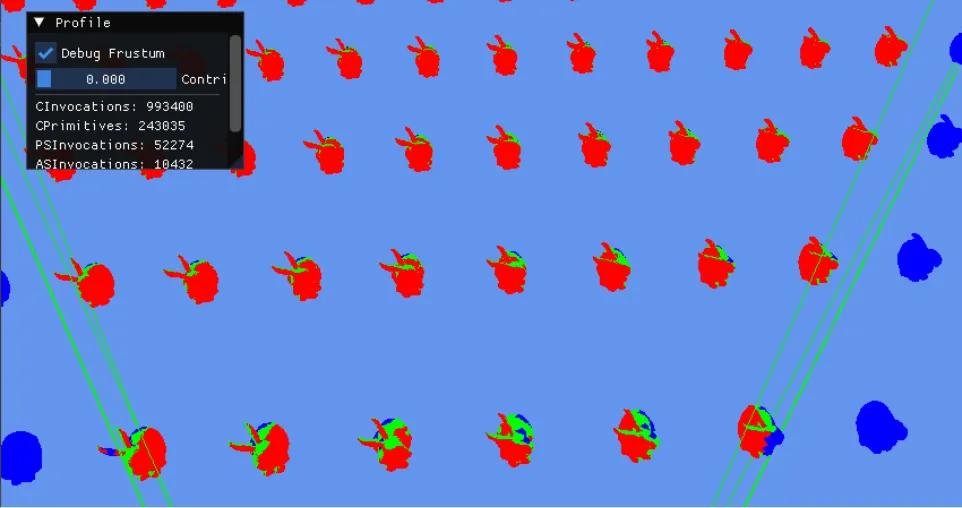

# Mesh Shaderによるカリング ～ ポリゴン編1 背面カリングとゼロ面積カリング ～  
前回まででやっとASによるメッシュレット単位のカリングが終わった!  
ここを通りぬけたメッシュレットは無事MS,つまりメッシュシェーダの処理に移ることになる.  
このMSでもさらに細かくカリングは可能で、処理単位としてポリゴン単位のカリングとなる.  
そのため、今回からはこのポリゴンカリングを見ていくことにしよう.  

さて、MSによるカリングもASと同じで3回を予定している.  
以下の順で進める予定.  

* 背面カリング+ゼロ面積カリング
* 視錐台カリング
* 微小ポリゴンカリング

この3つが実装できれば晴れてカリング周りはいったん終了！ということになる.  
内容に関してはいつも通りこいつ[^1],これが一番！  
ということで、まあもう少しですがお付き合いください.  

さて、まずは背面カリングから見ていこう.  
背面カリングは非常に単純で、三角形の法線と自分の視線ベクトルを用意する.  
これの内積を取って、その値を見てメッシュのカリングを決定するというもの.  
詳しい内容は自分が前に書いたこの記事[^2]を見てほしい、やってることは全く同じものである.  

さて、どちらにしろポリゴン単位のカリングであれば頂点の情報が欲しい.  
まずはこの頂点を取るためのコードを見直してみよう.  
Meshletにはポリゴンのインデックスバッファの情報が詰まっている.  
そのため、まずはこいつを取り出す.  
```c++
// triangle index
if (groupThreadIndex < meshlet.TriangleCount)
{
    uint packed = TriangleIndices[meshlet.TriangleOffset + groupThreadIndex];
    uint vIndex0 = (packed >>  0) & 0xFF;
    uint vIndex1 = (packed >>  8) & 0xFF;
    uint vIndex2 = (packed >> 16) & 0xFF;
```
取り出したものは以前までは`triangles`に記憶するだけであったが、今回は記録だけでなく`Index`に保持しておく.  
```c++
    uint3 Index = uint3(vIndex0, vIndex1, vIndex2);
    triangles[groupThreadIndex] = Index;
```
今回のポリゴンの持つ3つの頂点情報は`posW`として用意しておく
.  
```c++
    // for Culling
    float3 posW[3];
```
後はindexから各頂点を取り出して、各頂点を座標変換する.  
そして、変換したものを頂点に記録しつつ、カリング用に`posW`に入れておけばOK.  
```c++
    // vertex transform
    for (uint j = 0; j < 3; j++)
    {
        uint idx = Index[j];
        
        // Check Array Region.
        if (idx >= meshlet.VertexCount) { continue; }

        // Vertex
        uint vertexIndex = meshlet.VertexOffset + idx;
        vertexIndex = VertexIndices[vertexIndex];

        float4 localPosition = float4(Vertices[vertexIndex].Position, 1.0f);
        float4 worldPosition = mul(Instances[instanceIndex].Mat, localPosition);
        float4 projectionPosition = mul(Scene.Proj, mul(Scene.View, worldPosition));

        VertexOutput vout;
        vout.Position   = projectionPosition;
        vertices[idx] = vout;

        // set culling parameter
        posW[j] = worldPosition.xyz;
    }
```

カリングが入る前と入った後のここの処理はちょっと違ったものになっている.  
図で示すと次のような感じ.  

|  | indexの記録 | 頂点の記録 |
| :---: | :---: | :---: |
|以前 | 1ポリゴン分 | 1頂点分 |
|今回 | 1ポリゴン分 | 3頂点分 |

つまり、全Laneが3頂点分を計算するためちょっと計算的には遅くなるはず.  
なので、あまりカリングが行われない場合は無駄が多いということになる.  
逆にカリングが非常に多くのポリゴンで起こる場合は後々のPixel Shaderで省かれることになるので、軽くなるという寸法.よく出来てる.  

今回の処理は`IsBackFaceOrZeroArea`という関数で行う.  
これが`true`ならカリングするものなので、カリングしてしまえばよいという寸法だ.  
```c++
culled |= IsBackFaceOrZeroArea(posW, Scene.CameraPosition);
```

それではこの関数の中身を見てみよう.  
やってることは簡単で、ビューベクトルと法線を計算.  
その後、内積で判定を取るだけ.  

```c++
bool IsBackFaceOrZeroArea(float3 worldPos[3], float3 cameraPosition)
{
    float3 viewDirection = normalize(cameraPosition - worldPos[0]);

    float3 a = worldPos[1] - worldPos[0];
    float3 b = worldPos[2] - worldPos[0];
    float3 n = cross(a, b);
    return dot(n, viewDirection) < 0.0f;
}
```

今回はViewベクトルはカメラの方向に向いている.  
そのため、法線とViewベクトルが同じ方向,つまり正なら見えている状態.  
逆に負の場合はBack Faceとなるため、カリングしてやればよいというわけだ.  

さて、中級グラフィックス入門[^1]ではスカラー三重積など書いてある.  
ゼロ面積カリングは自分はもう少し簡単にしても良いかと思ったので、自分の考えで理解していく.  

三角形から法線$`n`$は$`n=a \times b`$で計算をしている.  
そもそも外積の大きさというのは、平行四辺形の大きさと対応している.  
そのため、面積がゼロというのを判定したければ$`n`$が0であるかを確認するだけでよい.  

ではこの$`n`$が0という場合は何が起きるか？  
最後の計算で $`dot(n, viewDirection)`$ を計算している.  
ちょっと長いので $`viewDirection`$ を $`v`$ とすると,

```math
\begin{split}
dot(n, v) &= n_{x} * v_{x} + n_{y} * v_{y} + n_{z} * v_{z} \\
&= 0 * v_{x} + 0 * v_{y} + 0 * v_{z} \\
&= 0
\end{split}
```

つまり、この内積が0になってしまう！！  
ゼロ面積カリングをやるということはつまり

```c++
    return dot(n, viewDirection) < 0.0f;
```

というところを

```c++
    return dot(n, viewDirection) <= 0.0f;
```

とすればよいというだけである.  
こうやって理解する方が個人的には分かりやすいんじゃないかな～？とは思う.個人差はあるかも.  

さて、それではここまでできたところで結果を見てみよう.  

  

今回からの色の塗分けは

* 青: ASによるカリング
* 緑: MSによるカリング
* 赤: 描画されている

となっている.  
背面は視線とは真逆の方向が消えてるということになる.  
ウサギの後ろ側が緑になっていることからも読み取れるのではないかなと思う.  
ゼロ面積カリングについては割愛、多分0になってたらそもそも描画されてないんじゃないかな...  

さて、ということでMSのカリング初回も終了！  
もう少しだけカリングも頑張っていきましょう.  

[^1]: [中級グラフィックス入門～効率的なメッシュレット描画～](https://speakerdeck.com/projectasura/zhong-ji-gurahuitukusuru-men-xiao-lu-de-nametusiyuretutomiao-hua)  
[^2]: [法線ベクトルによるBack Face Culling](./../Basics/BackFaceCulling.md)  