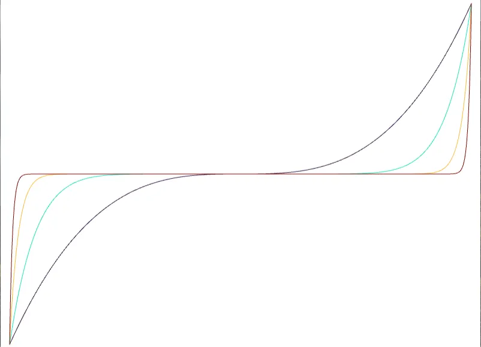

# Stylized depiction of images based on depth perceptionの実装をやってみた  
ここ[^1]を見ていた時にまたしても面白そうな物を見つけてしまった.  
Stylized depiction of images based on depth perception[^2]という論文で、雑に法線を復元してそれを使って画像編集を行っていくというもの.  
この論文自体はImage-Based Material Editing[^3]を元にしてるっぽいけど、元の方は結構読みにくいので、自分はこっちを読んだ形.  
論文の著者一覧見てて思ったけどReinhard教授が関わってるのね！Reinhard Tonemapで有名な方だ.  
ということで、余計な話は置いといて実装していこう.  

まずは画像からのデータ抽出.  
今回はまず色空間をRGBからYCbCrというJPEGでもお馴染みの空間に持っていく.  
この時のYが必要なわけだが、参照しているのはRec.709[^4]であろう.  
輝度値なので緑を強めに抽出するが、これは以下の形式で想定されてるっぽい.  

```math
\begin{equation}
    \begin{split}
        Y = 0.212R + 0.715G + 0.072B
    \end{split}
\end{equation}
```

このY値を使って処理を行うわけだけど、まず最初にやるのはバイラテラルフィルタの適用.  
これでノイズ低減をしておく.  
```c++
// AlphaをRに変換 
for (int i = 0; i < ImageWidth; i++)
{
    for (int j = 0; j < ImageHeight; j++)
    {
        r[j][i] = ColorF{ static_cast<double>(inputImage[j][i].a), 0.0, 0.0, 1.0 };

        // YCrCbのYを計算,その後でdepth=Yとしてしまう
        Vec3 color = Vec3{ inputImage[j][i].r,inputImage[j][i].g,inputImage[j][i].b } / 255.0;
        double Y = Dot(color, Vec3{ 0.213,0.715,0.072 });
        L[j][i] = ColorF{ Y,0.0,0.0,1.0 };

        // 保持しておく
        inputLayer[j][i] = Y;
    }
}

// Bilateral Filterを適用してぼかす
constexpr double SIGMA_COLOR = 0.1;
constexpr double SIGMA_SPACE = 10.0;
L.bilateralFilter(-1, SIGMA_COLOR, SIGMA_SPACE); 
```

現状`inputLayer`がY値、`L`がY値にバイラテラルフィルタを掛けたものとなっている.  
これを使ってTwo-scale Tone Management for Photographic Look[^5]において、「Bilateral Decomposition」と呼ばれている処理を行う.  
この`L`をBaseレイヤーとして`B(x,y)`とする.  
そして、入力`inputLayer`から`L`を抜いたものを`D(x,y)`とする.  
つまり,`inputLayer`を`I`,バイラテラルフィルタを`bf`とすると,

```math
\begin{equation}
    \begin{split}
        B(x,y) = bf(I(x,y)) \quad and \quad D(x,y) = I(x,y) - B(x,y)
    \end{split}
\end{equation}
```

を求めるわけだ.  
バイラテラルフィルタによる除去したデータを`B(x,y)`,これを引くことで`D(x,y)`はディテール側を持つという感じになるってことかな.  
この二つを調整したものを近似した深度`Z(x,y)`とするわけである.  

```math
\begin{equation}
    \begin{split}
    Z(x,y) = F_{b} B(x,y) + F_{d}D(x,y) \quad (F_{b},F_{d} \in [0,1])
    \end{split}
\end{equation}
```

ここで$`F_{b},F_{d}`$はハイパーパラメータである.  
調整して良い値を見つけよう.  
今回は以下のように実装してみた.  
`base`と`detail`に計算した後、これを重みと共に足し合わせるだけである.  
```c++
double baseWeight = 1.0; double detailWeight = 0.9;
for (int i = 0; i < ImageWidth; i++)
{
    for (int j = 0; j < ImageHeight; j++)
    {
        double base = f(f(f(f(L[j][i].r / 255.0))));
        double detail = inputLayer[j][i] - base;
        depthLayer[j][i] = base * baseWeight + detail * detailWeight;
    }
}
```

ここでちょっとおかしな点に気付くはず.  
`base`にfという謎の関数がかかっている...  
このfは以下のようになっている.  

```c++
auto f = [](const double& x)
    {
        return (3.0 + (-6.0 + 4.0 * x) * x) * x;
    };
```

これは数式で書くなら以下のような感じ.  

```math
\begin{equation}
    \begin{split}
        f(x) = (3+ (-6 + 4x)x)x
    \end{split}
\end{equation}
```

式だけでは分かりづらいので、$`x \in [0,1]`$の範囲でグラフをプロットしてみた.  

  

これは`gradient reshaping function`というもので、Image-Based Material Editing[^1]にて記述されていた式である.  
グラフにもある通り、値が小さいところや明るいところの閾値を上げる働きがある.  
要はSigmoidみたいに値を調整する役割があるんだけど、今回で言うと人間の目の傾向に合わせてこの処理が入ってるっぽい.  
暗い部分であればあるほど、人間の目は深度的には深いと感じやすいためそこを強調するのが目的.  
こうすることで以前やったLumo[^6]で得られる結果と同等のものが得られるらしい.  

ここまでで深度はできたので、後は色々とStylizedな結果を色々と生成していこう.  
今回は論文でも紹介されている

* Halftoning
* MultiToning
* Dynamic Lines
* Color relighting

の4つを試してみる.  

その前に光源との可視性を計算するための単純な方法を紹介しておこう.  
各Pixelの位置はもちろん$`(X,Y)`$として求まっている.  
今回深度が求まったことで、各Pixelの位置から$`Z`$が計算できるようになったということである.  

そのため、まず対象のPixelの$`X,Y`$から光源位置の$`X,Y`$までに通る直線となるPixelを求める.  
これは論文内だとBresenhamのアルゴリズムを使って求めるらしい...が、面倒なのでDDXで代用.  

こうして通るPixelを求めたら、後は各Pixelに対して当たってるかを確認するだけ.  


もし当たっていればそれは光源からは見えない位置、光源まで到達するならそれは光源からは見える位置なので処理を施してあげるといった感じだ.  
これを駆使して上記のうち3つは処理を施していくので、先に説明をしてみたわけである.  

* Halftoning  
まずはハーフトーンから.  
ハーフトーンは単純で光に当たるピクセルは1,当たらないなら0という単純なもの！  
この処理では`from`側に処理したいPixel,`to`側にポイントライトの位置を入れる.  
高さは関係なくあくまで位置が分かればいいので`.xy()`で取る.  
その後、距離を計算しておきつつ、DDAで点を求めておく.  
```c++
auto HalfToneProcess = [&]()
    {
        // AlphaをRに変換 
        for (int i = 0; i < ImageWidth; i++)
        {
            for (int j = 0; j < ImageHeight; j++)
            {
                Vec2 from = { i, j }; Vec2 to = { pointLight.xy() };
                const double targetDistance = from.distanceFrom(to);
                auto points = GetDDAPoints(from, to);
```

そしたらまずRayの高さを求める.  
`from`と`to`があるので、Rayの距離を使って`from: threshold=0, to: threshold=1`となるような閾値を求める.  
この閾値でLerpをして探索時点の高さが`currentDepth`で求まる.  
```c++
                bool isIntersect = false;
                for (const auto& point : points)
                {
                    double depth = depthLayer[point.y][point.x];

                    // 現状の高さに置ける値をlerpで計算してみる
                    double pointDistance = from.distanceFrom(point.xy());
                    double threshold = pointDistance / targetDistance;
                    double currentDepth = Math::Lerp(depthLayer[j][i], pointLight.z, threshold);
```
あとは現在のRayの高さである`currentDepth`が現状のピクセルに立ってる壁`depth`よりも高いか低いかを求める.  
`currentDepth`の方が低い場合,これは壁にめり込んでいるという判定なので、交差判定をtrueにして終わり.  
もしもPointLightまでたどり着いたら`false`となる.  

```c++
                    // 交差してる？
                    if (currentDepth <= depth)
                    {
                        isIntersect = true;
                        break;
                    }
                }
```
あとは交差していれば光から見えないので0,交差していなければ光から見えるので1とすれば完了.  
```c++
                result[j][i] = isIntersect ? 0.0 : 1.0;
            }
        }
    };
```

結果はこんな感じ、いい感じに色分けできている気がする.  

* MultiToning  
これは単純で、複数の光源を用意して、その交差で$`0 or 1`$ではなく$`0, 0.25, 0.5, 1`$みたいなグレーも混ぜましょう～というだけである.  

今回のテストではとりあえず光源は2つとして採用.  
用意した後は交差しているのかを取って、交差したものの平均した色にしてみた.  
```c++
// AlphaをRに変換 
for (int i = 0; i < ImageWidth; i++)
{
    for (int j = 0; j < ImageHeight; j++)
    {
        Vec2 from = { i, j };

        bool isIntersectPoint1 = IsHitLight(from, pointLight, depthLayer[j][i]);
        bool isIntersectPoint2 = IsHitLight(from, pointLight2, depthLayer[j][i]);

        double sum = (isIntersectPoint1 + isIntersectPoint2) / 2.0;

        result[j][i] = sum;
    }
}
```

結果は次のような感じ.  

うん、ちょっとグラデーションっぽくなった.  

* Dynamic Lines  
Dynamic Linesだと分かりにくいけど、集中線と言えば分かりやすいと思う.  
視覚効果として集中線があると、視線誘導になったりして便利よね.  
これを再現するのがDynamic Lines.  

線を引くにあたっての考え方は単純で、確率で光源の手前に高い壁を築くだけ！  

  

こうするとこのピクセルを通るRayは強制的に高い壁によって拒まれることになる.  
拒まれた位置は基本的に全部0になるため、結果として黒い線が形成されることになるわけだ.賢い.  

今回は以下のような感じで実装をしてみた.  
まず乱数を生成して、手前ほど出やすくなるような確率分布を`std::discrete_distribution`を使って作成.  
```C++
std::vector<double> values;
for (int i = pixelOffset; i > 0; i--) { values.push_back(i); }
std::discrete_distribution<std::size_t> dist(
    values.begin(),
    values.end()
);
```
極座標のような感じで実装するため、まずはどれくらい回転させるかを乱数で決める.  
```c++
auto wallDepthLayer = depthLayer;
for (int i = 0; i < wallNum;)
{
    Vec2 r = { 1,0 };
    r.rotate(Random(0.0, 1.0)* Math::TwoPi);
```

回転が決まった後は、先程の乱数を使ってどれくらいの位置に壁を築くかを決定する.  
今回は`50~75`pixelとした.  
あまり手前だとあまりにも光源から遠いピクセルの塗りつぶしが多くなるため.  
多分元の論文もそういう処理入れてそうではあるけどどうなんだろ？  
```c++
    size_t distance = dist(engine);
    r *= Math::Lerp(50, 75, distance/static_cast<double>(pixelOffset));

最後に光源位置からずらして、壁を作る位置を決定.  
現在のPixel位置をはみ出してないかを確認した上で壁を築く.  
```c++
    Vec2 p = pointLight.xy() + r;

    if (p.y < wallDepthLayer.size() && p.x < wallDepthLayer[p.y].size())
    {
        wallDepthLayer[p.y][p.x] = 5; // 壁を厚くする
        i++;
    }
}
```

これで完成、結果を見てみる.  


うん、それっぽく線が引かれている！  

* Color relighting
最後に法線ライティング,Lumoと同じことをすればよい.  
法線の計算は以下で行う.  

```math
\begin{equation}
    \begin{split}
    \Delta N(p) = 0
    \end{split}
\end{equation}
```

g_{x}(x,y) &= [1,0,\nabla_{x}z(x,y)] \\
g_{y}(x,y) &= [0,1,\nabla_{y}z(x,y)] \\
n(x,y) &= \frac{g_{x} \times g_{y}}{|g_{x} \times g_{y}|}

$`\nabla`$は単純にソーベルフィルタを取ってやればいい.  
そしたら式通りに計算するだけ.  
```c++
auto nablaX = SobelFilter(depthLayer, weightsX);
auto nablaY = SobelFilter(depthLayer, weightsY);

for (int i = 0; i < ImageWidth; i++)
{
    for (int j = 0; j < ImageHeight; j++)
    {
        Vec3 gx = {1.0, 0.0, nablaX[j][i]};
        Vec3 gy = {0.0, 1.0, nablaY[j][i]};
        Vec3 r = Math::Cross(gx, gy).normalized();
        r = r * 0.5 + Vec3::One() * 0.5; // [-1,1]->[0,1]へ
        resultImage[j][i] = ColorF(r.x, r.y, r.z, 1.0);
    }
}
```

そしたら最後にライティング、Pixel Shaderを見ておこう.  
ほぼLumoと変わらないが、前回と違いマスク画像ではなく画像に適用しているので2枚のテクスチャで色を重ねている.  
```hlsl
float4 PS(s3d::PSInput input) : SV_TARGET
{
	float2 uv = input.uv;
	float4 base = g_texture0.Sample(g_sampler0, uv);
	float4 tex = g_texture1.Sample(g_sampler0, uv);
	float3 normal = tex.rgb * 2.0f - 1.0f;

	float4 color = float4(saturate(dot(normal, g_lightDirection)) * g_lightColor, 1.0);
	color.rgb += base.rgb;
	return (color * input.color) + g_colorAdd;
}
```

そしたら結果.  

カラー画像な分、今回の方が見栄えがいいね.  

ということで今回はこの辺で終わりかな.  
実装が面白かったので満足です.  

[^1]: [Image-Based Material Editing](http://hideki-todo.com/cgu/blog/article/ImageBasedMaterialEditing/)  
[^2]: [Stylized depiction of images based on depth perception](https://dl.acm.org/doi/10.1145/1809939.1809952)  
[^3]: [Image-based material editing (Paper)](https://dl.acm.org/doi/10.1145/1141911.1141937)  
[^4]: [Rec. 709](https://w.wiki/Uo2i)  
[^5]: [Two-scale Tone Management for Photographic Look](https://dl.acm.org/doi/10.1145/1141911.1141935)  
[^6]: [Lumoを実装してみる](./Lumo.md)