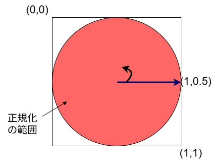
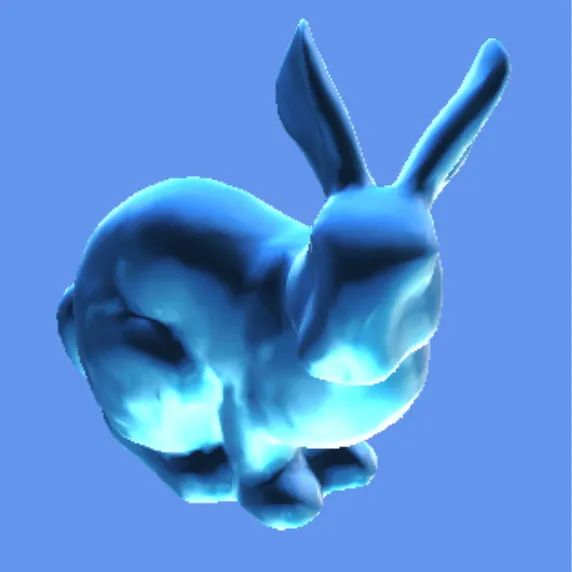

# MatCap  
それっぽい色味を既にライティングしたものからサンプルしていい感じにしたい.  
こういう時MatCapというものが便利である.  

この技術がどこから出てきたのか興味本位で調べてみたところ、そもそもの発端として環境マッピングに話が戻る.  
環境マッピングは法線方向を取ることで、上手く環境を焼いたテクスチャをサンプル仕様というもの.  
これを球面としてテクスチャに焼き付けてサンプルするわけである.  
詳しい説明は床井先生の解説[^1]やD3D9の解説[^2]辺りが非常に参考になると思う.  
この技術自体遡ると、確かにここ[^3]に書いてある通り、Blinn先生やNewell先生の論文が起源っぽい？  
んで元の論文[^4]を見に行くと、Abstractに1974年にCatmull先生の考えたアルゴリズムをテクスチャとかライティングに使用したものらしい.  
有名人勢ぞろいだ、それに1974年からあるというのもすごい...  

そのあと少し経った後、2001年にLitSphere[^5]という方法が出てくる.  
Abstractを読んでる感じは芸術作品のライティング再現のために、実際にキャプチャを行ってそれをサンプリングするというもの.  
サンプリング方法は環境マッピングと同じような感じなので、NPRの応用と言える気がする.  

そしてそして、更に時は流れ2007年にMatCapの名称でZBrushに実装された.  
これがMatCapの誕生となる、実装自体は昔からあってそれが実装されて今の名前が定着したという感じになるのかこれは.  
名前の由来は「Material Capture」.まあ、そうよね.  
因みにMatCapは2007だが、それよりも前に2005にShade/Shapeに似たようなものが実装されてたらしい[^6].  
より一般的になったのがZBrushなので、そっちが名前として定着したんだろうなぁ...と推察.  

さて、ここまで調べたところで実装をしてみようかなということで開始～.  
参考文献とかはないけど、自分が最後にこれを見たのはDirectX12の魔導書[^7]だった記憶.  
目次にそれっぽいのがあったので、Gitでサンプル漁ったらビンゴ[^8].ありました.  
そういえばMMDってSphere Mapという名称で同じもの実装してたんでしたね、忘れてました.  

やることは非常に簡単で、まず最初に頂点シェーダで法線をビュー空間まで持っていく.  
```c++
	// normal
	output.Normal   = normalize(mul((float3x3)World, input.Normal));
	output.Normal	= normalize(mul((float3x3)View, output.Normal));
```
今回はWorld座標ではスケールなしの回転のみ+View/Worldどちらも移動方向は`float3x3`で排除してる.  
そのためworldもViewもどちらも直行行列.  
これは$`(M^{-1})^{T}= (M^{T})^{T} = M`$となり、そのまま法線に掛けるので問題なくなっているということである.  
スケール使う場合とかがある場合はちゃんと$`(M^{-1})^{T}`$を掛けてあげようね.  
法線の座標変換って、こういうところがちょっと面倒よね.  

次はPixel Shader.  
今、法線は$`[-1,1]`$となっている.  
テクスチャ空間は$`[0,1]`$のため、これに合わせてあげる必要がある.  
そのため、スケールをしてあげればOK.最後にLookupして終わり.  
```c++
    float3 N = normalize(input.Normal);
	float2 uv = 0.5f + 0.5f * N.xy;
	output.Color.rgb = SphereMap.Sample(SphereMapSample, uv).rgb;
```

さて、ちょっとここで疑問に思うのがなんでこれ円なの？という点である.  
これの理由は特に読んでないので詳しくは知らないが、結局のところ法線が正規化されているという点にあると思う.  

  

正規化されているということは大きさが1にならなきゃいけない.  
これを満たすような領域を考えるなら、単純に$`(u,v)=(1,0.5)`$のような点を考えて、これを中心$`(u,v)=(0.5,0.5)`$としてぐるっと回した範囲が正規化された範囲となる.  
これがまさしくTextureが球になってる理由だと思う.  

逆を返せば外側の何もない位置はそもそもあり得てはいけない場所ともいえる.  
右端を考えると$`(u,v)=(1,0)`$である.  
これは正規化範囲から外れてるわけだが、法線空間に戻すと$`(N_{x},N_{y})= (1,-1)`$となる.  
これだとたとえ$`N_{z}=0`$だとしても、$`N = (1,-1,0)`$となり、明らかに大きさは1にならない.  
つまり、正規化されてない範囲なので法線としてもあり得ないものと差し支えない.  

さて、そしたら結果を見てみよう.  
今回MatCapの素材はこちら[^9]のを拝借した、非常にありがたいデータだ...  



うん、いい感じにマッピング出来てそう.  
簡単にそれっぽい特徴を乗せられるのは本当に便利だね.  

[^1]: [第１０回 スフィアマッピング](https://tokoik.github.io/blog/2005-01-07.html)  
[^2]: [球面環境マッピング](https://learn.microsoft.com/ja-jp/windows/win32/direct3d9/spherical-environment-mapping)  
[^3]: [The Story of Reflection Mapping](https://www.pauldebevec.com/ReflectionMapping/)  
[^4]: [Texture and reflection in computer generated images](https://dl.acm.org/doi/10.1145/360349.360353)  
[^5]: [The lit sphere: a model for capturing NPR shading from art](https://dl.acm.org/doi/10.5555/780986.781004)  
[^6]: [Inverse Light Probes and MatCap Re-Lighting](https://agraphafx.com/inverse-light-probes-and-matcap-re-lighting/)  
[^7]: [DirectX 12の魔導書 3Dレンダリングの基礎からMMDモデルを踊らせるまで](https://www.shoeisha.co.jp/book/detail/9784798161938)  
[^8]: [directx12_samples Chapter8 Pixel Shader](https://github.com/boxerprogrammer/directx12_samples/blob/master/Chapter8/BasicPixelShader.hlsl)  
[^9]: [MatCapの概要や仕組みを理解する話](https://note.com/mishoji_yuki/n/n1554fd51f57a)  