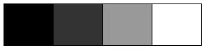
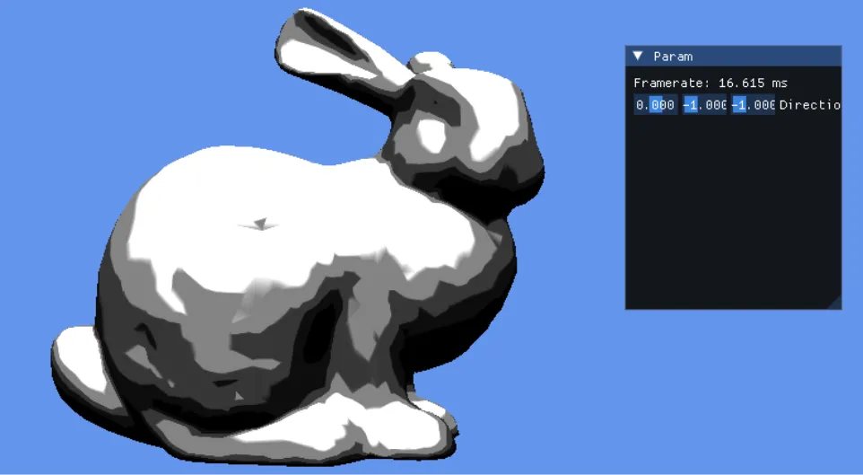

# Ramp Texture  
Toon Shadingで陰をつけたい場合は多々としてある.  
この時、基本的にはLambertである$`L \cdot N`$を計算して、これを陰として使う.  

が、Toonの場合滑らかすぎるとあまり見栄えが良くない...  
そのため`step`や`smoothstep`を入れることで2影を作ったりすることがよくある.  

しかし、これでも問題があって、意外とアーティストからすると2影じゃ足りず3影も入れたい...となることは結構ある.  
これを計算でやることも可能だが、こうなると更にパラメータが段々と増えていき、処理も複雑になる...  
処理が複雑になるだけならまだしも、パラメータが増えるのでアート側の調整コストも増大する.  
要は面倒が多いというわけだ.  

ならテクスチャに焼いてそれを参照すれば軽量で簡単に行けるんじゃない？というのが今回の本題.  
これをRamp Textureという、「Ramp」は辺りを照らすランプの意味ではなく、傾斜の意.  
階調といった方がそれっぽいかもしれない.  
このテクスチャはまず以下のような形状のものとなっている.  

  

$`V`$方向は特に変化はないが、$`U`$方向に変化がある.  
そのため、下の矢印のように$`L`$と$`N`$が同じ方向なら、内積は1なので明るい陰.  
外側は$`L`$と$`N`$が全く異なった方向になるので、内積は$`0`$となり暗い陰となる.  
こんな感じのサンプルをしてあげればよい.  
色に関してはテクスチャに焼き付けてもいいし、shaderのパラメータで用意してもよい.  
そこに関しては好みの問題かな～と思う、まあとはいえ二影であまりにも色変えたいとかならテクスチャに書き込んで都度用意してとかした方が速いのかもしれない.   

さて、今回はDirectX12で実装をしてみよう.  
まずテクスチャのサンプル方式だが、これは`Clamp`にしておく.  
```c++
samplers.push_back(PARAM_STATIC_SAMPLER{ D3D12_SHADER_VISIBILITY_PIXEL, 0, 0, 
    PARAM_STATIC_SAMPLER::SamplerType::LinearClamp });
```
折り返す必要は全くないのでこれが安牌.  
`saturate`とかで保証してもいいとは思うけど、shader側の不手際でwrapしないようにここで調整してしまうのが一番いいと思う.  

後はShaderだけどやることはシンプル.  
内積を計算後、これを`uv`の`u`に適用.`v`は関係ないので0を入れとく.  
あとはサンプルすれば終わり.  
```c++
	float NoL = saturate(dot(N,L));
	float2 uv = float2(NoL, 0);
	output.Color.rgb = RampTexture.Sample(RampTextureSample, uv).rgb;
```

結果を見てみよう.  
今回はこちら[^1]からテクスチャを拝借した.  
これくらい自分で作りなさいよ...という感じではあるけど...怠惰...  

  

うん、ちゃんと階調毎に表れてる！  
個人的にはこの方法が一番シンプルでアーティストも弄りやすくて、陰に関しては下手に`step`による計算でやるよりかはこういうので最初からやる方がいいんじゃないかなと思ったり.  
まあ、とはいえ要望次第よね.  
とはいえ、今回はこれで良しということで終わろうと思う.  

[^1]: [UNITY古典シェーダ Rampシェーダ（トゥーンシェーダ）](https://qiita.com/YukiMiyatake/items/ca4011d10eb590ecbb4b)  
