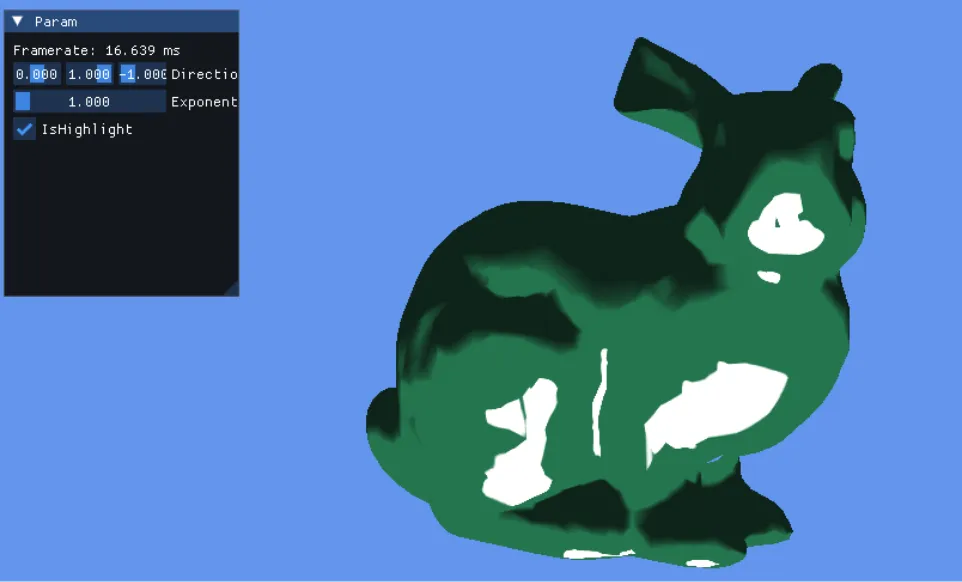
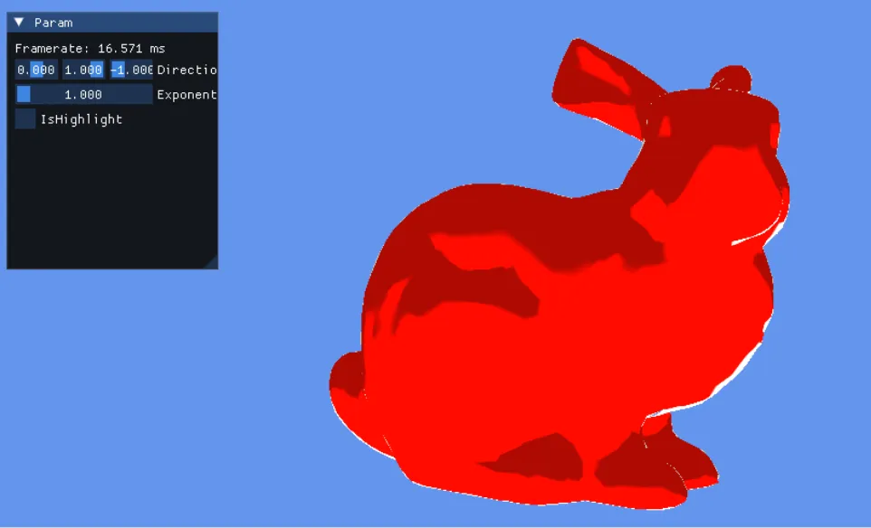

# XToon  
以前にRampTextureによる影を変える方法をやったけど、更に別のものも制御しようという考えもあるらしい.  
ここ[^1]で紹介されてるXToonというやつで、論文はこちら[^2].  
やろうとしてることは簡単で、Textureなら2DLookupができるよね.  
UVに対して、U方向はRamp Textureと同等のものを置き、V方向で更に別の特徴をつけようというもの.  
このV方向をDetailとして$`D`$をどう定義するか？が大事なところ.  

論文内ではDepthを貼り付けて～...ということもやってるけど、これは遠景用のものを用意するのが面倒...  
ということで、一番楽なハイライトとシルエットをやって行く.  

ハイライトはSpecular Highlightの値を参照するものである.  
Phongのハイライトが論文では使われているが、ハイライトは鏡面反射.  
鏡面反射は
* ライト方向をジオメトリ法線基準で反射させた$`R`$
* カメラ位置からワールド位置を引いて作ったビュー方向$`V`$
を使うと、以下のように表される.  

```math
D = (V \cdot R)^{\alpha}
```

つまり鏡面反射が強い場所ほどルックアップ位置が強い場所になる感じだ.  

次にシルエット.  
シルエットは簡単に言えばリムライトの位置を基準にして$`D`$を変えればよい.  
リムライトは
* カメラ位置からワールド位置を引いて作ったビュー方向$`V`$
* 法線方向$`N`$
を使うと、以下のように表される.  

```math
D = (V \cdot N)^{\alpha}
```

視線方向と法線が近ければ$`1`$,遠ければ,つまりシルエット位置の場所は$`0`$になるわけだ.  

さて、ここまでできれば後は実装するだけ.  
今回はまず基礎的なパラメータを用意する.  
```c++
    float3 N = normalize(input.Normal);
	float3 L = normalize(-Directional.xyz);
	float3 V = normalize(CameraPos.xyz - input.WorldPos.xyz);
	float3 R = reflect(-L, N);
```

そしたら内積でLambert,シルエット,リムライトを計算.  
```c++
	float NoL = saturate(dot(N,L));
	float NoV = saturate(dot(N,V)); // for silhouette
	float VoR = saturate(dot(V,R)); // for highlight
```
さて、ちょっと注意ポイント.  
シルエットテクスチャとハイライトテクスチャのUVは値が大きいほど右下へ,小さいと左上へとなる.  
そのため、今回のテクスチャとしてはv方向は上が1,下が0になるようにOneminusをしておく.  
Windowの面倒なところがでてきちゃってるね.  
できるのであれば、別段Texture側で逆転させるのでも問題ないはず.  
```c++
	float silhouette = 1.0f - saturate(pow(NoV, Exponent));
    float highlight = 1.0f - saturate(pow(VoR, Exponent));
```
今回はshader内でハイライトとシルエットを切り替えられるようにした.  
単純にデバッグで両方表示させたかったからです.  
```c++
    float v = lerp(silhouette, highlight, UseHighlight);
```
後はUVのルックアップをして終わり.  
```c++
	float2 uv = float2(NoL, v);
	output.Color.rgb = XToonTexture.Sample(XToonTextureSample, uv).rgb;
```

結果を見てみよう.  
まずはシルエット.  

  

こっちはハイライト.  

  

うん、ハイライトもシルエットもちゃんと出ている.  
とはいえちょっとピーキーかなという気もしないではない.  
普通にリムと鏡面だけで実際のところ問題はなさそうな感じはした.  
まあ、こういうのは知識として溜めとくことが大事よね.  

[^1]: [Maya CgFX シェーダー：X-Toon](http://hideki-todo.com/cgu/blog/article/XToon/)  
[^2]: [X-Toon: An extended toon shader](https://maverick.inria.fr/Publications/2006/BTM06a/)  