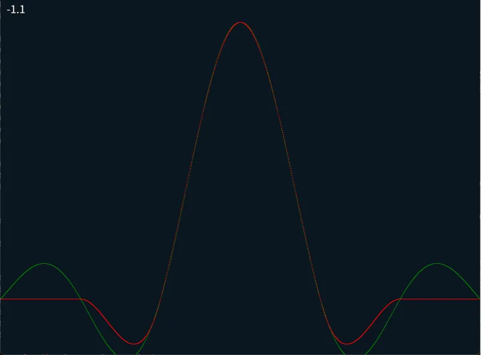

# バイキュービック補間  
前回は4点による補間、バイリニア補間[^1]をやった.  
更に更に16点による補間がある、これがバイキュービック補間[^2]だ.  
式に関してはここ[^3]が詳しく、非常に参考になった.  

バイキュービック補間であろうとも基本的にはバイリニア補間と同じでX方向とY方向の補間をやるだけとなる.  
そのため、まずはこの計算をどのように行うかを見ていく.  

今回は4x4の16点を見ていくことになる.  
基準となる点にfloor演算を掛けたものを$`S(0,0)`$とすると、次のような行列として書ける.  

```math
M=
\begin{bmatrix}
s(-1,-1) & s(0,-1) & s(1,-1) & s(2, -1) \\
s(-1, 0) & s(0,0) & s(1,0) & s(2,0) \\
s(-1, 1) & s(0,1) & s(1,1) & s(2,1) \\
s(-1,2) & s(0,2) & s(1,2) & s(2,2)
\end{bmatrix}
```

次にX方向の補間を行う関数を$`h`$とする.  
そして、基準点と格子状の点の距離を$`d_{xi}`$とすると、

```math
v_{x} = \begin{bmatrix}
h(d_{x0}) \\
h(d_{x1}) \\
h(d_{x2}) \\
h(d_{x3})
\end{bmatrix}
```

Y方向に関しても同じようにすると、

```math
v_{y} = \begin{bmatrix}
h(d_{y0}) &
h(d_{y1}) &
h(d_{y2}) &
h(d_{y3})
\end{bmatrix}
```

となる.  

このベクトルと行列を掛け合わせると、

```math
d(x,y) = v_{y}Mv_{x}
```

で計算が出来るわけだ！  
ここで$`h`$にlerpっぽいものを採用すれば、バイリニア補間とほぼ同じものとなる.  

では、実際のところ何を参考にするべきか...  
バイキュービックでは以下のような関数を採用している.  

```math
h(x)=
\begin{cases}
(a+2)|x|^{3} - (a+3)|x|^{2} + 1 & |x| \le 1 \\
a|x|^{3} - 5a|x|^{2} + 8a|x| - 4a & 1 < |x| < 2 \\
0 & otherwise
\end{cases}
```

なるほど、さっぱりわからない.  
この関数はsinc関数を近似したものを採用しているらしい.  
こういうのは実際に区間内で描画すると分かりやすくなるので、試しに描画をしてみよう.  

描画する関数は非常に簡単、こんな感じで書き起こせばよい.  

```c++
auto CalcH = [](double v, double a = -1.0)
    {
        double av = Abs(v);
        double av2 = av * av;
        double av3 = av * av2;
        double r = 0.0;

        if (av <= 1.0)
        {
            r = (a + 2.0) * av3 - (a + 3.0) * av2 + 1.0;
        }
        else if (1.0 < av && av <= 2.0)
        {
            r = a * av3 - 5.0 * a * av2 + 8.0 * a * av - 4.0 * a;
        }

        return r;
    };
```

あとはこれを描画すると以下のようになる.  



う～ん確かにsinc関数っぽい形状だ.  
$`2.0`$以降は切ってるのでここから先は合わなくなるのは正しい.  
ただ、微妙にsincとは合ってない...  

個人的になるほどとなったのはここ[^4]の考察で、$`2.0`$の直線に滑らかにつなげるなら確かにこの関数の方が正しいとなる.  
sinc関数で2以降を打ち切ったら、明らかに滑らかではないからだ.  
そもそも画素としてはなれる最大は$`2.0`$なので、そこに向かって滑らかになってる方が補間としては確かに正しいといえると思う.  

さて、ここまでくれば後は手を動かすだけだ.  
まず最初に16点を取る.  
```c++
// 4x4行列
Array<Array<Vec3>> m(4, Array<Vec3>(4, Vec3::Zero()));
for (int i = -1; i <= 2; i++)
{
    for (int j = -1; j <= 2; j++)
    {
        // Look-up
        auto p = Point{ i, j } + minPos;
        p.x = Clamp(p.x, 0, image.size().x);
        p.y = Clamp(p.y, 0, image.size().y);
        ColorF v = image[p.y][p.x];

        // 値を保持
        m[ConvertIndex(j)][ConvertIndex(i)] = v.rgb();
    }
}
```
その後、各点`p`に対して、基点`pos`との差を求める.  
この値に`CalcH`を適用することで、近似Sincのような重みへと変わる.  
```c++
// 距離を計算
Array<double> hx(4, 0.0), hy(4, 0.0);
for (int i = -1; i <= 2; i++)
{
    Point p = Point{ i, i } + minPos;
    Vec2 d = pos - p;

    hx[ConvertIndex(i)] = CalcH(Abs(d.x));
    hy[ConvertIndex(i)] = CalcH(Abs(d.y));
}
```
後は計算だ、まず最初に$`M^{'} = Mv_{x}`$を計算.  
```c++
// 行列計算
Array<Vec3> t(4, Vec3::Zero());
for (int j = 0; j < 4; j++)
{
    for (int i = 0; i < 4; i++)
    {
        Vec3 c = m[j][i];
        t[j] += c * hx[i];
    }
}
```
最後に$`d=v_{y}M^{'}`$を求めれば完了！  
これを保持してやればよい.  
```c++
Vec3 r = Vec3::Zero();
for (int i = 0; i < 4; i++)
{
    r += hy[i] * t[i];
}

// 格納
result[h][w] = ColorF{ r, 1.0 };
```
実際の所、ちゃんと計算するのであれば、$`CalcH`$で求めた重みを全部足して、ちゃんと正規化する必要があると思う.  
まあ今回はそこまで考えずにそのまま適用するので、ちょっと怪しくはあるが気にしないでおく.  

ということで結果.  


うん、いい感じだ.  
最後にランチョスやって終わりかな.  

[^1]: [バイリニア補間](./BilinearInterpolation.md)  
[^2]: [バイキュービック補間](https://w.wiki/hFDf)  
[^3]: [画素の補間（Nearest neighbor,Bilinear,Bicubic）](https://imagingsolution.blog.fc2.com/blog-entry-142.html)  
[^4]: [【画像処理100本ノックに挑戦】Q.27. Bi-cubic補間](https://qiita.com/jajagacchi/items/6ffeed638e1feaa101a2)  