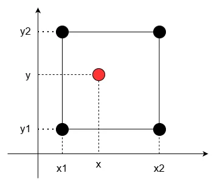

# バイリニア補間  
前回はNearest Neighbor[^1]を実装した.  
これは各ピクセルから近いものを強制的にその色にしてしまおうというやつ.  

では更によくするためにはどうすればいいか？  
一番簡単なのは周囲の色から補間すればいいんじゃない？となるのは道理である.  
これを実際にやるのがバイリニア補間[^2]である.  

  

周囲の各点を$`Q_{1},Q_{2},Q_{3},Q_{4}`$として、求めたい点を$`Q`$としてみよう.  
このとき、

```math
\begin{split}
Q_{1} &= (x_{1},y_{1}) \\
Q_{2} &= (x_{2},y_{1}) \\
Q_{3} &= (x_{1},y_{2}) \\
Q_{4} &= (x_{2},y_{2}) \\
Q &= (x,y)
\end{split}
```

となる.  
この点を$`x`$と$`y`$の二方向に線形補間してやればよい.  

さて、まず各点の色は$`Q_{i}^{col}`$となっているとしよう.  
そしたら$`y_{1}`$に関して線形補間をする際の点を$`Q_{y_{1}}=(x,y_{1})`$とする.  
こうすると、$`Q_{y_{1}}^{col}`$は

```math
\begin{cases}
Q_{y_{1}}^{col} = (1-\alpha)Q_{1}^{col}+ \alpha Q_{2}^{col}  & \alpha = \frac{x - x_{1}}{x_{2}-x_{1}}
\end{cases}
```

という風に線形補間してやればよい.  

同様にして、$`y_{2}`$に関して線形補間をする際の点を$`Q_{y_{2}}=(x,y_{2})`$とする.  
こうすると、$`Q_{y_{2}}^{col}`$は

```math
Q_{y_{2}}^{col} = (1-\alpha) Q_{3}^{col} + \alpha Q_{4}^{col}
```

これでX軸方向の補間は終わったことになる.  
次にY軸方向の補間,これも式としては同じで今までのX軸方向の結果を使うと、

```math
\begin{cases}
Q^{col} = (1-\beta)Q_{y{1}}^{col}+ \beta Q_{y_{2}}^{col}  & \alpha = \frac{y - y_{1}}{y_{2}-y_{1}}
\end{cases}
```

これでOK!!  
この式を計算できれば良いということになる.  
ちょっと式だけで見ると厄介だけど、Lerpを3回やってるだけと考えると、直感的に分かりやすいかもしれない.  

さて、実際にコードで書いてみよう.  
まずは移した際の位置を計算.  
前回みたいに$`0.5`$ずらしたりする必要はない.ただし、doubleで取るようにする.  
```c++
// 点の位置を計算
Vec2 pos = Vec2{ w,h } / scale;
```
つぎにfloorとceilで周囲の4点を取るための位置を計算しておく.  
```c++
// 矩形の最小最大を計算
Point minPos, maxPos;
minPos.x = Floor(pos.x); minPos.y = Floor(pos.y);
maxPos.x = Ceil(pos.x); maxPos.y = Ceil(pos.y);

// 画像内に限定
minPos.x = Clamp(minPos.x, 0, image.size().x);
minPos.y = Clamp(minPos.y, 0, image.size().y);
maxPos.x = Clamp(maxPos.x, 0, image.size().x);
maxPos.y = Clamp(maxPos.y, 0, image.size().y);
```
そしたら、$`\alpha,\beta`$を計算.  
ほほ同じ計算なのでVec2のまま行い、それを分解してやればよい.  
ただし$`x`$と$`y`$の値が同じなら0になって、0除算によりnanになるため切り分けておく.  
```c++
// 閾値を計算
auto [alpha, beta] = (pos - minPos) / (maxPos - minPos);
if (isnan(alpha)) { alpha = 0.0; }
if (isnan(beta)) { beta = 0.0; }
```

点のカラー値はそのまま取ればOK.  

```C++
// Qを用意
ColorF Q1 = image[minPos.y][minPos.x];
ColorF Q2 = image[minPos.y][maxPos.x];
ColorF Q3 = image[maxPos.y][minPos.x];
ColorF Q4 = image[maxPos.y][maxPos.x];
```

補間を3回行えばバイリニア補間は完了する.  
Siv3Dにはカラーの線形補間関数がああるので、これを拝借する.  
やってることは先程の式と全く同じ.  
最後に結果を代入すれば終了！  

```c++
// 線形補間
auto Q_y1 = Q1.lerp(Q2, alpha);
auto Q_y2 = Q3.lerp(Q4, alpha);
auto Q = Q_y1.lerp(Q_y2, beta);

// 格納
result[h][w] = Q;
```

さて、結果を見てみよう.  


うん、いい感じ.  

[^1]: [NearestNeighbor法](./NearestNeighbor.md)  
[^2]: [バイリニア補間](https://w.wiki/gKMY)  