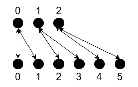

# NearestNeighbor法  
次に実装したいもので画像の拡大/縮小、言わばUpSampling/DownSamplingが必要になった.  
そのため、この際ちょっとまとめようかなと思い画像補間手法を実装していくことにした.  
予定では今回の手法のほかにBilinear,Bicubic,Lanczos辺りはやろうかなと思う.  
他にも手法あればこっそり教えてもらえれば簡単にまとめたいなと思うので、知ってる人いたら密かに教えてください(密かじゃなくてもいいよ).  

個人的にはここの説明[^1]が分かりやすいと思うが、式としては以下の形になればよい.  

```math
\begin{split}
x_{j} &= \lfloor \frac{x_{i} + 0.5}{s} \rfloor \\
y_{j} &= \lfloor \frac{y_{i} + 0.5}{s} \rfloor \\
\end{split}
```
それぞれのパラメータは以下のようになる.  

* 倍率$`s`$: どれくらいの大きさの画像に拡大/縮小するかを表すパラメータ  
* $`x_{i},y_{i}`$: 変換後の画像の座標値
* $`x_{j},y_{j}`$: 元画像の座標値

実際に求める際は変換後のここの座標値が元の画像だったらここに対応するので～...とやることになる.  
そのため、入力は変換後の座標値で出力が元画像となるわけだ.  

さて、まずはX軸だけで考えてみよう.  
更に簡単に考えるために、最初は

```math
x_{j} = \lfloor \frac{x_{i}}{s} \rfloor
```

といういたって単純な物について考える.  
$`s=2,\frac{1}{2}`$として、小さい方は$`x^{small}=0,1,2`$で大きい方は$`x^{large}=0,1,2,3,4,5`$という感じの対応とする.  



実際に$`2`$倍に拡大する場合を考える.  
この時は$`s=2`$で、変換後の座標値は$`x_{large}`$側で、元画像は$`x_{small}`$側だ.  
実際に計算してみると、

* $`x^{large}=0`$のとき: $`x^{small}=\lfloor \frac{0}{2} \rfloor = 0`$
* $`x^{large}=1`$のとき: $`x^{small}=\lfloor \frac{1}{2} \rfloor = 0`$
* $`x^{large}=2`$のとき: $`x^{small}=\lfloor \frac{2}{2} \rfloor = 1`$
* $`x^{large}=3`$のとき: $`x^{small}=\lfloor \frac{3}{2} \rfloor = 1`$
* $`x^{large}=4`$のとき: $`x^{small}=\lfloor \frac{4}{2} \rfloor = 2`$
* $`x^{large}=5`$のとき: $`x^{small}=\lfloor \frac{5}{2} \rfloor = 2`$

といった感じで各点がちゃんと対応している！  

逆方向も考えてみよう、つまり$`\frac{1}{2}`$倍という縮小の時だ.  
この時は$`s=\frac{1}{2}`$で、変換後の座標値は$`x_{small}`$側で、元画像は$`x_{large}`$側だ.  
実際に計算してみると、

* $`x^{small}=0`$のとき: $`x^{small}=\lfloor \frac{0}{\frac{1}{2}} \rfloor = 0`$
* $`x^{small}=1`$のとき: $`x^{small}=\lfloor \frac{1}{\frac{1}{2}} \rfloor = 2`$
* $`x^{small}=2`$のとき: $`x^{small}=\lfloor \frac{2}{\frac{1}{2}} \rfloor = 4`$

といった感じでこれもある程度対応はしていそう.  
これで矢印に関しては正しそうな感じなのが分かった.  

次に大事なのは$`0.5`$の存在である.  
現状の計算は各点$`x=0,1,2`$といったものを扱った.  
実際のピクセルには$`x=0,1`$の間にも沢山の小数があるため、これの対応付けが必要.  
が、小数があるとしても分かっている点はあくまでピクセル.  
小数の値がどんな値であっても、上記の場合は$`x=0`$か$`x=1`$のどちらかにわりあてる必要がある.  
この際、現状の計算だと以下のような割り当てになっている.  

  

これでも問題ないっちゃないが、緑に近い部分は緑のピクセルを選出してほしいし、青に近い部分は青のピクセルを選出してほしい...  
これを行うための処理が$`0.5`$なのである.  
実際に$`0.5`$だけずらすというのは以下のようになることを意味している.  

  

ピクセルの位置が$`x_{i}`$を自然数とすると、$`x_{i}+0.5`$の値がピクセル間の中心となるので、これを基準にして小数はいれていけば完成！ということになる.  

さて、そしたら実装をしてみよう.  
まずはNearestNeighborの計算.  
これは式通りに計算を行ってやればよい.  
```c++
auto CalculatePos = [&](Vec2 src)
    {
        Point dst;
        dst.x = Floor((src.x + 0.5) / scale);
        dst.y = Floor((src.y + 0.5) / scale);
        return dst;
    };
```
次に更新.  
今回はImageを新しく作り直してあげることにした.  
Resizeでもいいかなとは思ったけど、ちゃんと結果が反映されているかを確実にするために一応ね...  
```c++
auto UpdateImage = [&]()
    {
        Vec2 size = image.size() * scale;
        result = Image{ static_cast<size_t>(size.x), static_cast<size_t>(size.y) };
```
そして、移す側の画像範囲に対して`CalculatePos`を行う.  
こうすることでNearest Neighborが適用されて位置が確定.  
後はその位置のピクセル値を取れば終了！  
```c++
        for (int w = 0; w < result.width(); w++)
        {
            for (int h = 0; h < result.height(); h++)
            {
                Point pos = CalculatePos({ w,h });
                pos.x = Clamp(pos.x, 0, image.size().x);
                pos.y = Clamp(pos.y, 0, image.size().y);
                result[h][w] = image[pos.y][pos.x];
            }
        }
```
結果の反映も忘れずに.  
今回はDynamicTextureも入れ替え式にしました.  
```c++
        texture = DynamicTexture{ result };
    };
```

さて、結果を見てみよう.  

  

うん、いい感じ.ちゃんと反映されていそうですね.  
今回は単純にピクセルを取ってくるだけなので、特にエッジ部分がポリポリしてます.  
次はピクセル間でそれっぽく補間する方法をやる予定です.  

[^1]: [画像のリサイズを実装する（ニアレストネイバー編）](https://hexadrive.jp/hexablog/program/25599/)  